# B4-1 · 컴퓨터가 알아서 자기 상태를 점검하게 만들기

> 리눅스 서버를 안전하게 세팅하고(SSH · 방화벽 · 계정 · 권한), 제공 앱을 **1분마다 자동으로 점검하고 기록**하는 `monitor.sh`를 만든 과제입니다.

**환경:** 교육장 iMac(Intel) + UTM, Ubuntu Server 22.04.5 LTS (x86_64), VM 주소 `192.168.64.2`, 내 계정 `arang` · **범위:** 필수 요구사항만

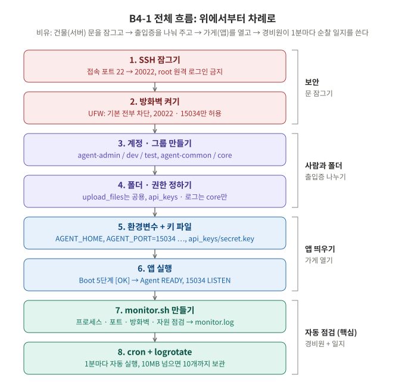

| 순서 | 내용 | 언제 보나 |
|---|---|---|
| 1 | [제공 앱은 무엇인가](#1-제공-앱은-무엇인가) | 과제가 준 프로그램이 하는 일 (채점기 + 연습 상대) |
| 2 | [결과 요약](#2-결과-요약) | 다 됐는지 1분 안에 확인 |
| 3 | [핵심 개념](#3-핵심-개념) | 용어가 낯설 때 |
| 4 | [단계별 수행](#4-단계별-수행) | 무엇을 어떤 순서로 했는지 (명령 + 설명) |
| 5 | [부록](#5-부록) | UTM을 고른 이유, 파일 구성 |

| 문서 | 내용 |
|---|---|
| **README.md** (이 문서) | 무엇을 왜 어떻게 설정했나: 개념, 단계별 명령과 설명 |
| **[수행내역서.md](수행내역서.md)** | 실행한 명령 + 확인한 것 + 📸 증거 사진 20장 |
| **[evaluation.md](evaluation.md)** | 평가 때 칠 명령과 답변 (평가표 질문 원문 순서) |

---

## 1. 제공 앱은 무엇인가

과제는 `agent-app-linux-x86`(Intel · AMD용)과 `agent-app-linux-arm64`(M칩용)를 줍니다. 문서에는 "실행 대상"이라고만 있어서 **직접 실행해 보고 화면 출력과 로그로 확인했습니다.** 한 줄로 요약하면, **켤 때는 내 세팅을 채점하고, 켜진 뒤에는 monitor.sh가 잡아낼 거리를 일부러 만드는 앱**입니다.

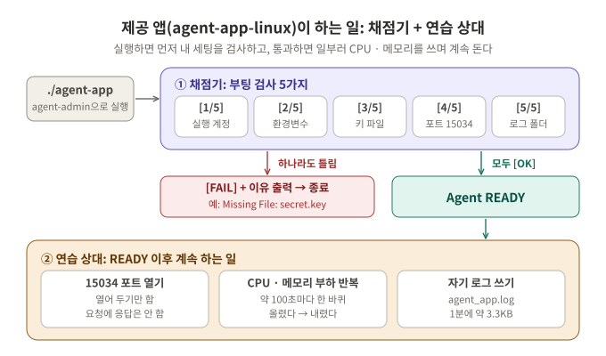

**역할 ① 채점기: 켤 때 내 세팅을 5가지로 검사합니다.**

| 부팅 검사 | 검사하는 것 | 틀렸을 때 먼저 볼 곳 |
|---|---|---|
| [1/5] | root가 아닌 일반 계정으로 실행했나 | `whoami`가 agent-admin인가 |
| [2/5] | 환경변수 5개가 있고 값이 맞나 | `env \| grep AGENT_`, 특히 `AGENT_KEY_PATH`가 폴더인가 |
| [3/5] | `api_keys/secret.key` 내용이 `agent_api_key_test`인가 | `cat $AGENT_KEY_PATH/secret.key` |
| [4/5] | 15034 포트가 비어 있나 | `sudo ss -ltnp \| grep 15034` (예전 앱이 남아 있나) |
| [5/5] | 로그 폴더에 쓸 수 있나 | `ls -ld /var/log/agent-app` |

앞 단계가 틀리면 뒤는 `Skipped`로 건너뛰고 `System Boot Failed`로 꺼집니다. 그래서 **[OK] 5개 = 계정 · 폴더 · 환경변수 세팅이 맞다는 증거**입니다.

**역할 ② 연습 상대: 켜진 뒤에는 monitor.sh가 잡아낼 거리를 일부러 만듭니다.**

| READY 뒤에 하는 일 | 확인한 내용 |
|---|---|
| 15034 열기 | LISTEN은 하지만 `curl`에는 응답 없음 → 열어 두기만 함 (monitor.sh의 포트 점검 대상) |
| CPU · 메모리 부하 반복 | 약 102초 주기 (아래 그림) → CPU · MEM 경고가 실제로 뜨게 만듦 |
| 우선순위 낮추기 | `nice=10` → 부하를 줘도 sshd, cron을 방해하지 않음 |
| 자기 로그 쓰기 | `/var/log/agent-app/agent_app.log`에 1분에 약 3.3KB (monitor.log보다 훨씬 빨리 쌓임) |
| 프로세스 2개 | PyInstaller 실행 파일이라 부모가 압축을 풀고 자식이 실제로 일함 |

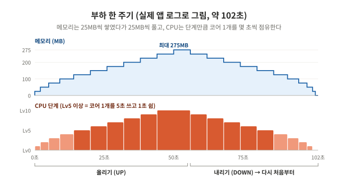

- monitor.sh의 CPU 값이 매번 다른 이유: 1초만 재는데, 그 1초가 앱이 코어를 쓰는 순간인지 쉬는 순간인지에 따라 달라집니다.
- MEM 경고는 VM 메모리 크기에 따라 다릅니다. 4GB VM에서는 `MEM 12.7% > 10%`가 실제로 떴습니다.
- **끄는 법:** 실행한 창에서 Ctrl+C. SSH가 끊기면 그 창의 앱도 같이 꺼집니다.

---

## 2. 결과 요약

| 과제 요구사항 | 결과 | 수행 내역 |
|---|---|---|
| SSH 포트 20022, root 원격 로그인 차단 | ✅ | [1단계](#1단계-ssh-잠그기) |
| UFW 활성화, 20022/tcp · 15034/tcp만 허용 | ✅ | [2단계](#2단계-방화벽-켜기) |
| 계정 3개, 그룹 2개 (common: 3명 / core: admin · dev) | ✅ | [3단계](#3단계-계정--그룹) |
| upload_files = common R/W, api_keys · 로그 = core만 R/W | ✅ | [4단계](#4단계-폴더--권한) |
| 환경변수 5개, 키 파일 | ✅ | [5단계](#5단계-환경변수--키-파일) |
| Boot 5단계 [OK], Agent READY, 0.0.0.0:15034 | ✅ | [6단계](#6단계-앱-실행) |
| monitor.sh 권한(agent-dev · agent-core · 750), 비정상 시 exit 1, 경고는 출력만 | ✅ | [7단계](#7단계-monitorsh) |
| cron 매분 실행, monitor.log 지정 포맷으로 누적 | ✅ | [8단계](#8단계-cron--logrotate) |
| 로그 용량 관리 10MB / 10개 (logrotate) | ✅ | [8단계](#8단계-cron--logrotate) |

> **과제 문서와 다른 점:** 제공 앱이 `AGENT_KEY_PATH`를 **폴더**로, 키 파일 이름을 **`secret.key`**로 요구해서(문서대로 하면 Boot FAIL) 앱 기준을 따랐습니다. → [5단계](#5단계-환경변수--키-파일)

---

## 3. 핵심 개념

| 용어 | 쉬운 말 | 이 과제에서 |
|---|---|---|
| SSH | 다른 컴퓨터에서 이 서버에 원격으로 들어오는 통로 | 22번 → **20022번**으로 옮기고 root는 못 들어오게 |
| 포트 | 한 서버 안의 "문 번호". 프로그램마다 자기 문을 연다 | sshd = 20022, 앱 = **15034** |
| 방화벽 (UFW) | 어떤 문으로 들어오는 요청을 통과시킬지 정하는 경비 | 20022, 15034만 통과 |
| 계정 / 그룹 | 계정 = 사람 한 명 (로그인 O), 그룹 = 같은 권한을 받는 명단 (로그인 X) | admin, dev, test / common, core |
| 권한 (rwx) | 읽기 · 쓰기 · 실행(폴더는 들어가기)을 주인 · 그룹 · 나머지에게 각각 | `750`, `2770`, `660` |
| setgid | 폴더 권한 앞자리 `2`. 안에 새로 생기는 파일이 **폴더의 그룹**을 물려받음 | 누가 만들든 그룹이 common/core |
| ACL | 기본 권한 3칸으로 부족할 때 그룹을 **더 지정**하는 추가 규칙 (`ls`에 `+` 표시) | 홈 폴더 통과, 새 파일도 그룹이 쓰기 가능 |
| 환경변수 | 프로그램에 건네는 "설정 메모" (`이름=값`) | `AGENT_HOME`, `AGENT_PORT` … |
| 프로세스 / PID | 지금 실행 중인 프로그램 하나 / 그 번호 | 앱이 살아 있나 = 프로세스가 있나 |
| 종료 코드 | 프로그램이 끝나며 남기는 숫자. `0` = 정상, `1` = 문제 있음 | 앱이 죽으면 monitor.sh는 `exit 1` |
| cron / logrotate | 정해진 시간에 자동 실행 / 로그가 커지면 잘라서 보관 | 1분마다 monitor.sh, 10MB × 10개 |
| 최소 권한 원칙 | 일에 꼭 필요한 만큼만 권한을 준다 | test는 키 · 로그에 접근 불가 |

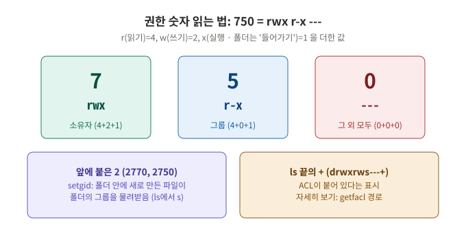

---

## 4. 단계별 수행

내 VM에서 **실제로 실행한 명령**과 **📸 증거 사진**입니다.

- 명령마다 **위에 주석으로 무엇을 바꾸는지** 적었습니다.
- `✔ 확인` 주석은 **설정이 실제로 적용됐는지 본 명령**이고, `결과:`는 그때 화면에 나온 핵심 내용입니다.
- 증거 사진은 설명과 함께 **[수행내역서.md](수행내역서.md)** 한곳에 모았습니다. 각 단계 끝의 "📸 증거" 링크를 누르면 바로 갑니다.

모든 명령 위 주석 맨 앞에 **어디서 치는지** 적었습니다. 치기 전에 **프롬프트**가 맞는지 보세요.

| 표시 | 어디서 | 프롬프트 |
|---|---|---|
| `[MAC]` | Mac 터미널 (VM에 접속하기 전) | `codewhite77770105@cx2r6s7 ~ %` |
| `[SSH]` | Mac에서 `ssh -p 20022`로 접속한 VM, 내 계정 arang | `arang@b4-1:~$` |
| `[SSH: agent-admin]` | 위 VM에서 `sudo -iu agent-admin`으로 바꾼 뒤 | `agent-admin@b4-1:~$` |
| `탭 1` · `탭 2` | 6단계부터 창이 2개: **탭 1** = 앱 실행 전용(agent-admin), **탭 2** = 나머지 작업(arang) | |

> ⚠️ **명령은 한 줄(한 명령)씩 붙여넣으세요.** 여러 줄을 한꺼번에 붙여넣으면 `sudo`가 비밀번호를 물을 때 다음 줄이 비밀번호로 들어가거나, `sudo -iu agent-admin` 뒤의 줄이 엉뚱한 계정에서 실행됩니다. (`\`로 끝나는 줄은 다음 줄과 합쳐서 한 명령입니다.)

### 0단계. 준비

UTM으로 Ubuntu VM을 만들고([만드는 순서](#a-실습-환경-왜-utm-vm인가)), 복사 · 붙여넣기가 되는 Mac 터미널에서 접속해 작업합니다.

> **VM을 새로 만들었다면 먼저 확인할 것 2가지**
> 1. **주소:** VM 화면에서 로그인 후 `ip -4 addr show`로 `192.168.64.x` 주소를 확인합니다. 예전 VM이 `.2`를 쓰고 있었다면 새 VM은 `.3`일 수 있습니다. 아래 명령의 `192.168.64.2`를 그 주소로 바꿔 씁니다.
> 2. **접속 경고:** 같은 주소로 예전 VM에 접속한 적이 있으면 `REMOTE HOST IDENTIFICATION HAS CHANGED!`가 뜨며 접속이 막힙니다. VM을 새로 만들어 열쇠가 바뀐 것이라 정상입니다. Mac에서 예전 기록을 지우고 다시 접속합니다.
>    ```bash
>    # [MAC]
>    ssh-keygen -R 192.168.64.2
>    ssh-keygen -R "[192.168.64.2]:20022"
>    ```

```bash
# [MAC] 제공 앱 파일을 VM의 내 홈 폴더로 복사 (scp는 포트 옵션이 대문자 -P)
#   Mac에 있는 파일을 보내는 명령이라 꼭 Mac 프롬프트(…% )에서 칩니다
scp -P 20022 ~/Downloads/agent-app/agent-app-linux-x86 arang@192.168.64.2:~/
# 새 VM이라면:
# scp ~/Downloads/agent-app/agent-app-linux-x86 arang@192.168.64.2:~/

# [MAC] VM에 접속 (1단계를 끝낸 VM이라 20022번 포트)
#   이 명령 뒤로는 프롬프트가 arang@b4-1:~$ 로 바뀜 = 여기부터 VM 안
ssh -p 20022 arang@192.168.64.2
# 새 VM이라면 아직 기본 22번 포트:
# ssh arang@192.168.64.2

# [SSH] 시간대를 한국 시간으로 (로그 시각이 맞도록)
sudo timedatectl set-timezone Asia/Seoul

# [SSH] 이 저장소 받기 (monitor.sh, 설정 파일)
git clone https://github.com/codewhite7777/codyssey_B4-1.git
cd ~/codyssey_B4-1

# [SSH] 필요한 프로그램 설치
sudo apt update
sudo apt install -y openssh-server ufw acl cron logrotate
```

### 1단계. SSH 잠그기

SSH 설정 파일 `/etc/ssh/sshd_config`에서 **두 줄을 바꿉니다.**

| 설정 | 바꾸기 전 | 바꾼 뒤 | 효과 |
|---|---|---|---|
| `Port` | `#Port 22` (기본값 22) | `Port 20022` | SSH 문 번호가 20022로 바뀜 |
| `PermitRootLogin` | `#PermitRootLogin prohibit-password` | `PermitRootLogin no` | root는 원격 로그인 불가 |

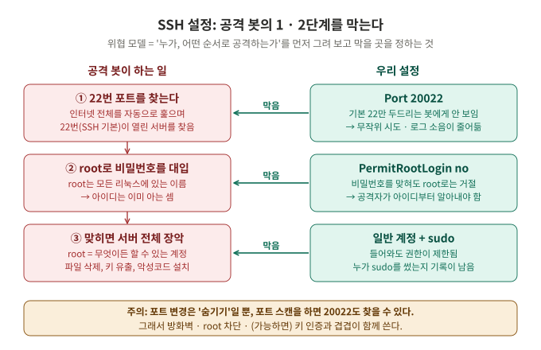

```bash
# [SSH] 원본 설정 파일 백업 (잘못되면 되돌리기용)
sudo cp /etc/ssh/sshd_config /etc/ssh/sshd_config.bak

# [SSH] [변경 1] "#Port 22" 줄 → "Port 20022"
#   ^#\? = 앞에 주석 표시(#)가 있어도 없어도 찾음
sudo sed -i 's/^#\?Port .*/Port 20022/' /etc/ssh/sshd_config

# [SSH] [변경 2] "#PermitRootLogin ..." 줄 → "PermitRootLogin no"
sudo sed -i 's/^#\?PermitRootLogin .*/PermitRootLogin no/' \
    /etc/ssh/sshd_config

# [SSH] 바뀐 두 줄 확인 → 결과: Port 20022 / PermitRootLogin no
grep -nE "^Port|^PermitRootLogin" /etc/ssh/sshd_config

# [SSH] 문법 검사(-t) 후 이상 없으면 SSH 재시작 → 새 설정 적용
#   (지금 접속한 창은 닫지 않음: 실수해도 이 창으로 고칠 수 있게)
sudo sshd -t && sudo systemctl restart ssh

# [MAC] 새 탭에서 새 포트로 접속되는지 먼저 확인
ssh -p 20022 arang@192.168.64.2

# [SSH] ✔ 확인: 포트·root 설정이 실제로 적용됐나 (📸 1-1)
#   결과: port 20022 / permitrootlogin no
sudo sshd -T | grep -E "^port |^permitrootlogin "

# [SSH] ✔ 확인: 20022번 문이 실제로 열렸나 (📸 1-2)
#   결과: 0.0.0.0:20022 ... LISTEN ... "sshd"
sudo ss -tlnp | grep sshd

# [MAC] ✔ 확인: root 접속이 실제로 막혔나 (📸 1-3)
#   결과: Permission denied
ssh -p 20022 root@192.168.64.2
```

- **확인을 3번 하는 이유:** `grep`은 "파일에 적은 값", `sshd -T`는 "sshd가 실제로 쓰는 값"(다른 설정 파일에 덮이지 않았나), `ss`는 "정말 그 문에서 기다리나"입니다.
- Ubuntu 22.04는 `systemctl restart ssh`로 포트 변경이 적용됩니다.

📸 증거: [1-1](수행내역서.md#1-1-ssh-설정-적용값) · [1-2](수행내역서.md#1-2-sshd가-20022번에서-대기) · [1-3](수행내역서.md#1-3-root-원격-접속-거절)

### 2단계. 방화벽 켜기

**기본은 전부 막고**, SSH(20022)와 앱(15034)만 엽니다. 허용 명단을 먼저 넣고 **켜기는 맨 마지막**에 합니다(순서가 바뀌면 SSH가 막힘).

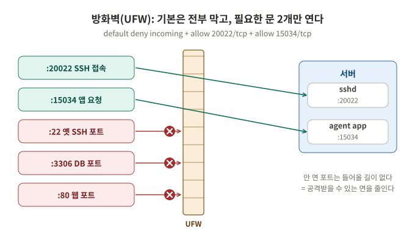

```bash
# [SSH] 기본 규칙: 들어오는 연결은 전부 거절, 나가는 연결은 허용
sudo ufw default deny incoming
sudo ufw default allow outgoing

# [SSH] 허용 명단: 20022 = 내가 SSH로 들어오는 문, 15034 = 앱이 쓰는 문
sudo ufw allow 20022/tcp
sudo ufw allow 15034/tcp

# [SSH] 켜기 전에 명단 확인 (20022가 꼭 있어야 SSH가 안 끊김)
sudo ufw show added

# [SSH] 방화벽 켜기 (y 입력, 재부팅해도 켜진 상태 유지)
sudo ufw enable

# [SSH] ✔ 확인: 방화벽 상태 (📸 2)
#   결과: Status: active / deny (incoming) / 20022/tcp, 15034/tcp만
sudo ufw status verbose
```

📸 증거: [2](수행내역서.md#2-ufw-상태)

### 3단계. 계정 · 그룹

사람 3명(계정)을 만들고 권한을 나눠 줄 명단 2개(그룹)에 넣습니다.


```bash
# [SSH] 계정 3개 만들기 (-m 홈 폴더 생성, -s 기본 셸 bash)
sudo useradd -m -s /bin/bash agent-admin
sudo useradd -m -s /bin/bash agent-dev
sudo useradd -m -s /bin/bash agent-test

# [SSH] 그룹 2개 만들기 (common = 공용, core = 핵심)
sudo groupadd agent-common
sudo groupadd agent-core

# [SSH] 그룹에 넣기 (-aG = 기존 그룹은 그대로 두고 추가)
#   admin, dev → common + core / test → common만
sudo usermod -aG agent-common,agent-core agent-admin
sudo usermod -aG agent-common,agent-core agent-dev
sudo usermod -aG agent-common agent-test

# [SSH] ✔ 확인: 계정별 그룹 (📸 3)
#   결과: admin·dev = agent-common, agent-core / test = agent-common만
id agent-admin; id agent-dev; id agent-test
```

- **왜 그룹이 필요한가:** 파일 권한 칸은 [주인 1명] [그룹 1개] [나머지] 3칸뿐입니다. "admin · dev는 되고 test는 안 됨"을 하려면 둘이 든 그룹을 그룹 칸에 넣어야 합니다.
- **그룹에는 상하 관계가 없습니다.** core에 넣어도 common에 자동으로 들어가지 않아서 각각 넣습니다.
- 계정을 만들면 같은 이름의 **개인 그룹**이 자동으로 생깁니다(`id` 맨 앞). 과제에서 쓰는 그룹은 common, core 2개입니다.
- `-aG`의 `-a`를 빼면 기존 그룹이 다 빠집니다.

📸 증거: [3](수행내역서.md#3-계정별-그룹)

### 4단계. 폴더 · 권한

**한 줄 요약:** 폴더마다 "누가 들어올 수 있는지"를 정합니다. 3명이 함께 쓰는 방 하나, admin · dev만 들어가는 방 두 개를 만듭니다.

#### 비유로 보기

agent-admin의 홈 폴더를 **건물**, 그 안의 폴더들을 **방**이라고 생각하면 쉽습니다.

| 폴더 | 비유 | 들어갈 수 있는 사람 | 왜 |
|---|---|---|---|
| `/home/agent-admin` | 건물 입구 | 3명 모두 **지나가기만** | 안쪽 방에 가려면 입구는 지나가야 함 |
| `agent-app` | 사무실 | 3명 모두 (보기만) | 앱 파일이 있는 곳 |
| `upload_files` | **공용 회의실** | 3명 모두 읽기 · 쓰기 | 함께 쓰는 공간 |
| `api_keys` | **금고** | admin · dev만 | 비밀 키가 들어 있음 |
| `bin` | 개발자 작업실 | dev가 주인, admin은 실행만 | monitor.sh를 dev가 만들고 admin이 돌림 |
| `/var/log/agent-app` | **기록 보관실** | admin · dev만 | 로그가 지워지면 사고 원인을 못 찾음 |

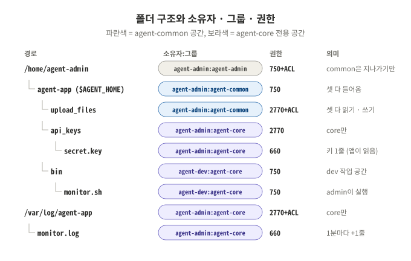

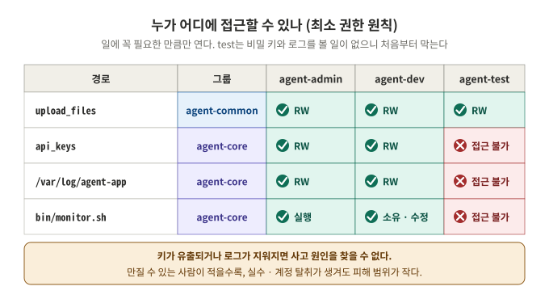

#### 권한 숫자 읽는 법 (3가지만 알면 됨)

1. **칸은 3개:** `주인` / `그룹` / `나머지` 순서로 숫자 3개를 씁니다.
2. **숫자는 더하기:** 읽기 `4` + 쓰기 `2` + 들어가기 `1`
   - `7` = 다 됨, `5` = 보기 · 들어가기만, `0` = 못 들어감
3. **읽어 보기**

| 숫자 | 주인 | 그룹 | 나머지 | 쓰는 곳 |
|---|---|---|---|---|
| `750` | 7 다 됨 | 5 보기만 | 0 못 들어감 | `agent-app`, `bin` |
| `770` | 7 다 됨 | 7 다 됨 | 0 못 들어감 | `upload_files`, `api_keys`, 로그 폴더 |
| `2770` | | | | 위 `770` + 앞자리 `2`(아래 setgid) |

#### 특별 장치 3개

| 장치 | 쉬운 말 | 없으면 생기는 일 |
|---|---|---|
| **입구 통과권** (`setfacl -m g:agent-common:x`) | 건물 입구를 **지나가기만** 허용. 입구에서 다른 방을 둘러보지는 못함 | Ubuntu 홈 폴더는 남이 못 들어가서 dev · test는 안쪽 방에 아예 못 감 |
| **setgid** (`2770`의 앞자리 `2`) | 이 방에서 만든 파일에 **방 이름표(그룹)가 자동으로** 붙음 | 만든 사람 개인 이름표가 붙어서 같은 방 사람이 못 씀 |
| **기본 ACL** (`setfacl -d`) | 앞으로 생길 파일도 **그룹이 쓸 수 있게** 하는 기본 규칙 | 새 파일이 그룹에게 "읽기만"으로 생길 수 있음 |

`ls -l`에서 권한 끝에 `+`가 보이면 ACL이 걸린 폴더라는 뜻이고, `rws`의 `s`가 setgid입니다.

#### 명령 (폴더별로)

`chown 주인:그룹 폴더` = 주인과 그룹 정하기, `chmod 숫자 폴더` = 권한 숫자 정하기

```bash
# [SSH] 긴 경로를 H라는 짧은 이름으로 (이 창에서만 유효)
H=/home/agent-admin/agent-app

# [SSH] 방 4개 만들기 (처음엔 주인이 root라 아무도 못 씀)
sudo mkdir -p $H/upload_files $H/api_keys $H/bin /var/log/agent-app

# [SSH] 건물 입구: common(3명)에게 "지나가기"만 허용
sudo setfacl -m g:agent-common:x /home/agent-admin

# [SSH] 사무실 agent-app: 주인 admin, 그룹 common, 750 (3명 보기만)
sudo chown agent-admin:agent-common $H
sudo chmod 750 $H

# [SSH] 공용 회의실 upload_files: 그룹 common, 2770 (3명 읽기·쓰기)
sudo chown agent-admin:agent-common $H/upload_files
sudo chmod 2770 $H/upload_files
#   앞으로 생길 파일도 common이 쓸 수 있게 (기본 ACL)
sudo setfacl -d -m g:agent-common:rwx $H/upload_files

# [SSH] 금고 api_keys: 그룹 core, 2770 (admin·dev만)
sudo chown agent-admin:agent-core $H/api_keys
sudo chmod 2770 $H/api_keys

# [SSH] 작업실 bin: 주인 dev, 그룹 core, 750 (dev 수정, admin 실행만)
sudo chown agent-dev:agent-core $H/bin
sudo chmod 750 $H/bin

# [SSH] 기록 보관실 로그 폴더: 그룹 core, 2770 (admin·dev만)
sudo chown agent-admin:agent-core /var/log/agent-app
sudo chmod 2770 /var/log/agent-app
#   앞으로 생길 로그 파일도 core가 쓸 수 있게 (기본 ACL)
sudo setfacl -d -m g:agent-core:rw /var/log/agent-app
```

#### 확인 (진짜로 막히는지 직접 들어가 보기)

`sudo -u 계정 명령` = 그 계정인 척하고 명령을 실행해 보기

```bash
# [SSH] 방 5개의 주인·그룹·권한 한눈에 (📸 4-1)
#   결과: 위 "비유로 보기" 표와 같은 주인·그룹, + 와 s 표시
sudo ls -ld $H $H/upload_files $H/api_keys $H/bin /var/log/agent-app

# [SSH] test가 공용 회의실에 파일 만들기 → 결과: 에러 없이 성공
sudo -u agent-test touch $H/upload_files/from-test.txt

# [SSH] ✔ 확인: test가 금고 열기 (📸 4-2) → 결과: Permission denied (거절)
sudo -u agent-test ls $H/api_keys

# [SSH] ✔ 확인: dev가 금고 열기 (📸 4-3) → 결과: 목록이 보임 (통과)
#   키 파일은 5단계에서 만들어서 지금은 . 과 .. 만 보임
sudo -u agent-dev ls -la $H/api_keys
```

같은 금고인데 **test는 거절, dev는 통과**하는 것이 이 단계의 핵심 증거입니다.

> 내 계정 arang은 common도 core도 아니라서 `getfacl`로 ACL을 보려 해도 막힙니다. 바깥 사람이 막힌다는 뜻이라 정상이고, 볼 때는 `sudo getfacl 폴더`로 봅니다.

📸 증거: [4-1](수행내역서.md#4-1-폴더-5개의-주인그룹권한) · [4-2](수행내역서.md#4-2-test는-비밀-폴더-거절) · [4-3](수행내역서.md#4-3-dev는-비밀-폴더-통과)


### 5단계. 환경변수 · 키 파일

앱을 실행할 agent-admin에게 "집은 어디, 문은 몇 번, 키는 어디"를 적은 메모(환경변수)를 두고 키 파일을 만듭니다.

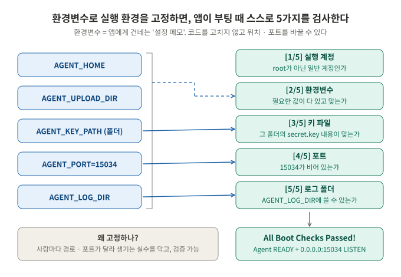

```bash
# [SSH] agent-admin으로 바꾸기 (프롬프트가 agent-admin@b4-1로 바뀜)
sudo -iu agent-admin

# [SSH: agent-admin] 먼저 이미 들어 있는지 확인
#   결과가 0이면 바로 아래 cat 명령 실행, 5 이상이면 이미 했으니 건너뛰기
#   (cat >> 는 칠 때마다 같은 5줄이 또 붙음)
grep -c "^export AGENT_" ~/.bashrc

# [SSH: agent-admin] 환경변수 5개를 ~/.bashrc 끝에 추가 (로그인할 때마다 적용)
#   cat 줄부터 EOF 줄까지 7줄이 한 명령 → 이 7줄만 한 번에 붙여넣기
cat >> ~/.bashrc <<'EOF'
export AGENT_HOME=/home/agent-admin/agent-app
export AGENT_PORT=15034
export AGENT_UPLOAD_DIR=$AGENT_HOME/upload_files
export AGENT_KEY_PATH=$AGENT_HOME/api_keys
export AGENT_LOG_DIR=/var/log/agent-app
EOF

# [SSH: agent-admin] 지금 창에 바로 적용
source ~/.bashrc

# [SSH: agent-admin] 환경변수 확인 (📸 5-1) → 결과: AGENT_ 5개, KEY_PATH는 폴더
env | grep ^AGENT_ | sort

# [SSH: agent-admin] 키 파일: 앱이 읽는 secret.key + 과제 문서의 t_secret.key
echo "agent_api_key_test" > $AGENT_KEY_PATH/secret.key
echo "agent_api_key_test" > $AGENT_KEY_PATH/t_secret.key

# [SSH: agent-admin] 키 파일 권한 660 (주인·그룹만 읽기·쓰기)
chmod 660 $AGENT_KEY_PATH/*.key

# [SSH: agent-admin] 확인 (📸 5-2) → 결과: -rw-rw---- agent-admin agent-core
#   그룹이 agent-core인 건 폴더의 setgid 덕분
ls -l $AGENT_KEY_PATH
```

**과제 문서와 실제 앱이 다른 곳.** 성공 기준이 "Boot 5단계 [OK]"이므로 앱이 검사하는 값을 따랐습니다.

| | 과제 문서 | 실제 앱이 검사하는 값 | 문서대로 하면 |
|---|---|---|---|
| `AGENT_KEY_PATH` | `$AGENT_HOME/api_keys/t_secret.key` (파일) | `$AGENT_HOME/api_keys` (**폴더**) | `[2/5] FAIL` Key Path Mismatch |
| 키 파일 이름 | `t_secret.key` | `secret.key` | `[3/5] FAIL` Missing File: secret.key |

- **`~/.bashrc`에 같은 줄이 여러 번 들어갔거나 엉뚱한 줄이 섞였다면** (`sudo -iu agent-admin` 할 때 `Command '...' not found`가 뜸)
  1. `[SSH: agent-admin]` `cp ~/.bashrc ~/.bashrc.bak` 으로 백업
  2. `[SSH: agent-admin]` `grep -n "AGENT_" ~/.bashrc` 로 줄 번호 확인 (엉뚱한 줄은 오류에 나온 단어로 찾음)
  3. `[SSH: agent-admin]` 첫 묶음 5줄만 남기고 `sed -i '시작,끝d' ~/.bashrc` 로 나머지 줄 삭제 (예: `sed -i '125,146d' ~/.bashrc`)
- **cron에서는 환경변수가 비어 있습니다.** Ubuntu의 `~/.bashrc`는 사람이 직접 쓰는 셸이 아니면 읽지 않습니다. 그래서 monitor.sh는 `${AGENT_PORT:-15034}`처럼 기본값을 둡니다.

📸 증거: [5-1](수행내역서.md#5-1-환경변수-5개) · [5-2](수행내역서.md#5-2-키-파일-권한)

### 6단계. 앱 실행

제공 앱을 **일반 계정(agent-admin)**으로 실행하면 1~5단계 세팅을 앱이 5가지로 검사합니다. 통과하면 15034를 열고 일부러 CPU · 메모리를 썼다 줄였다 합니다. ([제공 앱 분석](#1-제공-앱은-무엇인가))

```bash
# [SSH 탭 1: agent-admin] arang으로 돌아가기
exit

# [SSH 탭 1] 앱 파일을 AGENT_HOME으로 복사 + 주인 agent-admin + 권한 750
sudo install -o agent-admin -g agent-admin -m 750 \
    ~/agent-app-linux-x86 /home/agent-admin/agent-app/

# [SSH 탭 1] agent-admin으로 바꾸기
sudo -iu agent-admin

# [SSH 탭 1: agent-admin] AGENT_HOME(앱 폴더)으로 이동
cd $AGENT_HOME

# [SSH 탭 1: agent-admin] ✔ 확인: 앱 실행 (📸 6)
#   이 창(탭 1)은 앱 전용, 종료는 Ctrl+C
#   결과: [1/5]~[5/5] [OK] → All Boot Checks Passed! → Agent READY
./agent-app-linux-x86

# [SSH 탭 2] ✔ 확인: 탭 2(Mac에서 ⌘T로 새 탭을 열고 ssh 접속)에서 (📸 6-2)
#   결과: 0.0.0.0:15034 ... LISTEN ... "agent-app-linux"
sudo ss -ltnp | grep 15034
```

- **SSH가 끊기면** 그 창에서 돌던 앱도 같이 꺼집니다. 다시 접속해 `pgrep -a -f "^[^ ]*agent-app-linux"`로 확인하고, 비어 있으면 다시 실행합니다.

📸 증거: [6](수행내역서.md#6-boot-5단계와-agent-ready) · [6-2](수행내역서.md#6-2-앱이-15034에서-대기)

### 7단계. monitor.sh

경비원 스크립트 [bin/monitor.sh](bin/monitor.sh)를 설치하고, 일부러 문제 상황을 만들어 반응을 봅니다. **서비스가 죽으면 멈추고(exit 1), 아직 돌고 있으면 경고만** 합니다.

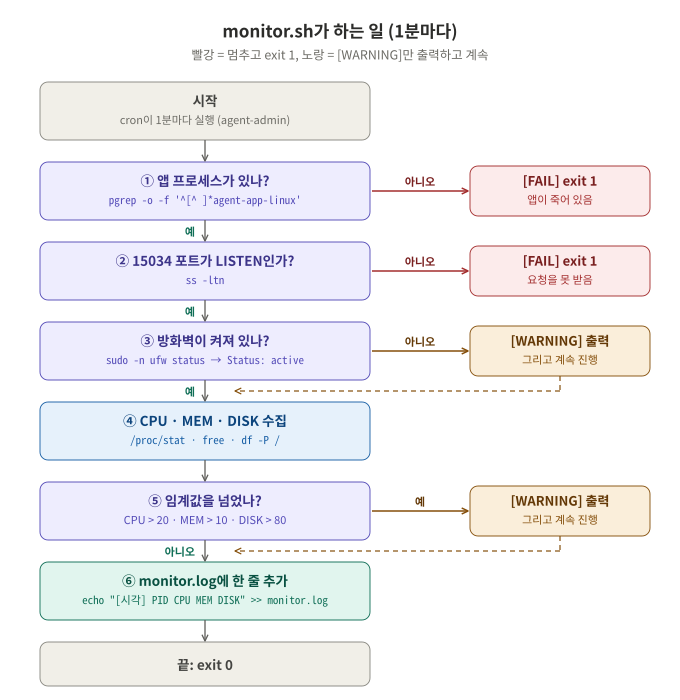

```bash
# [SSH 탭 2]
cd ~/codyssey_B4-1

# [SSH 탭 2] monitor.sh 설치: 복사 + 주인 agent-dev + 그룹 agent-core + 권한 750
sudo install -o agent-dev -g agent-core -m 750 \
    bin/monitor.sh /home/agent-admin/agent-app/bin/monitor.sh

# [SSH 탭 2] ✔ 확인: 설치 결과 (📸 7-1)
#   결과: -rwxr-x--- agent-dev agent-core monitor.sh
sudo ls -l /home/agent-admin/agent-app/bin

# [SSH 탭 2] agent-core에게 "ufw status" 한 명령만 sudo 허용 (방화벽 확인용)
sudo install -o root -g root -m 0440 \
    config/sudoers-agent-monitor /etc/sudoers.d/agent-monitor

# [SSH 탭 2] sudoers 문법 검사 → 결과: parsed OK
sudo visudo -cf /etc/sudoers.d/agent-monitor

# [SSH 탭 2] ✔ 확인: 정상일 때 (📸 7-2)
#   결과: [OK] 3개, CPU·MEM·DISK 출력, MEM 경고가 떠도 exit=0
sudo -u agent-admin /home/agent-admin/agent-app/bin/monitor.sh
echo "exit=$?"

# [SSH 탭 2] ✔ 확인: 방화벽을 잠깐 끄고 실행 (📸 7-3)
#   결과: [WARNING] Firewall (ufw) is not active, 기록까지 하고 exit=0
sudo ufw disable
sudo -u agent-admin /home/agent-admin/agent-app/bin/monitor.sh
echo "exit=$?"

# [SSH 탭 2] 방화벽 다시 켜기 (y)
sudo ufw enable

# [SSH 탭 1: agent-admin] ✔ 확인: 앱이 죽었을 때 (📸 7-4)
#   탭 1에서 Ctrl+C로 앱을 끄고, 탭 1(agent-admin)에서 sudo 없이 실행
#   결과: [FAIL] not running, exit=1
/home/agent-admin/agent-app/bin/monitor.sh
echo "exit=$?"

# [SSH 탭 1: agent-admin] 앱 다시 켜기 (8단계에서 cron이 정상 기록을 쌓도록)
./agent-app-linux-x86
```

> 위에서 `echo "exit=$?"`는 **바로 앞 명령의 종료 코드**를 보여 줍니다. 한 줄에 `; echo "exit=$?"`로 붙여 써도 같습니다.

| 상황 | monitor.sh 반응 | 종료 코드 |
|---|---|---|
| 정상 (MEM 기준 초과) | `[OK]` 3개, `[WARNING] MEM`, 기록함 | `exit=0` |
| 방화벽 꺼짐 | `[WARNING] Firewall`, 기록함 | `exit=0` |
| 앱 죽음 | `[FAIL] not running`, 바로 멈춤 | `exit=1` |

**쓴 명령과 고른 이유**

| 순서 | 무엇을 | 쓴 명령 | 왜 이 명령 |
|---|---|---|---|
| ① | 앱 프로세스 | `pgrep -o -f '^[^ ]*agent-app-linux'` | 결과가 바로 PID. `^[^ ]*` = 명령줄 **첫 단어**가 앱일 때만 → 앱을 띄운 셸이나 `vim agent-app...`은 안 걸림. `-o` = 부모 · 자식 중 부모 |
| ② | 15034 LISTEN | `ss -ltn` → 4번째 칸이 `:15034`로 끝나나 | Ubuntu 기본 도구. `-l` LISTEN, `-t` TCP, `-n` 숫자 (`netstat`은 기본 설치가 아님) |
| ③ | 방화벽 | `sudo -n /usr/sbin/ufw status` → `Status: active` | 실제 상태를 보는 정확한 방법. sudoers로 **이 명령 하나만** 허용 |
| ④ | CPU | `/proc/stat`을 1초 간격 두 번 | 누적값이라 두 번 읽은 차이로 "그 1초 동안 쉬지 않은 비율" 계산 |
| ④ | MEM · DISK | `free` (used ÷ total) · `df -P /` (Use%) | `-P`로 한 줄 출력 고정 → 칸 위치가 항상 같음 |
| ⑤ | 임계값 | `awk`로 비교 (CPU 20 · MEM 10 · DISK 80%) | bash `[ ]`는 정수만 비교 가능 |
| ⑥ | 기록 | `echo "..." >> monitor.log` | `>>` = 이어쓰기. `>`는 매번 덮어써서 과거가 사라짐 |

- **로그 포맷:** `[YYYY-MM-DD HH:MM:SS] PID:... CPU:..% MEM:..% DISK_USED:..%`. 한 줄 = 한 번 측정, 칸 순서 고정 → `grep`(시각 찾기), `awk`(평균)로 바로 꺼내 씁니다.
- **권한 정책:** 주인 dev는 `rwx`(수정 · 실행), core 그룹인 admin은 `r-x`(실행만 → cron이 돌릴 수 있지만 못 고침), test는 `---`.
- **방화벽 확인에만 sudo를 쓴 이유:** `ufw status`는 root만 되고 agent-admin은 sudo가 없습니다. 그래서 [config/sudoers-agent-monitor](config/sudoers-agent-monitor)에 `ufw status` **한 줄만** 허용했습니다(`ufw status verbose`, `ufw disable`은 거절됨). `/etc/ufw/ufw.conf`의 `ENABLED=yes`는 "켜기로 설정됨"일 뿐이라 실제로 꺼졌는데 `[OK]`가 나올 수 있어 쓰지 않았습니다.

📸 증거: [7-1](수행내역서.md#7-1-monitorsh-설치-권한) · [7-2](수행내역서.md#7-2-정상일-때) · [7-3](수행내역서.md#7-3-방화벽을-껐을-때) · [7-4](수행내역서.md#7-4-앱이-죽었을-때)

### 8단계. cron · logrotate

**cron**으로 agent-admin이 1분마다 monitor.sh를 자동 실행하고, **logrotate**로 monitor.log가 10MB를 넘으면 잘라서 10개까지만 보관합니다.


```bash
# [SSH 탭 2] 탭 1은 앱이 쓰고 있으므로 탭 2에서 agent-admin으로 잠깐 바꿈
sudo -iu agent-admin

# [SSH 탭 2: agent-admin] agent-admin 본인의 crontab에 "1분마다 monitor.sh" 등록
#   > /dev/null 2>&1 = 화면 출력은 버림 (기록은 monitor.sh가 직접 함)
echo "* * * * * /home/agent-admin/agent-app/bin/monitor.sh > /dev/null 2>&1" \
    | crontab -

# [SSH 탭 2: agent-admin] arang으로 돌아가기 (저장소 폴더로 돌아옴)
exit

# [SSH 탭 2] ✔ 확인: crontab 확인 (📸 8-1)
#   결과: * * * * * /home/agent-admin/agent-app/bin/monitor.sh ...
sudo crontab -u agent-admin -l

# [SSH 탭 2] ✔ 확인: 로그가 매분 저절로 쌓이나 (📸 8-2) → 등록 후 2~3분 기다린 뒤
#   (앱이 켜져 있어야 쌓임)
#   결과: [시각] PID:.. CPU:..% MEM:..% DISK_USED:..% 줄이 1분 간격
sudo tail /var/log/agent-app/monitor.log

# [SSH 탭 2] logrotate 설정 설치 (10MB / 10개)
sudo cp config/logrotate-agent-app /etc/logrotate.d/agent-app

# [SSH 탭 2] ✔ 확인: 설치된 설정 (📸 8-3) → 결과: size 10M / rotate 10
cat /etc/logrotate.d/agent-app

# [SSH 탭 2] ✔ 확인: 판단만 해 보기, -d = 실제로 자르지 않음 (📸 8-4)
#   결과: 10485760 bytes (10 rotations), log does not need rotating
sudo logrotate -d /etc/logrotate.d/agent-app
```

| cron 줄의 부분 | 뜻 |
|---|---|
| `* * * * *` | 분 · 시 · 일 · 월 · 요일 모두 "매번" → **1분마다** |
| 전체 경로 | cron은 내 셸과 환경이 달라서 전체 경로를 씀 |
| `> /dev/null 2>&1` | 화면 출력은 버림. 기록은 monitor.sh가 monitor.log에 직접 남김 |

| logrotate 설정 ([config/logrotate-agent-app](config/logrotate-agent-app)) | 뜻 |
|---|---|
| `size 10M` | 10MB를 넘으면 자름 |
| `rotate 10` | 예전 파일 `.1` ~ `.10`까지만 남기고 더 오래된 건 삭제 |
| `missingok` · `notifempty` | 파일이 없어도 에러 없음 · 빈 파일은 안 자름 |
| `create 0660 agent-admin agent-core` | 새 monitor.log도 core 정책 그대로 |
| `su agent-admin agent-core` | 로그 폴더가 root 소유가 아니라서 이 권한으로 작업 |

- 로그 시각이 매분 `:02`초 근처인 이유: cron이 0초에 깨우고 CPU 측정에 1초 쉬기 때문입니다.
- 앱이 꺼져 있으면 `[FAIL]`로 바로 끝나서 로그가 쌓이지 않습니다.
- **logrotate를 쓴 이유:** 하루 한 번 자동으로 도는 Ubuntu 기본 도구라 스크립트를 짤 필요가 없습니다. 한 줄 약 65바이트 × 1,440분 ≈ 하루 94KB라서 하루 한 번 검사로 충분합니다.

📸 증거: [8-1](수행내역서.md#8-1-crontab-등록) · [8-2](수행내역서.md#8-2-monitorlog-자동-누적) · [8-3](수행내역서.md#8-3-logrotate-설정) · [8-4](수행내역서.md#8-4-logrotate-판단-결과)

---

## 5. 부록

### A. 실습 환경: 왜 UTM VM인가

**과제는 UTM을 요구하지 않습니다.** "Ubuntu 22.04 LTS 또는 동등 리눅스 환경(컨테이너/VM)"이라고만 되어 있어서, 과제 요구에서 기준 5개를 뽑아 비교했습니다.

| 기준 | 왜 필요한가 |
|---|---|
| ① 진짜 서버처럼 동작 (systemd) | sshd · ufw · cron이 부팅할 때 서비스로 켜져야 함 |
| ② 같은 CPU 종류로 빠르게 | Mac과 같은 종류(Intel = x86, M칩 = ARM)면 번역 없이 빠름 |
| ③ SSH가 잠겨도 콘솔로 복구 | SSH · 방화벽을 바꾸는 과제라 실수하면 VM 화면으로 고쳐야 함 |
| ④ 무료 | 과제에 비용을 쓰지 않기 위해 |
| ⑤ 평가 때 내 Mac에서 시연 | 앱 실행, monitor.sh, 로그 증가를 바로 보여 줘야 함 |

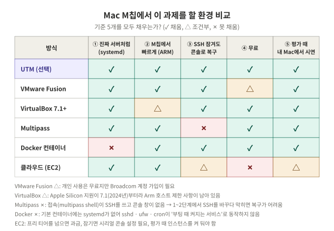

- 5개를 모두 채우는 것은 **UTM**입니다(VMware Fusion, VirtualBox 7.1+도 가능).
- **Docker를 쓰지 않은 이유:** systemd 없는 컨테이너에서 시험했을 때, 다시 시작하면 sshd와 cron이 꺼진 채로 올라오고 `ufw status`는 inactive였습니다.

| VM 만드는 순서 | 할 일 |
|---|---|
| 1 | UTM 설치 (mac.getutm.app에서 dmg → `~/Applications`. 인텔 Mac은 Homebrew 지원이 끝나 직접 받음) |
| 2 | Ubuntu Server 22.04 iso: 인텔 Mac은 `amd64`, M칩은 `arm64` |
| 3 | UTM → `+` → 가상화(Virtualize) → Linux → iso 선택, 메모리 4GB |
| 4 | 설치: Profile에서 만드는 계정이 내 계정(sudo 가능). README와 같게 쓰려면 **계정 이름 `arang`, 서버 이름 `b4-1`**. **Install OpenSSH server 체크** |
| 5 | 설치 후 CD/DVD 꺼내기 → 재부팅 → `ip -4 addr show`로 주소 확인 |

### B. 파일 구성

| 파일 | 내용 |
|---|---|
| [bin/monitor.sh](bin/monitor.sh) | 자동 점검 스크립트 (설정 17~26줄, 프로세스 · 포트 45~59줄, 방화벽 61~71줄, 자원 76~97줄, 기록 105~108줄) |
| [config/logrotate-agent-app](config/logrotate-agent-app) | `/etc/logrotate.d/agent-app`에 복사 (10MB / 10개) |
| [config/sudoers-agent-monitor](config/sudoers-agent-monitor) | `/etc/sudoers.d/agent-monitor`에 복사 (`ufw status`만 허용) |
| [수행내역서.md](수행내역서.md) | 증거 사진 20장과 확인 내용 |
| [evaluation.md](evaluation.md) | 평가 가이드 |
| [images/](images/) | 설명 그림, [images/evidence/](images/evidence/)는 내 VM 증거 사진 20장 |
