# B4-1 · 컴퓨터가 알아서 자기 상태를 점검하게 만들기

| 분야 | 구분 | 학습시간 | 필수/선택 |
|---|---|---|---|
| AI/SW 기초 | Linux와 OS | 40시간 | 필수 |

**환경:** 교육장 iMac(Intel) + UTM, Ubuntu Server 22.04.5 LTS (x86_64) · **방화벽:** UFW · **범위:** 필수 요구사항만 (보너스 제외)

이 README가 **요구사항 수행 내역서**입니다. 📸 사진은 모두 **내 VM에서 직접 찍은 화면**입니다.

| 문서 | 내용 |
|---|---|
| **README** (이 문서) | 결과 요약 + 단계별 수행 내역과 증거 사진 |
| [docs/commands.md](docs/commands.md) | 설정 · 명령어 기록: 내 VM에서 실행한 명령을 순서 그대로 |
| [docs/concepts.md](docs/concepts.md) | 개념과 배경: 제공 앱, UTM을 고른 이유, 권한 · cron 등 자세한 설명 |
| [docs/evaluation.md](docs/evaluation.md) | **평가표 기준 정리**: 질문마다 설명 → VM에서 실행해서 보여주기 → 말하기 |
| [bin/monitor.sh](bin/monitor.sh) | 자동화 스크립트 (Bash) |
| [config/](config/) | logrotate 설정 (10MB / 10개), sudoers 설정 (`ufw status`만 허용) |

---

## 한눈에 보기

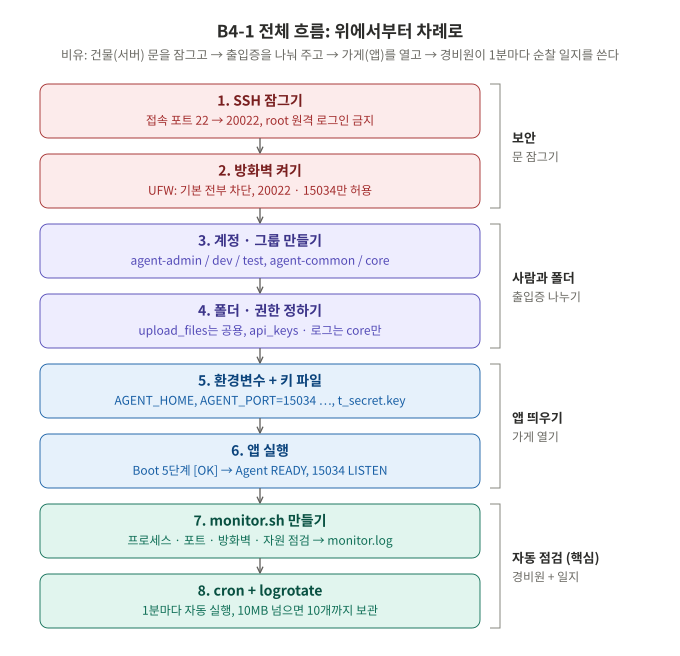

**"서버의 문을 잠그고(1~2), 사람마다 출입증을 나눠 주고(3~4), 가게(앱)를 연 다음(5~6), 경비원(monitor.sh)이 1분마다 순찰하며 일지(monitor.log)를 쓰게 만든다(7~8)."**

---

## 결과 요약

| 과제 요구사항 | 결과 | 증거 |
|---|---|---|
| SSH 포트 20022, root 원격 로그인 차단 | ✅ | [1-1](docs/images/evidence/1-1_sshd_rules.png) · [1-2](docs/images/evidence/1-2_sshd_listen.png) · [1-3](docs/images/evidence/1-3_root_denied.png) |
| UFW 활성화, 20022/tcp · 15034/tcp만 허용 | ✅ | [2](docs/images/evidence/2_ufw_status.png) |
| 계정 3개, 그룹 2개 (common: 3명 / core: admin · dev) | ✅ | [3](docs/images/evidence/3_id_groups.png) |
| upload_files = common R/W, api_keys · 로그 폴더 = core만 R/W | ✅ | [4-1](docs/images/evidence/4-1_dirs.png) · [4-2](docs/images/evidence/4-2_test_denied.png) · [4-3](docs/images/evidence/4-3_dev_allowed.png) |
| 환경변수 5개, 키 파일 `agent_api_key_test` | ✅ | [5-1](docs/images/evidence/5-1_env.png) · [5-2](docs/images/evidence/5-2_keys.png) |
| 일반 계정으로 실행, Boot 5단계 [OK], Agent READY, 0.0.0.0:15034 | ✅ | [6](docs/images/evidence/6_boot_ready.png) · [6-2](docs/images/evidence/6-2_app_listen.png) |
| monitor.sh: agent-dev 소유, agent-core 그룹, 750 | ✅ | [7-1](docs/images/evidence/7-1_monitor_perm.png) |
| 점검 → 수집 → 경고 → 기록, 앱 · 포트 비정상 시 exit 1, 방화벽 꺼짐은 경고만 | ✅ | [7-2](docs/images/evidence/7-2_monitor_ok.png) · [7-3](docs/images/evidence/7-3_monitor_fw_warn.png) · [7-4](docs/images/evidence/7-4_monitor_fail.png) |
| agent-admin crontab 매분 실행, monitor.log 지정 포맷으로 자동 누적 | ✅ | [8-1](docs/images/evidence/8-1_crontab.png) · [8-2](docs/images/evidence/8-2_monitor_log.png) |
| monitor.log 용량 관리 10MB / 10개 | ✅ | [8-3](docs/images/evidence/8-3_logrotate_conf.png) · [8-4](docs/images/evidence/8-4_logrotate_dryrun.png) |
| 스크립트는 Bash로만, sudo는 필요할 때만 | ✅ | monitor.sh는 순수 Bash, sudo는 `ufw status` 한 줄에만 |

> **과제 문서와 다르게 한 점:** 제공 앱이 `AGENT_KEY_PATH`를 **폴더**(`.../api_keys`)로, 키 파일 이름을 **`secret.key`**로 요구합니다. 문서대로 하면 Boot [2/5], [3/5]가 FAIL이라 앱을 따랐고, 문서의 `t_secret.key`도 함께 만들어 두었습니다. ([자세히](docs/concepts.md#6-환경변수와-키-파일))

---

## 단계별 수행 내역

> `[Mac]` = Mac 터미널, 나머지는 VM 안. 명령은 sudo가 되는 내 계정(`arang`)에서 실행하고, `agent-admin`이 필요할 때만 `sudo -iu agent-admin`으로 바꿉니다.

### 0단계. 준비

UTM으로 Ubuntu VM을 만들고, Mac 터미널에서 접속해 작업합니다. ([VM을 고른 이유와 만드는 순서](docs/concepts.md#3-실습-환경-왜-utm-vm인가))

```bash
ssh arang@192.168.64.2                                                     # [Mac] VM 접속
scp ~/Downloads/agent-app/agent-app-linux-x86 arang@192.168.64.2:~/       # [Mac] 앱 파일 보내기

sudo timedatectl set-timezone Asia/Seoul
git clone https://github.com/codewhite7777/codyssey_B4-1.git && cd codyssey_B4-1
sudo apt update && sudo apt install -y openssh-server ufw acl cron logrotate
```

---

### 1단계. SSH 잠그기

SSH 문 번호를 22 → **20022**로 옮기고, **root 원격 로그인을 막습니다.** 봇이 노리는 "22번 + root" 조합을 둘 다 없앱니다. ([위협 모델](docs/concepts.md#4-ssh와-방화벽))


```bash
sudo cp /etc/ssh/sshd_config /etc/ssh/sshd_config.bak
sudo sed -i 's/^#\?Port .*/Port 20022/; s/^#\?PermitRootLogin .*/PermitRootLogin no/' /etc/ssh/sshd_config
sudo sshd -t && sudo systemctl restart ssh        # 문법 검사 후 재시작 (기존 창은 닫지 않음)
ssh -p 20022 arang@192.168.64.2                   # [Mac] 새 창에서 새 포트로 접속되는지 확인
```

**📸 1-1** 적용된 규칙: `port 20022`, `permitrootlogin no`


**📸 1-2** sshd가 20022번에서 LISTEN

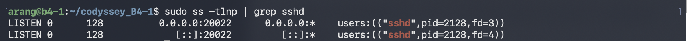

**📸 1-3** Mac에서 root로 접속하면 `Permission denied`


---

### 2단계. 방화벽 켜기

**기본은 전부 막고**, SSH(20022)와 앱(15034)만 엽니다. 허용 명단을 먼저 넣고 **켜기는 맨 마지막**에 합니다(순서가 바뀌면 SSH가 막힘).


```bash
sudo ufw default deny incoming
sudo ufw default allow outgoing
sudo ufw allow 20022/tcp
sudo ufw allow 15034/tcp
sudo ufw show added          # 켜기 전 명단 확인
sudo ufw enable
```

**📸 2** `Status: active`, `deny (incoming)`, 허용은 20022 · 15034만


---

### 3단계. 계정 · 그룹

사람 3명(계정)을 만들고, 권한을 나눠 줄 명단 2개(그룹)에 넣습니다. **그룹에는 상하 관계가 없어서** admin · dev는 두 그룹에 각각 넣습니다. ([계정과 그룹의 차이](docs/concepts.md#5-계정--그룹--권한))

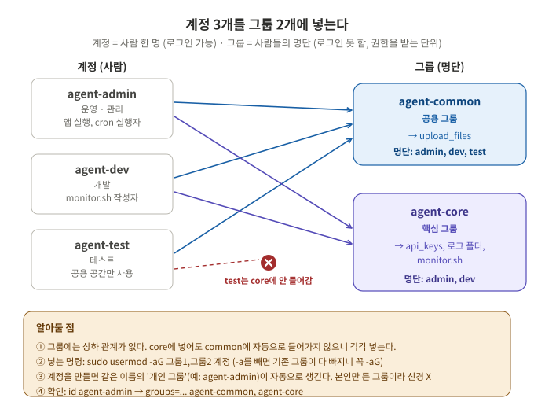

```bash
sudo useradd -m -s /bin/bash agent-admin
sudo useradd -m -s /bin/bash agent-dev
sudo useradd -m -s /bin/bash agent-test
sudo groupadd agent-common
sudo groupadd agent-core
sudo usermod -aG agent-common,agent-core agent-admin
sudo usermod -aG agent-common,agent-core agent-dev
sudo usermod -aG agent-common agent-test
```

**📸 3** admin · dev는 common과 core, test는 common만 (맨 앞 같은 이름 그룹은 자동으로 생긴 개인 그룹)

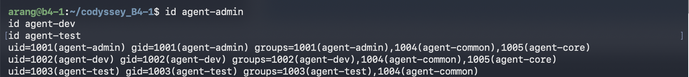

---

### 4단계. 폴더 · 권한

`upload_files`는 3명이 함께 쓰는 **공용** 폴더, `api_keys`와 로그 폴더는 admin · dev만 쓰는 **보안** 폴더입니다(최소 권한 원칙). ([권한 숫자 · setgid · ACL](docs/concepts.md#권한-숫자--setgid--acl))


| 폴더 | 주인:그룹 | 권한 | 의미 |
|---|---|---|---|
| `agent-app` ($AGENT_HOME) | agent-admin:agent-common | `750` | 3명 모두 들어올 수 있음, 바깥은 막힘 |
| `upload_files` | agent-admin:agent-common | `2770` + 기본 ACL | 3명 모두 읽기 · 쓰기 |
| `api_keys` | agent-admin:agent-core | `2770` | admin · dev만 |
| `bin` | agent-dev:agent-core | `750` | dev가 만들고 admin은 실행만 |
| `/var/log/agent-app` | agent-admin:agent-core | `2770` + 기본 ACL | admin · dev만 |

```bash
H=/home/agent-admin/agent-app
sudo mkdir -p $H/upload_files $H/api_keys $H/bin /var/log/agent-app
sudo setfacl -m g:agent-common:x /home/agent-admin                    # 홈 폴더는 "지나가기"만 허용

sudo chown agent-admin:agent-common $H              && sudo chmod 750  $H
sudo chown agent-admin:agent-common $H/upload_files && sudo chmod 2770 $H/upload_files
sudo chown agent-admin:agent-core   $H/api_keys     && sudo chmod 2770 $H/api_keys
sudo chown agent-dev:agent-core     $H/bin          && sudo chmod 750  $H/bin
sudo chown agent-admin:agent-core   /var/log/agent-app && sudo chmod 2770 /var/log/agent-app

sudo setfacl -d -m g:agent-common:rwx $H/upload_files                 # 앞으로 생길 파일도 그룹이 쓰기 가능
sudo setfacl -d -m g:agent-core:rw    /var/log/agent-app
```

**📸 4-1** 폴더 5개의 주인 · 그룹 · 권한 (`+` = ACL이 걸린 폴더)


**📸 4-2 · 4-3** 같은 비밀 폴더인데 **test는 거절, dev는 통과**


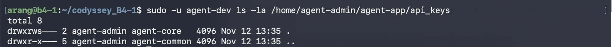

---

### 5단계. 환경변수 · 키 파일

앱을 실행할 agent-admin에게 "집은 어디, 문은 몇 번, 키는 어디" 메모(환경변수)를 적어 두고 키 파일을 만듭니다. 앱이 부팅할 때 이 값을 검사합니다.

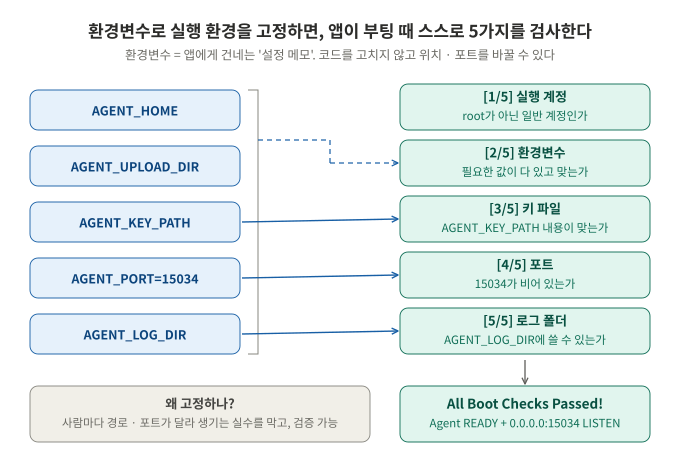

```bash
sudo -iu agent-admin
cat >> ~/.bashrc <<'EOF'
export AGENT_HOME=/home/agent-admin/agent-app
export AGENT_PORT=15034
export AGENT_UPLOAD_DIR=$AGENT_HOME/upload_files
export AGENT_KEY_PATH=$AGENT_HOME/api_keys
export AGENT_LOG_DIR=/var/log/agent-app
EOF
source ~/.bashrc
echo "agent_api_key_test" > $AGENT_KEY_PATH/secret.key       # 앱이 읽는 파일
echo "agent_api_key_test" > $AGENT_KEY_PATH/t_secret.key     # 과제 문서에 적힌 이름
chmod 660 $AGENT_KEY_PATH/*.key
```

**📸 5-1** 환경변수 5개 (`AGENT_KEY_PATH`는 폴더)


**📸 5-2** 키 파일 권한 `660`, 그룹은 폴더의 setgid로 자동으로 `agent-core`

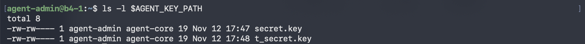

---

### 6단계. 앱 실행

제공 앱을 **일반 계정(agent-admin)**으로 실행하면, 1~5단계 세팅이 맞는지 앱이 5가지를 검사합니다. 통과하면 15034를 열고 일부러 CPU · 메모리를 썼다 줄였다 합니다. ([제공 앱은 무엇인가](docs/concepts.md#2-제공-앱은-무엇인가))


```bash
exit                                                   # agent-admin → arang
sudo install -o agent-admin -g agent-admin -m 750 ~/agent-app-linux-x86 /home/agent-admin/agent-app/
sudo -iu agent-admin
cd $AGENT_HOME && ./agent-app-linux-x86                # 이 창은 앱 전용으로 켜 둠 (종료: Ctrl+C)
sudo ss -ltnp | grep 15034                             # [새 창, arang] 포트 확인
```

**📸 6** Boot 5단계 모두 `[OK]` → `Agent READY`, 그 뒤 부하 반복


**📸 6-2** 앱이 `0.0.0.0:15034`에서 LISTEN

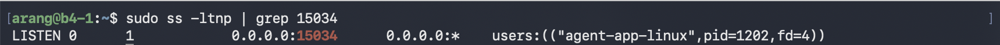

---

### 7단계. monitor.sh

경비원 스크립트를 설치하고 일부러 문제 상황을 만들어 반응을 확인합니다. **서비스가 죽으면 멈추고(exit 1), 아직 돌고 있으면 경고만** 합니다. ([쓴 명령과 이유](docs/concepts.md#7-monitorsh))


```bash
cd ~/codyssey_B4-1
sudo install -o agent-dev -g agent-core -m 750 bin/monitor.sh /home/agent-admin/agent-app/bin/monitor.sh
sudo install -o root -g root -m 0440 config/sudoers-agent-monitor /etc/sudoers.d/agent-monitor   # ufw status만 허용
sudo visudo -cf /etc/sudoers.d/agent-monitor
sudo -u agent-admin /home/agent-admin/agent-app/bin/monitor.sh; echo "exit=$?"
```

**📸 7-1** monitor.sh: 주인 `agent-dev`, 그룹 `agent-core`, `750`


| 상황 | monitor.sh 반응 | 종료 코드 | 증거 |
|---|---|---|---|
| 정상 (MEM 기준 초과) | 경고만, 기록함 | `exit=0` | 7-2 |
| 방화벽 꺼짐 (`sudo ufw disable`) | 경고만, 기록함 | `exit=0` | 7-3 |
| 앱 죽음 (탭 1에서 Ctrl+C) | `[FAIL]`, 바로 멈춤 | `exit=1` | 7-4 |

**📸 7-2** 점검 3개 `[OK]`, `MEM threshold exceeded (12.7% > 10%)`, `exit=0`

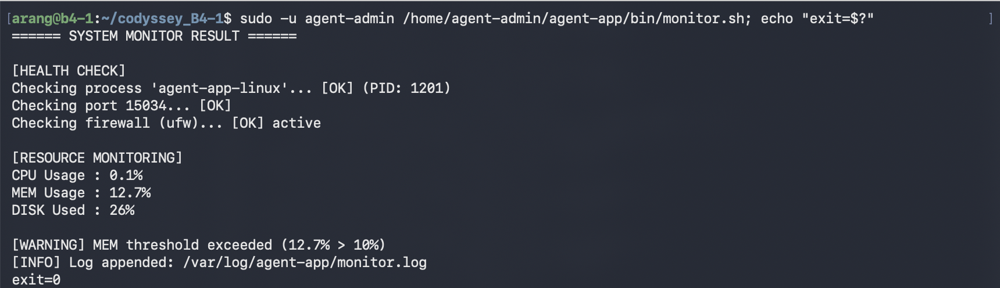

**📸 7-3** 방화벽을 끈 뒤 `[WARNING] Firewall (ufw) is not active`, 그래도 `exit=0` (확인 후 `sudo ufw enable`)

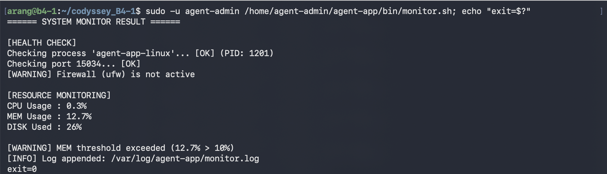

**📸 7-4** 앱을 끈 뒤 `[FAIL] not running`, `exit=1`

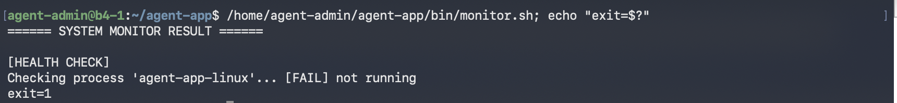

---

### 8단계. cron · logrotate

**cron**으로 agent-admin이 1분마다 monitor.sh를 자동 실행하고, **logrotate**로 monitor.log가 10MB를 넘으면 잘라서 10개까지만 보관합니다. ([cron 줄 읽는 법, logrotate 설정 해설](docs/concepts.md#8-cron과-logrotate))

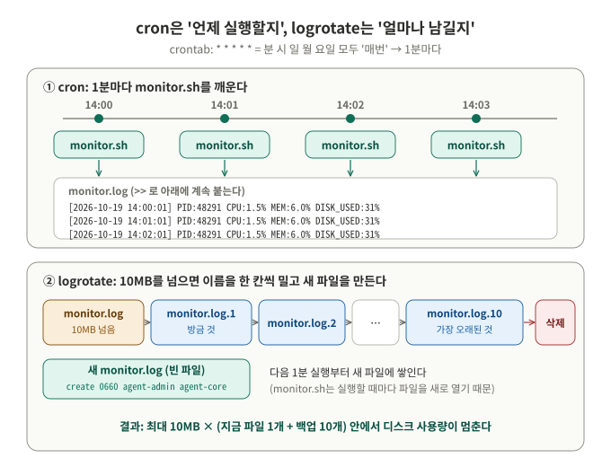

```bash
# [agent-admin] 본인 crontab에 등록 (앱은 탭 1에서 켜 둔 상태)
echo "* * * * * /home/agent-admin/agent-app/bin/monitor.sh > /dev/null 2>&1" | crontab -

# [arang] logrotate 설정 설치 → 판단만 해 보기
sudo cp config/logrotate-agent-app /etc/logrotate.d/agent-app
sudo logrotate -d /etc/logrotate.d/agent-app
```

**📸 8-1** agent-admin의 crontab에 1분마다(`* * * * *`) 등록


**📸 8-2** 16:48 ~ 16:57 매분 `:02`초에 한 줄씩 자동으로 누적 (지정 포맷, `>>` 이어쓰기)

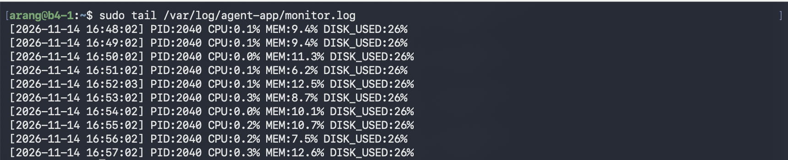

**📸 8-3** 설치된 logrotate 설정: `size 10M`, `rotate 10`

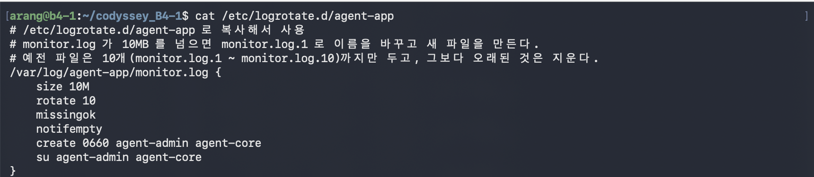

**📸 8-4** `10485760 bytes (10 rotations)`로 읽음, `log does not need rotating` (아직 10MB 미만)


---

## 파일 구조

```text
codyssey_B4-1/
├── README.md                    ← 수행 내역서 (이 문서)
├── bin/monitor.sh               ← 자동화 스크립트
├── config/
│   ├── logrotate-agent-app      ← /etc/logrotate.d/agent-app
│   └── sudoers-agent-monitor    ← /etc/sudoers.d/agent-monitor
└── docs/
    ├── commands.md              ← 설정 · 명령어 기록 (실행 순서 그대로)
    ├── concepts.md              ← 개념과 배경
    ├── evaluation.md            ← 평가표 기준 정리 (설명 → 실행 → 말하기)
    └── images/                  ← 설명 그림 (SVG) · evidence/ 증거 사진 20장
```
