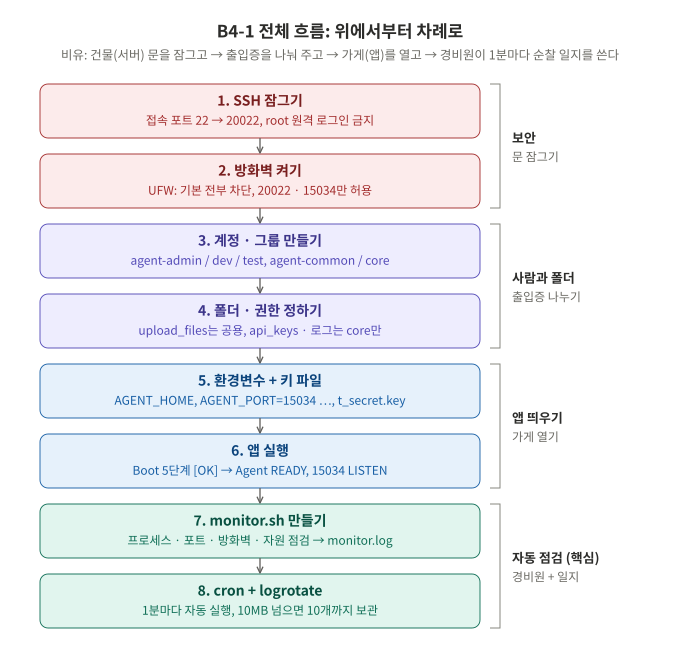
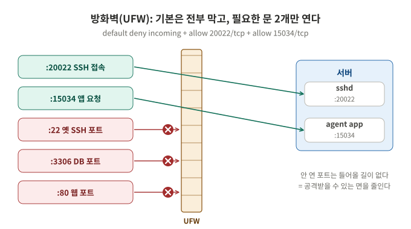
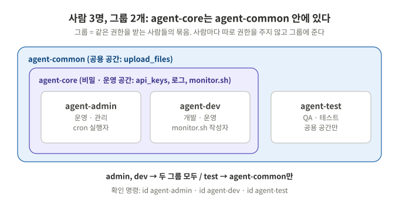
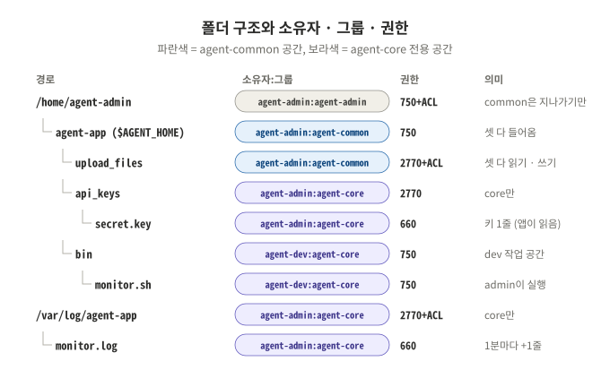
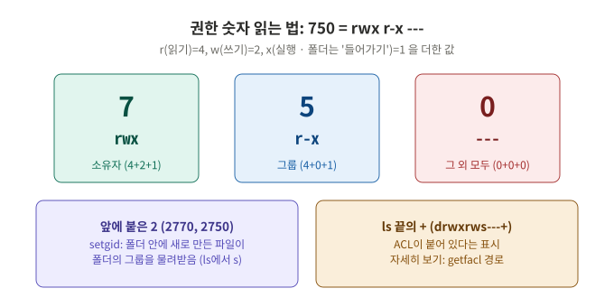
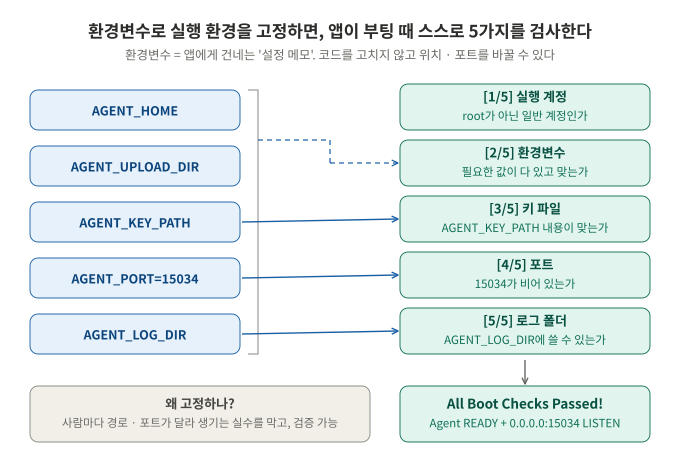

# B4-1 · 컴퓨터가 알아서 자기 상태를 점검하게 만들기

| 분야 | 구분 | 학습시간 | 필수/선택 |
|---|---|---|---|
| AI/SW 기초 | Linux와 OS | 40시간 | 필수 |

**환경: Ubuntu 22.04 LTS (VM) / 방화벽: UFW / 범위: 필수 요구사항만 (보너스 제외)**

이 README가 **요구사항 수행 내역서**입니다. 세 부분으로 되어 있습니다.

| 순서 | 섹션 | 내용 |
|---|---|---|
| 1 | [한눈에 보기](#한눈에-보기) | 전체 흐름 그림 한 장 + 용어 사전 |
| 2 | [실행 흐름 0~8단계](#실행-흐름) | 단계마다 **개념(그림) → 명령 → 확인 → 실제 출력** |
| 3 | [증거 자료 체크리스트](#증거-자료-체크리스트) | 과제가 요구한 증거 8개가 어디 있는지 |

> **평가하시는 분은 [한눈에 보기](#한눈에-보기) 그림으로 전체를 먼저 보고, [실행 흐름](#실행-흐름)을 1단계부터 따라 가면 됩니다.**

| 함께 보는 파일 | 내용 |
|---|---|
| [docs/evaluation.md](docs/evaluation.md) | **평가표 항목 1~4 정리** (질문마다 보여줄 곳, 그림, 말하기 예시) |
| [bin/monitor.sh](bin/monitor.sh) | 자동화 스크립트 소스코드 (Bash) |
| [config/logrotate-agent-app](config/logrotate-agent-app) | 로그 용량 관리 설정 (10MB / 10개) |

## 진행 상황

| 단계 | 할 일 | 결과물 | 상태 |
|---|---|---|---|
| 1~2 | SSH 포트 20022, root 차단, UFW로 20022 · 15034만 허용 | `/etc/ssh/sshd_config`, `ufw status` | ✅ |
| 3~4 | 계정 3개, 그룹 2개, 폴더 · 권한 · ACL | `id`, `ls -l`, `getfacl` | ✅ |
| 5~6 | 환경변수, 키 파일, 앱 실행 (Boot 5단계 [OK]) | `~/.bashrc`, `t_secret.key` | ✅ |
| 7 | monitor.sh (점검 → 수집 → 경고 → 기록) | [bin/monitor.sh](bin/monitor.sh) | ✅ |
| 8 | cron 1분마다 실행 + logrotate 10MB/10개 | `crontab -l`, [config/logrotate-agent-app](config/logrotate-agent-app) | ✅ |
| - | 보너스 (report.sh, 시간 기반 보존) | - | ⛔ 하지 않음 |

> **출력 예시에 대해**: 아래 `$` 명령 아래의 출력은 이 저장소를 만들면서 Ubuntu 테스트 환경에서 **실제로 실행한 결과**입니다. (UID 숫자, 시각, PID는 환경마다 다릅니다.)
> 제공 앱의 Boot Sequence 출력만은 과제 문서의 예시를 옮겼습니다. 본인 VM에서 같은 명령을 실행해 화면을 캡처하면 그대로 증거 자료가 됩니다.

---

## 한눈에 보기



이 과제를 한 문장으로 줄이면 **"서버의 문을 잠그고, 사람마다 출입증을 나눠 주고, 가게(앱)를 연 다음, 경비원(monitor.sh)이 1분마다 순찰하며 일지(monitor.log)를 쓰게 만든다"** 입니다.

### 용어 사전 (먼저 읽으면 편한 9개)

| 용어 | 쉬운 말 | 이 과제에서 |
|---|---|---|
| SSH | 다른 컴퓨터에서 이 서버에 원격으로 들어오는 통로 | 22번 → **20022번** 문으로 옮기고, root는 못 들어오게 |
| 포트 | 한 서버 안의 "문 번호". 프로그램마다 자기 문을 연다 | sshd = 20022, 앱 = **15034** |
| 방화벽 (UFW) | 어떤 문으로 들어오는 요청을 통과시킬지 정하는 경비 | 20022, 15034만 통과 |
| 계정 / 그룹 | 계정 = 사람 한 명, 그룹 = 같은 권한을 받는 사람들 묶음 | admin, dev, test / common, core |
| 권한 (rwx) | 읽기 · 쓰기 · 실행(폴더는 들어가기)을 누구에게 줄지 | `750`, `2770`, `660` |
| ACL | 기본 권한(소유자/그룹/나머지)으로 부족할 때 **사람이나 그룹을 더 지정**하는 추가 규칙 | 홈 폴더 통과, 새 파일도 그룹이 쓰기 가능 |
| 환경변수 | 프로그램에 건네는 "설정 메모" (`이름=값`) | `AGENT_HOME`, `AGENT_PORT` … |
| 프로세스 | 지금 실행 중인 프로그램 하나 (번호 = PID) | 앱이 살아 있나 = 프로세스가 있나 |
| cron / logrotate | cron = 정해진 시간에 자동 실행, logrotate = 로그가 커지면 잘라서 보관 | 1분마다 monitor.sh, 10MB × 10개 |

---

## 실행 흐름

각 단계는 **개념 → 명령 → 확인 → 실제 출력** 순서입니다. 명령은 sudo를 쓸 수 있는 **내 계정**에서 실행하고, 계정을 바꿔야 할 때만 `sudo -iu 계정` 으로 바꿉니다.

### 0단계. 준비

```bash
# 저장소 받기
git clone https://github.com/codewhite7777/codyssey_B4-1.git
cd codyssey_B4-1

# 필요한 프로그램 설치 (대부분 이미 있음)
sudo apt update
sudo apt install -y openssh-server ufw acl cron logrotate
```

| 설치한 것 | 왜 |
|---|---|
| openssh-server | SSH 접속을 받는 프로그램 (sshd) |
| ufw | 방화벽 (Ubuntu 기본, 명령이 짧아서 firewalld 대신 선택) |
| acl | `setfacl`, `getfacl` 명령 |
| cron, logrotate | 자동 실행, 로그 용량 관리 |

---

### 1단계. SSH 잠그기 (포트 20022, root 원격 접속 차단)


**개념**: 인터넷에는 22번 포트에 `root` + 흔한 비밀번호를 자동으로 넣어 보는 봇이 많습니다.
문 번호를 바꾸면(20022) 그런 무작위 시도가 줄고, root 접속을 막으면(PermitRootLogin no) 비밀번호를 맞혀도 root로는 못 들어옵니다.

> ⚠️ **잠기지 않게 순서 주의**
> - root를 막기 전에 **일반 계정(내 계정)으로 로그인되는지** 먼저 확인합니다.
> - UFW가 **이미 켜져 있다면** 2단계의 `sudo ufw allow 20022/tcp`를 먼저 하고 SSH를 재시작합니다.

```bash
# 1) 원본 백업
sudo cp /etc/ssh/sshd_config /etc/ssh/sshd_config.bak

# 2) 두 줄 수정: "#Port 22" → "Port 20022", "#PermitRootLogin ..." → "PermitRootLogin no"
sudo nano /etc/ssh/sshd_config
#   (nano 대신 한 줄로 하려면)
#   sudo sed -i 's/^#\?Port .*/Port 20022/; s/^#\?PermitRootLogin .*/PermitRootLogin no/' /etc/ssh/sshd_config

# 3) 문법 검사 → 아무것도 안 나오면 정상
sudo sshd -t

# 4) 재시작
sudo systemctl restart ssh
#   Ubuntu 24.04 이상(ssh.socket 사용)이면:
#   sudo systemctl daemon-reload && sudo systemctl restart ssh.socket
```

**확인**

```console
$ grep -nE "^Port|^PermitRootLogin" /etc/ssh/sshd_config
23:Port 20022
42:PermitRootLogin no

$ sudo sshd -T | grep -E "^port |^permitrootlogin "     # 실제로 적용된 값
port 20022
permitrootlogin no

$ sudo ss -tulnp | grep sshd
tcp   LISTEN 0      128          0.0.0.0:20022      0.0.0.0:*    users:(("sshd",pid=1249,fd=3))

$ ssh -p 20022 root@localhost          # root는 비밀번호를 맞혀도 거절
Permission denied, please try again.

$ ssh -p 20022 agent-admin@localhost whoami   # 일반 계정은 접속됨 (3단계 이후 확인)
agent-admin

$ ssh -p 22 agent-admin@localhost      # 옛 포트는 닫힘
ssh: connect to host localhost port 22: Connection refused
```

| 확인 방법 | 무엇을 보나 |
|---|---|
| `grep` | 설정 **파일**에 적힌 값 |
| `sshd -T` | sshd가 **실제로 쓰는** 최종 값 (다른 설정 파일에 덮여 있지 않은지) |
| `ss -tulnp` | sshd가 정말 **20022에서 기다리는지(LISTEN)** |

> VM을 쓰면 호스트 → VM 포트 포워딩도 22 대신 **20022**로 바꿔야 밖에서 접속됩니다.

---

### 2단계. 방화벽 켜기 (20022/tcp, 15034/tcp만 허용)



**개념**: 방화벽은 "기본은 전부 막고, 필요한 문만 연다"가 원칙입니다. 열린 문이 적을수록 공격받을 곳(공격 면)이 줄어듭니다.

```bash
sudo ufw default deny incoming      # 들어오는 것: 기본 차단
sudo ufw default allow outgoing     # 나가는 것: 기본 허용 (업데이트 등)
sudo ufw allow 20022/tcp            # SSH
sudo ufw allow 15034/tcp            # 앱
sudo ufw enable                     # 켜기 (재부팅해도 켜짐)
```

> 예전에 `ufw allow OpenSSH`나 `22`를 허용한 적이 있으면 `sudo ufw status numbered`로 번호를 보고 `sudo ufw delete 번호`로 지웁니다. **허용 목록은 딱 2줄**이어야 합니다.

**확인**

```console
$ sudo ufw status verbose
Status: active
Logging: on (low)
Default: deny (incoming), allow (outgoing), disabled (routed)
New profiles: skip

To                         Action      From
--                         ------      ----
20022/tcp                  ALLOW IN    Anywhere
15034/tcp                  ALLOW IN    Anywhere
```

(IPv6가 켜진 환경이면 같은 규칙이 `(v6)`로 한 번 더 보입니다. 정상입니다.)

---

### 3단계. 계정 · 그룹 만들기



**개념**: 권한을 사람마다 따로 주면 사람이 늘 때마다 실수가 생깁니다. 그래서 **그룹에 권한을 주고, 사람을 그룹에 넣습니다.**
`agent-core`(비밀 · 운영)는 `agent-common`(공용) 안에 있는 더 좁은 그룹입니다.

```bash
# 계정 3개 (-m: 홈 폴더 생성, -s: 기본 셸)
sudo useradd -m -s /bin/bash agent-admin
sudo useradd -m -s /bin/bash agent-dev
sudo useradd -m -s /bin/bash agent-test
sudo passwd agent-admin            # SSH 접속에 쓸 비밀번호 (dev, test도 필요하면)

# 그룹 2개
sudo groupadd agent-common
sudo groupadd agent-core

# 그룹에 넣기 (-aG: 기존 그룹은 유지하고 추가)
sudo usermod -aG agent-common,agent-core agent-admin
sudo usermod -aG agent-common,agent-core agent-dev
sudo usermod -aG agent-common            agent-test
```

> `-a` 없이 `-G`만 쓰면 **기존 그룹이 다 빠지고** 적은 그룹만 남습니다. 꼭 `-aG`.

**확인**

```console
$ id agent-admin
uid=30033(agent-admin) gid=30033(agent-admin) groups=30033(agent-admin),30036(agent-common),30037(agent-core)
$ id agent-dev
uid=30034(agent-dev) gid=30034(agent-dev) groups=30034(agent-dev),30036(agent-common),30037(agent-core)
$ id agent-test
uid=30035(agent-test) gid=30035(agent-test) groups=30035(agent-test),30036(agent-common)
```

---

### 4단계. 폴더 · 권한 정하기 (공유 폴더 vs 보안 폴더)



**권한 숫자 읽는 법**



**정책**: `upload_files`는 세 명 모두 쓰는 **공유 폴더**, `api_keys`와 로그 폴더는 `agent-core`만 쓰는 **보안 폴더**입니다.


```bash
AGENT_HOME=/home/agent-admin/agent-app       # 이 단계에서만 쓰는 임시 변수

# 1) 폴더 만들기
sudo mkdir -p $AGENT_HOME/upload_files $AGENT_HOME/api_keys $AGENT_HOME/bin /var/log/agent-app

# 2) 홈 폴더 통과 허용 (ACL)
#    Ubuntu는 홈 폴더가 750이라 dev, test는 /home/agent-admin 안으로 들어갈 수조차 없다.
#    agent-common에게 "지나가기(x)"만 허용 → 목록 보기(r)는 여전히 불가
sudo setfacl -m g:agent-common:x /home/agent-admin

# 3) 소유자:그룹, 권한
sudo chown agent-admin:agent-common $AGENT_HOME               && sudo chmod 750  $AGENT_HOME
sudo chown agent-admin:agent-common $AGENT_HOME/upload_files  && sudo chmod 2770 $AGENT_HOME/upload_files
sudo chown agent-admin:agent-core   $AGENT_HOME/api_keys      && sudo chmod 2770 $AGENT_HOME/api_keys
sudo chown agent-dev:agent-core     $AGENT_HOME/bin           && sudo chmod 750  $AGENT_HOME/bin
sudo chown agent-admin:agent-core   /var/log/agent-app        && sudo chmod 2770 /var/log/agent-app

# 4) 기본(default) ACL: 앞으로 이 폴더에 생기는 파일도 그룹이 읽고 쓸 수 있게
sudo setfacl -d -m g:agent-common:rwx $AGENT_HOME/upload_files
sudo setfacl -d -m g:agent-core:rw    /var/log/agent-app
```

| 설정 | 왜 필요한가 |
|---|---|
| `2770`의 앞자리 **2 (setgid)** | 누가 파일을 만들든 **폴더의 그룹**(agent-core 등)을 물려받음. 없으면 만든 사람의 개인 그룹이 되어 다른 사람이 못 씀 |
| 끝자리 **0** | 그룹 밖의 사람(other)은 아예 못 들어옴 → agent-test는 api_keys, 로그 폴더 불가 |
| **기본 ACL** (`setfacl -d`) | 새 파일은 보통 `644`(그룹은 읽기만)로 생김. 기본 ACL을 두면 새 파일도 그룹이 **쓰기**까지 가능 → "R/W 가능" 요구 충족 |
| `bin`의 소유자 **agent-dev** | monitor.sh 작성자가 dev이므로 dev가 이 폴더에 파일을 만들 수 있어야 함 |

**확인**

```console
$ ls -ld $AGENT_HOME $AGENT_HOME/* /var/log/agent-app
drwxr-x---  5 agent-admin agent-common 4096 Oct 19 01:24 /home/agent-admin/agent-app
drwxrws---  2 agent-admin agent-core   4096 Oct 19 01:24 /home/agent-admin/agent-app/api_keys
drwxr-x---  2 agent-dev   agent-core   4096 Oct 19 01:26 /home/agent-admin/agent-app/bin
drwxrws---+ 2 agent-admin agent-common 4096 Oct 19 01:24 /home/agent-admin/agent-app/upload_files
drwxrws---+ 2 agent-admin agent-core   4096 Oct 19 01:31 /var/log/agent-app

$ getfacl -p /home/agent-admin /var/log/agent-app
# file: /home/agent-admin
# owner: agent-admin
# group: agent-admin
user::rwx
group::r-x
group:agent-common:--x        ← common은 지나가기만
mask::r-x
other::---

# file: /var/log/agent-app
# owner: agent-admin
# group: agent-core
# flags: -s-                  ← setgid
user::rwx
group::rwx
other::---
default:user::rwx
default:group::rwx
default:group:agent-core:rw-  ← 새 파일도 core가 읽기·쓰기
default:mask::rwx
default:other::---
```

**계정별로 직접 들어가 보기** (정책이 실제로 지켜지는지)

```console
$ sudo -u agent-test touch $AGENT_HOME/upload_files/from-test.txt    # 공유 폴더: 성공
$ sudo -u agent-test cat $AGENT_HOME/api_keys/t_secret.key           # 보안 폴더: 거절 (키는 5단계에서 생성)
cat: /home/agent-admin/agent-app/api_keys/t_secret.key: Permission denied
$ sudo -u agent-test ls /var/log/agent-app
ls: cannot open directory '/var/log/agent-app': Permission denied
$ sudo -u agent-dev cat $AGENT_HOME/api_keys/t_secret.key            # core 멤버: 성공
agent_api_key_test
```

| | upload_files 쓰기 | api_keys 읽기 | 로그 폴더 쓰기 |
|---|---|---|---|
| agent-admin | ✅ | ✅ | ✅ |
| agent-dev | ✅ | ✅ | ✅ |
| agent-test | ✅ | ❌ Permission denied | ❌ Permission denied |

---

### 5단계. 환경변수 + 키 파일



**개념**: 환경변수는 앱에게 건네는 설정 메모입니다. 경로와 포트를 코드에 박지 않고 환경변수로 주면, **누가 실행해도 같은 환경**이 되고 `env` 명령 하나로 **검증**할 수 있습니다.
앱은 이 값들을 읽어서 부팅할 때 스스로 검사(Boot Sequence)합니다.

```bash
sudo -iu agent-admin              # 앱을 실행할 계정으로 바꾸기 (-i: 로그인한 것처럼)

# ~/.bashrc 맨 아래에 추가 → 로그인할 때마다 자동 설정
cat >> ~/.bashrc <<'EOF'

# ---- agent-app 실행 환경 ----
export AGENT_HOME=/home/agent-admin/agent-app
export AGENT_PORT=15034
export AGENT_UPLOAD_DIR=$AGENT_HOME/upload_files
export AGENT_KEY_PATH=$AGENT_HOME/api_keys/t_secret.key
export AGENT_LOG_DIR=/var/log/agent-app
EOF
source ~/.bashrc                  # 지금 셸에 바로 적용

# 키 파일 만들기 (내용 1줄)
echo "agent_api_key_test" > $AGENT_KEY_PATH
chmod 660 $AGENT_KEY_PATH         # core 그룹만 읽기·쓰기, 그 외는 없음
```

**확인**

```console
$ env | grep ^AGENT_ | sort
AGENT_HOME=/home/agent-admin/agent-app
AGENT_KEY_PATH=/home/agent-admin/agent-app/api_keys/t_secret.key
AGENT_LOG_DIR=/var/log/agent-app
AGENT_PORT=15034
AGENT_UPLOAD_DIR=/home/agent-admin/agent-app/upload_files

$ cat $AGENT_KEY_PATH
agent_api_key_test

$ ls -l $AGENT_HOME/api_keys
-rw-rw---- 1 agent-admin agent-core 19 Oct 19 01:24 t_secret.key     ← 그룹이 agent-core (setgid 덕분)
```

> **알아두기**: Ubuntu의 `~/.bashrc`는 맨 위에서 "사람이 직접 쓰는 셸이 아니면 읽지 않고 끝" 하도록 되어 있습니다.
> 그래서 **cron에서는 이 환경변수가 비어 있습니다.** monitor.sh가 `${AGENT_PORT:-15034}`처럼 **기본값**을 둔 이유입니다. ([7단계](#7단계-monitorsh-만들기))

---

### 6단계. 앱 실행 (Boot Sequence 5단계 [OK])

**개념**: 앱은 **일반 계정(agent-admin)** 으로 실행합니다. root로 실행한 앱에 구멍이 있으면 공격자가 곧바로 root 권한을 얻기 때문입니다.

```bash
# agent-admin 상태에서
uname -m                          # x86_64 → x86용, aarch64 → arm64용(Apple 실리콘 VM)
cd $AGENT_HOME
unzip ~/agent-app.zip             # 제공 파일 (받은 위치에 맞게)
chmod +x agent-app-linux-x86      # arm이면 agent-app-linux-arm64
./agent-app-linux-x86             # 이 터미널은 앱이 계속 돌도록 켜 둔다 (종료는 Ctrl+C)
```

**확인** (과제 문서의 출력 예시)

```text
> Starting Agent Boot Sequence...
[1/5] Checking User Account               [OK]
... Running as service user 'agent-admin' (uid=1001)
[2/5] Verifying Environment Variables     [OK]
... All required Envs correct
[3/5] Checking Required Files             [OK]
... Verified key file with correct key string.
[4/5] Checking Port Availability          [OK]
... Port 15034 is available.
[5/5] Verifying Log Permission            [OK]
... Log directory is writable: /var/log/agent-app
------------------------------------------------------------
All Boot Checks Passed!
Agent READY
```

다른 터미널(SSH 한 번 더 접속)에서 포트를 확인합니다.

```console
$ ss -ltn | grep 15034
LISTEN 0      128          0.0.0.0:15034      0.0.0.0:*
```

| [OK]가 안 나오면 | 먼저 볼 곳 |
|---|---|
| [1/5] | `whoami`가 agent-admin인가 (sudo로 실행하지 않았나) |
| [2/5] | `env \| grep AGENT_` 값, 오타 |
| [3/5] | `cat $AGENT_KEY_PATH` 내용이 정확히 `agent_api_key_test` 인가 |
| [4/5] | `ss -ltnp \| grep 15034` 다른 프로그램이 이미 쓰고 있지 않나 |
| [5/5] | `ls -ld /var/log/agent-app` 그룹 agent-core, 권한 `rws` 인가 |

---

### 7단계. monitor.sh 만들기


**개념**: monitor.sh는 경비원입니다. **멈춰야 하는 문제**(앱이 죽음, 포트가 닫힘)는 `exit 1`로 끝내고, **알려만 줄 문제**(방화벽 꺼짐, 자원 많이 씀)는 `[WARNING]`만 출력한 뒤 기록까지 계속합니다.

**설치**: 소유자 agent-dev, 그룹 agent-core, 권한 750 (내 계정에서, 저장소 폴더 안에서)

```bash
sudo install -o agent-dev -g agent-core -m 750 bin/monitor.sh /home/agent-admin/agent-app/bin/monitor.sh
#   install = 복사(cp) + 소유자/그룹 변경(chown) + 권한 변경(chmod)을 한 번에
```

```console
$ ls -l /home/agent-admin/agent-app/bin/monitor.sh
-rwxr-x--- 1 agent-dev agent-core 4440 Oct 19 01:26 /home/agent-admin/agent-app/bin/monitor.sh
```

| 누가 | 권한 칸 | 할 수 있는 것 |
|---|---|---|
| agent-dev (소유자) | `rwx` | 읽기, **수정**, 실행 |
| agent-admin (agent-core 그룹) | `r-x` | 읽기, **실행** → cron이 돌릴 수 있음. 수정은 불가 |
| agent-test (그 외) | `---` | 아무것도 못 함 (`Permission denied`) |

**스크립트가 하는 일** ([전체 코드](bin/monitor.sh), 주석 포함 100줄 남짓)

| 순서 | 무엇을 | 쓴 명령 | 왜 이 명령 |
|---|---|---|---|
| ① | 앱 프로세스 확인 | `pgrep -o -f 'agent_app.py\|agent-app-linux'` | `-f`는 명령줄 전체에서 찾음 → `python3 agent_app.py`도, 실행 파일 `agent-app-linux-x86`도 찾음. 결과가 바로 **PID**라 로그에 쓰기 좋음 |
| ② | 15034 LISTEN 확인 | `ss -ltn` → 4번째 칸이 `:15034`로 끝나는지 | netstat의 후속 도구로 Ubuntu에 기본 설치. `-l` LISTEN만, `-t` TCP만, `-n` 숫자로 |
| ③ | 방화벽 켜짐 확인 | `/etc/ufw/ufw.conf`의 `ENABLED=yes` | `ufw status`는 **root만** 실행 가능. cron은 agent-admin으로 돌기 때문에, 누구나 읽을 수 있고 `ufw enable/disable`이 바꾸는 이 값을 봄 |
| ④ | CPU | `/proc/stat` 을 1초 간격 두 번 읽기 | 부팅 후 누적 시간이라, 두 번 읽은 **차이**로 "그 1초 동안 쉬지 않은 비율"을 계산 |
| ④ | MEM | `free` → `used / total × 100` | Mem 줄 한 줄이면 끝 |
| ④ | DISK | `df -P /` → Use% 칸 | `-P`는 한 줄 출력 고정 → 칸 위치가 항상 같아 파싱이 안전 |
| ⑤ | 임계값 | `awk`로 소수 비교 | bash의 `[ ]`는 정수만 비교 가능 (`25.3 > 20` 불가) |
| ⑥ | 기록 | `echo "..." >> monitor.log` | `>>` = 이어쓰기 ([evaluation.md 항목 3](docs/evaluation.md#3-4-리다이렉션-덮어쓰기-vs-이어쓰기)) |

**로그 포맷**: `[YYYY-MM-DD HH:MM:SS] PID:... CPU:..% MEM:..% DISK_USED:..%`
한 줄 = 한 번의 측정, 칸 순서가 항상 같아서 `grep`(특정 시각 찾기), `awk`(평균 계산)로 바로 꺼내 쓸 수 있습니다.

**실행 확인 1: 정상** (agent-admin으로)

```console
$ /home/agent-admin/agent-app/bin/monitor.sh; echo "exit=$?"
====== SYSTEM MONITOR RESULT ======

[HEALTH CHECK]
Checking process 'agent_app.py|agent-app-linux'... [OK] (PID: 1550)
Checking port 15034... [OK]
Checking firewall (ufw)... [OK] active

[RESOURCE MONITORING]
CPU Usage : 1.5%
MEM Usage : 6.0%
DISK Used : 31%

[INFO] Log appended: /var/log/agent-app/monitor.log
exit=0
```

**실행 확인 2: 임계값 초과 → 경고만, 기록은 계속**

```console
====== SYSTEM MONITOR RESULT ======
...
[RESOURCE MONITORING]
CPU Usage : 100.0%
MEM Usage : 6.1%
DISK Used : 31%

[WARNING] CPU threshold exceeded (100.0% > 20%)
[INFO] Log appended: /var/log/agent-app/monitor.log
exit=0
```

**실행 확인 3: 방화벽 끔 → 경고만, 기록은 계속** (`sudo ufw disable` 후, 확인 뒤 `sudo ufw enable`)

```console
[HEALTH CHECK]
Checking process 'agent_app.py|agent-app-linux'... [OK] (PID: 1550)
Checking port 15034... [OK]
[WARNING] Firewall (ufw) is not active
...
[INFO] Log appended: /var/log/agent-app/monitor.log
exit=0
```

**실행 확인 4: 앱 종료(Ctrl+C) → exit 1**

```console
====== SYSTEM MONITOR RESULT ======

[HEALTH CHECK]
Checking process 'agent_app.py|agent-app-linux'... [FAIL] not running
exit=1
```

**실행 확인 5: 프로세스는 있는데 포트가 안 열림 → exit 1**

```console
[HEALTH CHECK]
Checking process 'agent_app.py|agent-app-linux'... [OK] (PID: 1507)
Checking port 15034... [FAIL] not listening
exit=1
```

**실행 확인 6: agent-test는 실행 불가**

```console
$ sudo -iu agent-test /home/agent-admin/agent-app/bin/monitor.sh
-bash: line 1: /home/agent-admin/agent-app/bin/monitor.sh: Permission denied
```

---

### 8단계. cron으로 1분마다 + logrotate로 용량 관리


#### 8-1. cron 등록 (agent-admin의 crontab)

```bash
sudo -iu agent-admin
crontab -e        # 처음이면 편집기 선택 → 1 (nano)
```

맨 아래에 한 줄 추가:

```text
* * * * * /home/agent-admin/agent-app/bin/monitor.sh > /dev/null 2>&1
```

| 부분 | 뜻 |
|---|---|
| `* * * * *` | 분 · 시 · 일 · 월 · 요일 이 모두 "매번" → **1분마다** |
| 전체 경로 | cron은 내 셸과 환경이 달라서 `~`나 환경변수 대신 전체 경로를 씀 |
| `> /dev/null 2>&1` | 화면 출력은 사람이 볼 때만 필요. 기록은 스크립트가 monitor.log에 직접 남김 |

**확인: 1분 뒤 줄 수가 늘어나면 성공**

```console
$ crontab -l
* * * * * /home/agent-admin/agent-app/bin/monitor.sh > /dev/null 2>&1

$ date +%T; wc -l < /var/log/agent-app/monitor.log
01:37:50
1
$ # 1분 기다린 뒤
$ date +%T; wc -l < /var/log/agent-app/monitor.log
01:38:52
2

$ tail -3 /var/log/agent-app/monitor.log
[2026-10-19 01:37:02] PID:1550 CPU:1.0% MEM:6.9% DISK_USED:31%
[2026-10-19 01:38:02] PID:1550 CPU:1.0% MEM:5.9% DISK_USED:31%
[2026-10-19 01:39:03] PID:1550 CPU:7.0% MEM:5.9% DISK_USED:31%
```

시각이 매분 `:02`초 근처로 찍히는 것이 cron이 실행했다는 표시입니다. (cron이 매분 0초에 깨우고, CPU 측정에 1초 쉬기 때문)
안 늘어나면 `systemctl status cron` 으로 cron이 켜져 있는지 봅니다.

#### 8-2. logrotate로 10MB / 10개 관리

**개념**: monitor.log는 1분마다 한 줄씩 영원히 커집니다. logrotate는 **10MB를 넘으면 `monitor.log` → `monitor.log.1`로 이름을 바꾸고 새 파일을 만들며, 예전 파일은 10개까지만** 남깁니다.

```bash
sudo cp config/logrotate-agent-app /etc/logrotate.d/agent-app     # 저장소 폴더에서
```

```text
/var/log/agent-app/monitor.log {
    size 10M                              # 10MB를 넘으면 돌린다
    rotate 10                             # 예전 파일 .1 ~ .10 까지만 남기고 더 오래된 건 삭제
    missingok                             # 파일이 없어도 에러 내지 않음
    notifempty                            # 빈 파일은 돌리지 않음
    create 0660 agent-admin agent-core    # 새 monitor.log의 소유자 · 권한 (core 정책 유지)
    su agent-admin agent-core             # 이 사용자 권한으로 작업 (로그 폴더가 root 소유가 아니라서 필요)
}
```

**확인**

```console
$ sudo logrotate -d /etc/logrotate.d/agent-app       # -d: 실제로 하지 않고 판단만 출력
considering log /var/log/agent-app/monitor.log
  log does not need rotating (log size is below the 'size' threshold)

$ sudo logrotate -f /etc/logrotate.d/agent-app       # -f: 크기와 상관없이 지금 한 번 돌려 보기
$ ls -l /var/log/agent-app
-rw-rw----+ 1 agent-admin agent-core   0 Oct 19 01:39 monitor.log      ← 새 파일
-rw-rw----+ 1 agent-admin agent-core 189 Oct 19 01:39 monitor.log.1    ← 방금까지 쓰던 파일

$ # 1분 뒤: cron이 새 monitor.log에 이어서 기록
$ cat /var/log/agent-app/monitor.log
[2026-10-19 01:40:02] PID:1550 CPU:1.0% MEM:5.9% DISK_USED:31%
```

테스트 환경에서 11MB짜리 로그를 만들고 12번 돌려 본 결과, **monitor.log + monitor.log.1 ~ .10 (11개)** 까지만 남고 그보다 오래된 것은 지워졌습니다.

| 알아둘 점 | 내용 |
|---|---|
| 언제 검사하나 | logrotate는 하루 한 번 자동 실행 (`systemctl list-timers logrotate`) |
| 하루 한 번이면 충분한가 | 한 줄 약 65바이트 × 1,440분 ≈ 하루 94KB → 10MB까지 약 100일. 하루 검사로 충분 |
| 왜 스크립트가 아니라 logrotate | Ubuntu 기본 도구라 이미 매일 돌고 있고, 설정 6줄로 끝남 (직접 구현은 오버엔지니어링) |

---

## 증거 자료 체크리스트

과제가 요구한 증거 8개입니다. 본인 VM에서 **확인 명령**을 실행한 화면을 캡처하면 됩니다.

| # | 요구 증거 | 확인 명령 | 이 문서에서 |
|---|---|---|---|
| 1 | SSH 포트 20022, root 원격 접속 차단 | `sudo sshd -T \| grep -E "^port \|^permitrootlogin "`, `sudo ss -tulnp \| grep sshd`, `ssh -p 20022 root@localhost` | [1단계](#1단계-ssh-잠그기-포트-20022-root-원격-접속-차단) |
| 2 | UFW 활성화, 20022/tcp · 15034/tcp만 허용 | `sudo ufw status verbose` | [2단계](#2단계-방화벽-켜기-20022tcp-15034tcp만-허용) |
| 3 | 계정 3개, 그룹 2개 | `id agent-admin`, `id agent-dev`, `id agent-test` | [3단계](#3단계-계정--그룹-만들기) |
| 4 | 폴더 구조, 권한, ACL | `ls -ld ...`, `getfacl -p ...`, 계정별 접근 테스트 | [4단계](#4단계-폴더--권한-정하기-공유-폴더-vs-보안-폴더) |
| 5 | Boot 5단계 [OK] + Agent READY | 앱 실행 화면, `ss -ltn \| grep 15034` | [6단계](#6단계-앱-실행-boot-sequence-5단계-ok) |
| 6 | monitor.sh 실행 결과 (프로세스/포트/리소스/경고) | `monitor.sh; echo "exit=$?"` 정상 · 경고 · 실패 | [7단계](#7단계-monitorsh-만들기) |
| 7 | monitor.log 누적 (최근 라인) | `tail -5 /var/log/agent-app/monitor.log` | [8-1](#8-1-cron-등록-agent-admin의-crontab) |
| 8 | crontab 매분 등록 + 1분 후 증가 | `crontab -l`, `wc -l` 전후 비교 | [8-1](#8-1-cron-등록-agent-admin의-crontab) |

---

## 과제 요구사항 대응

| 과제 요구 | 어디에 |
|---|---|
| SSH 20022, PermitRootLogin no | [1단계](#1단계-ssh-잠그기-포트-20022-root-원격-접속-차단) `/etc/ssh/sshd_config` |
| UFW 활성화, 20022/tcp · 15034/tcp만 | [2단계](#2단계-방화벽-켜기-20022tcp-15034tcp만-허용) |
| agent-admin/dev/test, agent-common(3명)/core(admin, dev) | [3단계](#3단계-계정--그룹-만들기) |
| upload_files = common R/W, api_keys · /var/log/agent-app = core ONLY R/W | [4단계](#4단계-폴더--권한-정하기-공유-폴더-vs-보안-폴더) |
| 환경변수 5개, 키 파일 `agent_api_key_test` | [5단계](#5단계-환경변수--키-파일) |
| 일반 계정으로 실행, Boot [OK] ×5, Agent READY, 0.0.0.0:15034 | [6단계](#6단계-앱-실행-boot-sequence-5단계-ok) |
| monitor.sh 위치 · 소유 agent-dev · 그룹 agent-core · 750 | [7단계](#7단계-monitorsh-만들기) |
| 프로세스/포트 실패 시 exit 1 | [monitor.sh](bin/monitor.sh) ①② |
| 방화벽 비활성 → [WARNING], 종료 안 함 | [monitor.sh](bin/monitor.sh) ③ |
| CPU · MEM · DISK 수집, 20 / 10 / 80 초과 경고 | [monitor.sh](bin/monitor.sh) ④⑤ |
| 로그 파일 · 포맷 | [monitor.sh](bin/monitor.sh) ⑥ |
| 10MB / 10개 | [config/logrotate-agent-app](config/logrotate-agent-app), [8-2](#8-2-logrotate로-10mb--10개-관리) |
| cron 매분 (agent-admin) | [8-1](#8-1-cron-등록-agent-admin의-crontab) |
| 스크립트는 Bash로만, sudo는 필요할 때만 | monitor.sh는 순수 Bash, sudo 없이 agent-admin으로 실행 |

## 파일 구조

```text
codyssey_B4-1/
├── README.md                    ← 수행 내역서 (이 문서)
├── bin/
│   └── monitor.sh               ← 자동화 스크립트 (제출 소스코드)
├── config/
│   └── logrotate-agent-app      ← /etc/logrotate.d/agent-app 로 복사
└── docs/
    ├── evaluation.md            ← 평가표 항목 1~4 정리
    └── images/                  ← 설명 그림 (SVG, 직접 제작)
```
