# 개념과 배경

README(수행 내역서)에 넣기에는 긴 **배경 설명과 개념**을 모은 문서입니다. 평가 질문에 답할 때 근거로 씁니다.

[← README](../README.md) · [명령어 기록](commands.md) · [평가표 기준 정리](evaluation.md)

| 순서 | 내용 |
|---|---|
| 1 | [용어 사전](#1-용어-사전) |
| 2 | [제공 앱은 무엇인가](#2-제공-앱은-무엇인가) |
| 3 | [실습 환경: 왜 UTM VM인가](#3-실습-환경-왜-utm-vm인가) |
| 4 | [SSH와 방화벽](#4-ssh와-방화벽) |
| 5 | [계정 · 그룹 · 권한](#5-계정--그룹--권한) |
| 6 | [환경변수와 키 파일](#6-환경변수와-키-파일) |
| 7 | [monitor.sh](#7-monitorsh) |
| 8 | [cron과 logrotate](#8-cron과-logrotate) |

---

## 1. 용어 사전

| 용어 | 쉬운 말 | 이 과제에서 |
|---|---|---|
| SSH | 다른 컴퓨터에서 이 서버에 원격으로 들어오는 통로 | 22번 → **20022번** 문으로 옮기고, root는 못 들어오게 |
| 포트 | 한 서버 안의 "문 번호". 프로그램마다 자기 문을 연다 | sshd = 20022, 앱 = **15034** |
| 방화벽 (UFW) | 어떤 문으로 들어오는 요청을 통과시킬지 정하는 경비 | 20022, 15034만 통과 |
| 계정 / 그룹 | 계정 = 사람 한 명, 그룹 = 같은 권한을 받는 사람들 명단 | admin, dev, test / common, core |
| 권한 (rwx) | 읽기 · 쓰기 · 실행(폴더는 들어가기)을 누구에게 줄지 | `750`, `2770`, `660` |
| ACL | 기본 권한(주인/그룹/나머지)으로 부족할 때 **사람이나 그룹을 더 지정**하는 추가 규칙 | 홈 폴더 통과, 새 파일도 그룹이 쓰기 가능 |
| 환경변수 | 프로그램에 건네는 "설정 메모" (`이름=값`) | `AGENT_HOME`, `AGENT_PORT` … |
| 프로세스 | 지금 실행 중인 프로그램 하나 (번호 = PID) | 앱이 살아 있나 = 프로세스가 있나 |
| cron / logrotate | cron = 정해진 시간에 자동 실행, logrotate = 로그가 커지면 잘라서 보관 | 1분마다 monitor.sh, 10MB × 10개 |

---

## 2. 제공 앱은 무엇인가

과제는 `agent-app-linux-x86`(Intel · AMD용)과 `agent-app-linux-arm64`(Mac M칩용)를 줍니다. 과제 문서에는 "실행 대상"이라고만 적혀 있어서, **직접 실행해 보고 화면 출력과 로그로 확인한 내용**을 정리했습니다.

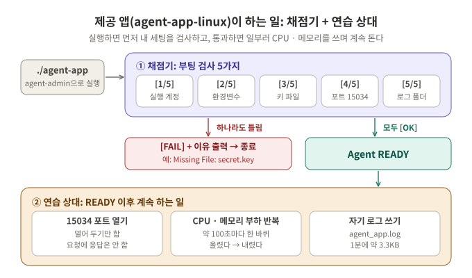

**한 줄 요약: 켤 때는 내 세팅을 채점하고, 켜진 뒤에는 monitor.sh가 잡아낼 거리를 일부러 만들어 주는 앱입니다.**

### 역할 ① 채점기: 부팅할 때 5가지를 검사

| 단계 | 검사하는 것 | 틀렸을 때 실제 출력 예 |
|---|---|---|
| [1/5] | root가 아닌 일반 계정으로 실행했나 | - |
| [2/5] | 환경변수 5개가 있고 값이 맞나 | `Key Path Mismatch. Expected: .../api_keys` |
| [3/5] | `api_keys/secret.key` 내용이 `agent_api_key_test` 인가 | `Missing File: secret.key` |
| [4/5] | 15034 포트가 비어 있나 | - |
| [5/5] | 로그 폴더(`/var/log/agent-app`)에 쓸 수 있나 | - |

앞 단계가 틀리면 뒤 단계는 `Skipped due to previous critical failure.`로 건너뛰고 `System Boot Failed`로 꺼집니다. 그래서 **[OK] 5개 = 계정 · 폴더 · 환경변수 세팅이 맞다는 증거**입니다.

### 역할 ② 연습 상대: READY 뒤에 계속 하는 일

| 하는 일 | 확인한 내용 | monitor.sh와의 관계 |
|---|---|---|
| 15034 포트 열기 | `0.0.0.0:15034 LISTEN`. `curl`로 요청하면 응답 없이 시간 초과 → **열어 두기만 하고 응답은 안 함** | "포트가 열려 있나" 점검 대상 |
| CPU · 메모리 부하 반복 | 아래 그림. 약 102초마다 한 바퀴 | CPU · MEM **경고가 실제로 뜨게** 만듦 |
| 우선순위 낮추기 | `[SafetyGuard] Process priority lowered (nice=10)` | 부하를 줘도 sshd, cron을 방해하지 않게 |
| 자기 로그 쓰기 | 화면과 `/var/log/agent-app/agent_app.log`에 1분에 약 3.3KB | 로그가 쌓이는 속도 문제 ([evaluation.md 4-3](evaluation.md#4-3-로그가-급증해-디스크가-가득-찰-위험이-있다면-운영자가-취할-대응단기중기은)) |

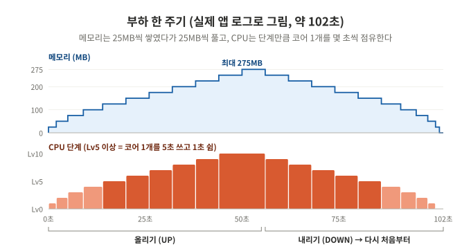

| 구간 | 메모리 | CPU |
|---|---|---|
| 올리기 (0~56초) | 단계마다 **+25MB**, 최대 약 275MB (`PEAK REACHED`) | 단계(Lv) 1→10. 단계마다 코어 1개를 Lv초(최대 5초) 쓰고 1초 쉼 |
| 내리기 (56~102초) | 단계마다 **-25MB**, 0MB까지 (`BOTTOM REACHED`) | 단계 9→0 |
| 그 뒤 | 처음부터 다시 반복 (Ctrl+C로 끌 때까지) | |

- **monitor.sh의 CPU 값이 매번 다른 이유:** monitor.sh는 1초만 잽니다. 그 1초가 앱이 코어를 쓰는 순간이면 높고, 쉬는 순간이면 낮습니다.
- **MEM 경고는 VM 메모리 크기에 따라 다릅니다.** 4GB VM인 내 환경에서는 `MEM 12.7% > 10%` 경고가 실제로 떴습니다([증거 7-2](images/evidence/7-2_monitor_ok.png)).

### 그 밖에

| 내용 | 설명 |
|---|---|
| 프로세스가 2개 | 파이썬 프로그램을 실행 파일 하나로 묶은 것(PyInstaller)이라 **부모가 압축을 풀고 자식이 실제로 일하며 포트를 엽니다.** 부모는 자식이 끝나면 함께 끝납니다 |
| 끄는 방법 | 실행한 터미널에서 Ctrl+C → `Stop signal received ... Shutting down gracefully` |
| SSH가 끊기면 | 그 창에서 실행 중이던 앱도 함께 종료됨 → 다시 접속해 다시 실행 |

---

## 3. 실습 환경: 왜 UTM VM인가

**과제는 UTM을 요구하지 않습니다.** 과제 문서에는 "Ubuntu 22.04 LTS 또는 동등 리눅스 환경(컨테이너/VM)"이라고만 되어 있어서, 과제 요구에서 **기준 5개**를 뽑아 비교했습니다.

| 기준 | 왜 필요한가 (과제 요구 근거) |
|---|---|
| ① 진짜 서버처럼 동작 (systemd) | sshd · ufw · cron이 **부팅할 때 서비스로 켜져야** 함 (SSH 재시작, 방화벽 "재부팅해도 켜짐", cron 1분마다) |
| ② 같은 CPU 종류로 빠르게 | Mac의 CPU와 같은 종류(Intel이면 x86, M칩이면 ARM)의 Ubuntu를 쓰면 번역(에뮬레이션) 없이 빠르게 돌아감 |
| ③ SSH가 잠겨도 콘솔로 복구 | SSH 포트와 방화벽을 바꾸는 과제라 실수하면 SSH로 못 들어감. VM 화면으로 직접 로그인해 고칠 수 있어야 함 |
| ④ 무료 | 과제에 비용을 쓰지 않기 위해 |
| ⑤ 평가 때 내 Mac에서 시연 | 앱 실행, monitor.sh, 로그 증가를 바로 보여 줄 수 있어야 함 |

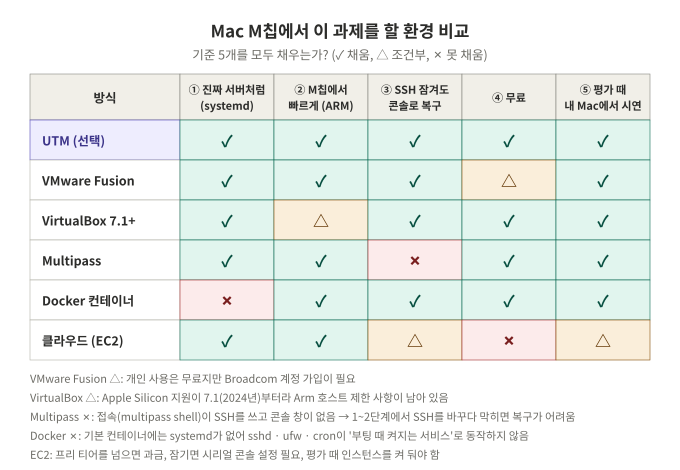

- 기준 5개를 모두 채우는 것은 **UTM**입니다. VMware Fusion, VirtualBox 7.1+도 충분합니다.
- **Docker 컨테이너를 쓰지 않은 이유:** 이 저장소를 만들 때 쓴 테스트 환경(systemd 없는 컨테이너 방식)에서, 다시 시작하면 sshd와 cron이 **꺼진 채로** 올라오고, 설정은 `ENABLED=yes`인데 `ufw status`는 **inactive**였습니다. 일반 VM에서는 systemd가 부팅 때 이 서비스들을 켜 주므로 이런 문제가 없습니다.

**내가 쓴 환경:** 교육장 iMac(Intel, x86_64) + UTM, Ubuntu Server 22.04.5 LTS (amd64), 메모리 4GB, 앱은 `agent-app-linux-x86`.

**VM 만드는 순서 (요약)**

| 순서 | 할 일 |
|---|---|
| 1 | UTM 설치 (mac.getutm.app에서 dmg를 받아 `~/Applications`에 복사. 인텔 Mac은 Homebrew 지원이 끝나 직접 받음) |
| 2 | Ubuntu Server 22.04 설치 파일: 인텔 Mac은 `...-live-server-amd64.iso`, M칩은 `...-live-server-arm64.iso` |
| 3 | UTM → `+` → **가상화(Virtualize)** → Linux → iso 선택. 메모리 4GB, 나머지 기본값 |
| 4 | Ubuntu 설치: 언어 English, Profile에서 만드는 계정이 "내 계정"(sudo 가능), **Install OpenSSH server 체크** |
| 5 | 설치 후 CD/DVD 꺼내기(Eject) → 재부팅 → `ip -4 addr show`로 주소 확인 (내 VM: `192.168.64.2`) |
| 6 | 이후 작업은 복사 · 붙여넣기가 되는 **Mac 터미널**에서 `ssh`로 접속해서 함 |

---

## 4. SSH와 방화벽

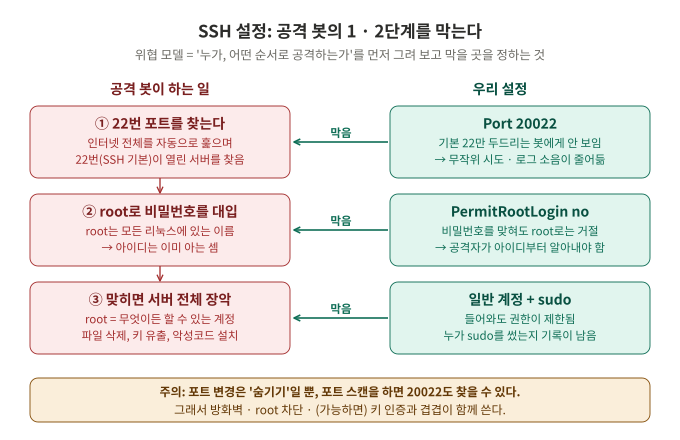

**위협 모델:** 인터넷에는 22번 포트에 `root` + 흔한 비밀번호를 자동으로 넣어 보는 봇이 많습니다. 문 번호를 바꾸면(20022) 무작위 시도가 줄고, root 접속을 막으면 비밀번호를 맞혀도 root로는 못 들어옵니다. 포트 변경은 "숨기기"일 뿐이라 방화벽 · root 차단과 **겹쳐서** 써야 의미가 있습니다.

**SSH 설정을 확인하는 3가지 방법**

| 확인 방법 | 무엇을 보나 |
|---|---|
| `grep -nE "^Port\|^PermitRootLogin" /etc/ssh/sshd_config` | 설정 **파일**에 적힌 값 |
| `sudo sshd -T` | sshd가 **실제로 쓰는** 최종 값 (다른 설정 파일에 덮여 있지 않은지) |
| `sudo ss -tlnp \| grep sshd` | sshd가 정말 **20022에서 기다리는지(LISTEN)** |

**잠기지 않게 하는 순서**
- 설정을 바꾼 뒤 **지금 연결된 창은 닫지 않고**, 새 창에서 `ssh -p 20022 ...`로 접속되는지 먼저 확인합니다.
- 방화벽은 **허용 명단(20022)을 먼저 넣고 맨 마지막에 켭니다.**
- Ubuntu 22.04는 `systemctl restart ssh`로 포트 변경이 적용됩니다. (22.10 이상은 ssh.socket 방식이라 추가 명령이 필요합니다.)

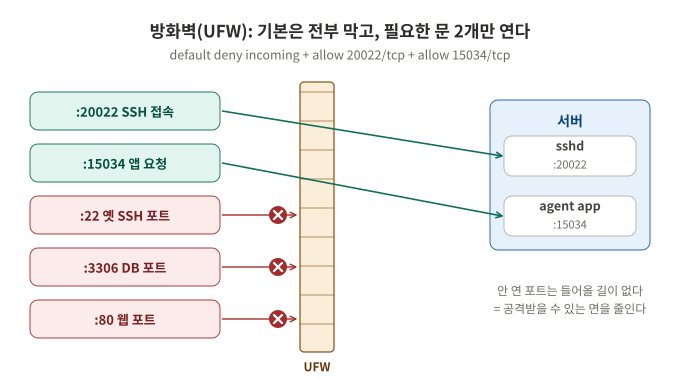

**방화벽 원칙:** "기본은 전부 막고(`default deny incoming`), 필요한 문만 연다." 열린 문이 적을수록 공격받을 곳(공격 면)이 줄어듭니다.

| 문 번호 | 누가 쓰나 | 용도 |
|---|---|---|
| 20022 | 나 (Mac 터미널) | SSH 접속 |
| 15034 | 앱 | 앱이 여는 문 |

---

## 5. 계정 · 그룹 · 권한

### 계정과 그룹

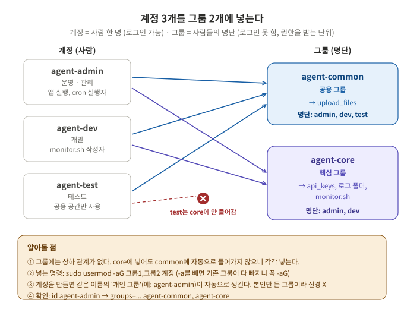

| | 계정 | 그룹 |
|---|---|---|
| 무엇 | **사람 한 명** | **사람들의 명단** |
| 로그인 | 할 수 있음 | 못 함 |
| 이 과제 | agent-admin, agent-dev, agent-test | agent-common, agent-core |

- **왜 그룹이 필요한가:** 파일마다 권한 칸이 **[주인 1명] [그룹 1개] [나머지]** 3칸뿐입니다. "admin과 dev는 되고 test는 안 됨"을 하려면 둘이 든 그룹을 그룹 칸에 넣어야 합니다. "나머지" 칸을 열면 test까지 들어옵니다.
- **그룹에는 상하 관계가 없습니다.** core에 넣었다고 common에 자동으로 들어가지 않으므로 admin · dev는 두 그룹에 각각 넣습니다.
- 계정을 만들면 **같은 이름의 개인 그룹**이 자동으로 생깁니다(그래서 시스템에는 그룹이 5개). 과제에서 쓰는 그룹은 common, core **2개**입니다.
- `usermod`는 꼭 `-aG`로 씁니다. `-a` 없이 `-G`만 쓰면 기존 그룹이 다 빠집니다.

### 권한 숫자 · setgid · ACL

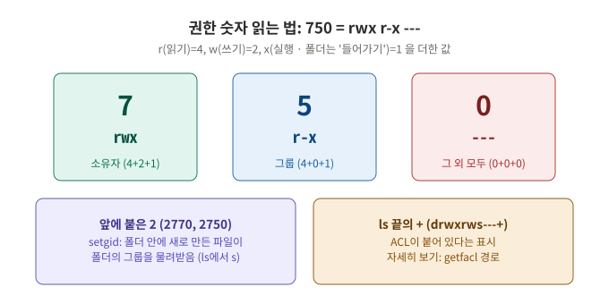

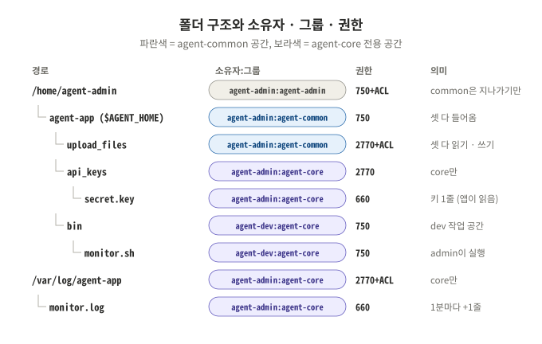

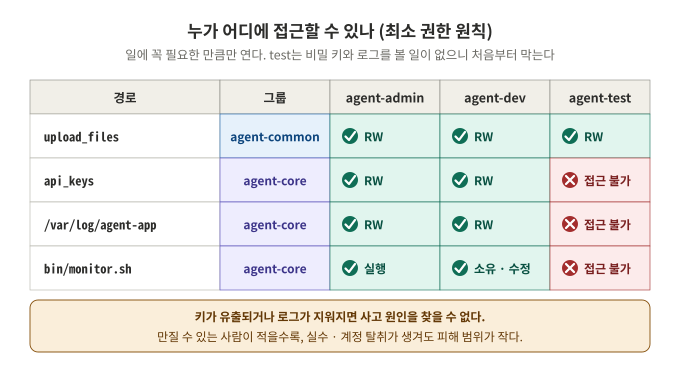

| 설정 | 왜 필요한가 |
|---|---|
| 홈 폴더 ACL `g:agent-common:x` | Ubuntu 홈 폴더는 `750`이라 dev · test는 `/home/agent-admin` 안으로 들어갈 수조차 없음. common에게 **지나가기(x)만** 허용 (목록 보기는 불가) |
| `2770`의 앞자리 **2 (setgid)** | 누가 파일을 만들든 **폴더의 그룹**을 물려받음. 없으면 만든 사람의 개인 그룹이 되어 다른 사람이 못 씀 |
| 끝자리 **0** | 그룹 밖의 사람은 아예 못 들어옴 → test는 api_keys, 로그 폴더 불가 |
| **기본 ACL** (`setfacl -d`) | 새 파일은 보통 그룹이 읽기만 가능하게 생김. 기본 ACL을 두면 새 파일도 그룹이 **쓰기**까지 가능 → "R/W 가능" 요구 충족 |
| `bin`의 주인 **agent-dev** | monitor.sh 작성자가 dev이므로 dev가 이 폴더에 파일을 만들 수 있어야 함 |
| `ls`의 `+` 표시 | 그 폴더에 ACL이 걸려 있다는 뜻. 자세히는 `getfacl` |

**최소 권한 원칙:** 일에 꼭 필요한 만큼만 연다. 키가 새거나 로그가 지워지면 사고 원인을 찾을 수 없으므로, 만질 수 있는 사람(core)을 줄여 실수 · 계정 탈취의 피해 범위를 좁힙니다.

> 참고: arang(내 계정)은 common도 core도 아니어서 `getfacl .../upload_files`가 `Permission denied`로 막혔습니다. 바깥 사람은 막힌다는 뜻이라 정상이며, `sudo getfacl`로 확인했습니다.

---

## 6. 환경변수와 키 파일

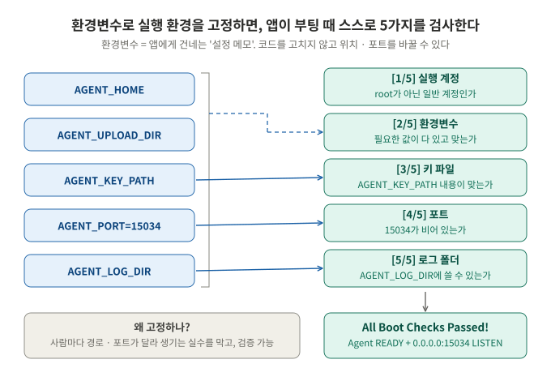

환경변수는 앱에게 건네는 설정 메모입니다. 경로와 포트를 코드에 박지 않고 환경변수로 주면 **누가 실행해도 같은 환경**이 되고 `env` 명령 하나로 **검증**할 수 있습니다. 값이 틀리면 앱이 시작 전에 정확히 어디가 틀렸는지 알려 줍니다.

### 과제 문서와 실제 앱이 다른 곳 2개

| | 과제 문서 | 실제 앱이 검사하는 값 | 문서대로 하면 |
|---|---|---|---|
| `AGENT_KEY_PATH` | `$AGENT_HOME/api_keys/t_secret.key` (파일) | `$AGENT_HOME/api_keys` (**폴더**) | `[2/5] FAIL` `Key Path Mismatch. Expected: .../api_keys` |
| 키 파일 이름 | `t_secret.key` | `secret.key` | `[3/5] FAIL` `Missing File: secret.key` |

성공 기준이 "Boot 5단계 [OK]"이므로 **앱이 검사하는 값을 따랐습니다.** 과제 문서의 `t_secret.key`도 같은 내용으로 만들어 두었지만 앱은 읽지 않습니다.

### cron에서는 환경변수가 비어 있다

Ubuntu의 `~/.bashrc`는 맨 위에서 "사람이 직접 쓰는 셸이 아니면 읽지 않고 끝"하도록 되어 있습니다. 그래서 cron으로 실행할 때는 `AGENT_PORT` 같은 값이 없습니다. monitor.sh가 `${AGENT_PORT:-15034}`처럼 **기본값**을 둔 이유입니다.

### 앱이 [OK]를 안 줄 때 먼저 볼 곳

| 단계 | 먼저 볼 곳 |
|---|---|
| [1/5] | `whoami`가 agent-admin인가 (root나 arang으로 실행하지 않았나) |
| [2/5] | `env \| grep AGENT_` 값. 특히 `AGENT_KEY_PATH`가 **폴더**인가 |
| [3/5] | `cat $AGENT_KEY_PATH/secret.key` 내용이 정확히 `agent_api_key_test` 인가 |
| [4/5] | `sudo ss -ltnp \| grep 15034` 예전에 띄운 앱이 아직 쓰고 있지 않나 |
| [5/5] | `ls -ld /var/log/agent-app` 그룹 agent-core, 권한 `rws` 인가 |

---

## 7. monitor.sh

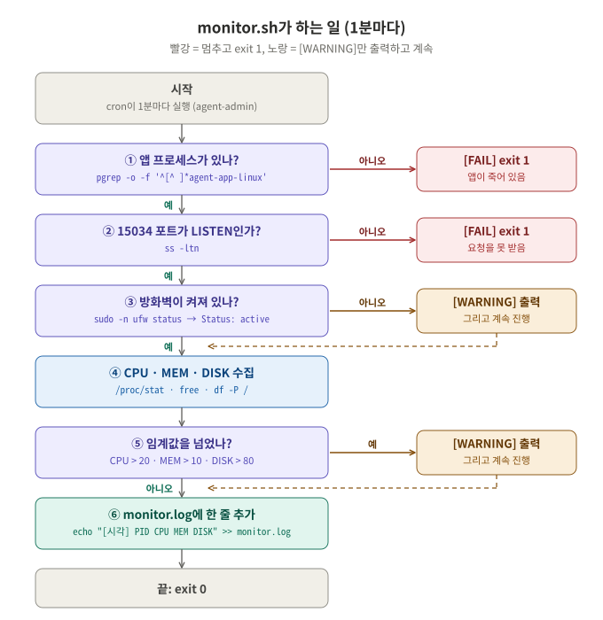

**설계:** 멈춰야 하는 문제(앱 죽음, 포트 닫힘)는 `exit 1`, 알려만 줄 문제(방화벽 꺼짐, 자원 많이 씀)는 `[WARNING]`만 출력하고 기록까지 계속합니다.

### 쓴 명령과 이유

| 순서 | 무엇을 | 쓴 명령 | 왜 이 명령 |
|---|---|---|---|
| ① | 앱 프로세스 | `pgrep -o -f '^[^ ]*agent-app-linux'` | 결과가 바로 **PID**. `^[^ ]*` = 명령줄의 **첫 단어**가 앱일 때만 → `vim agent-app-linux-x86`처럼 이름만 들어간 프로세스는 안 걸림. `-o` = 부모 · 자식 중 먼저 뜬 부모 |
| ② | 15034 LISTEN | `ss -ltn` → 4번째 칸이 `:15034`로 끝나는지 | Ubuntu 기본 설치. `-l` LISTEN만, `-t` TCP만, `-n` 숫자로 |
| ③ | 방화벽 | `sudo -n /usr/sbin/ufw status` → `Status: active` | 실제로 켜졌는지 보는 정확한 방법. sudoers로 이 명령 하나만 허용. `-n` = 비밀번호 묻지 않음 |
| ④ | CPU | `/proc/stat`을 1초 간격 두 번 읽기 | 부팅 후 누적값이라 두 번 읽은 **차이**로 "그 1초 동안 쉬지 않은 비율" 계산 |
| ④ | MEM | `free` → used / total × 100 | Mem 줄 한 줄이면 끝 |
| ④ | DISK | `df -P /` → Use% | `-P`는 한 줄 출력 고정 → 칸 위치가 항상 같음 |
| ⑤ | 임계값 | `awk`로 소수 비교 | bash의 `[ ]`는 정수만 비교 가능 |
| ⑥ | 기록 | `echo "..." >> monitor.log` | `>>` = 이어쓰기. `>`는 매번 덮어써서 과거 기록이 사라짐 |

**로그 포맷:** `[YYYY-MM-DD HH:MM:SS] PID:... CPU:..% MEM:..% DISK_USED:..%`. 한 줄 = 한 번의 측정, 칸 순서가 고정이라 `grep`(시각 찾기), `awk`(평균)로 바로 꺼내 쓸 수 있습니다.

### 권한 정책 (만든 사람과 돌리는 사람 분리)

| 누가 | 권한 칸 (`750`) | 할 수 있는 것 |
|---|---|---|
| agent-dev (주인) | `rwx` | 읽기, **수정**, 실행 |
| agent-admin (agent-core) | `r-x` | 읽기, **실행** → cron이 돌릴 수 있음. 수정은 불가 |
| agent-test (그 외) | `---` | 실행도 불가 (`Permission denied`) |

### 방화벽 확인에만 sudo를 쓴 이유

- `ufw status`는 **root만** 실행할 수 있고, monitor.sh를 실행하는 agent-admin은 sudo 권한이 없습니다.
- 그래서 `/etc/sudoers.d/agent-monitor`에 `%agent-core ALL=(root) NOPASSWD: /usr/sbin/ufw status` **한 줄만** 넣었습니다. 인자까지 정확히 같아야 해서 `ufw status verbose`나 `ufw disable`은 거절됩니다(내 VM에서 시험함).
- 설정 파일 `/etc/ufw/ufw.conf`의 `ENABLED=yes`를 읽으면 sudo 없이 되지만, 이건 "켜기로 **설정**됨"일 뿐입니다. 테스트 환경에서 `ENABLED=yes`인데 `ufw status`는 `inactive`인 상태를 실제로 겪었고, 그대로 두면 방화벽이 꺼졌는데 `[OK]`가 나옵니다.

### 테스트 환경에서 추가로 확인한 것

| 시험 | 결과 |
|---|---|
| 처음 쓴 단순 패턴 `pgrep -f agent-app-linux` | 앱을 띄운 셸 `bash -c "... ./agent-app-linux-x86"`의 PID가 잡힘 → 첫 단어 패턴으로 수정 |
| 앱을 끄고 이름만 들어간 미끼 프로세스를 띄움 | 수정한 패턴은 미끼를 무시하고 `[FAIL] exit=1` |
| `sleep`을 앱 이름으로 띄움 (프로세스는 있는데 포트 없음) | `Checking port 15034... [FAIL] not listening`, `exit=1` |

---

## 8. cron과 logrotate

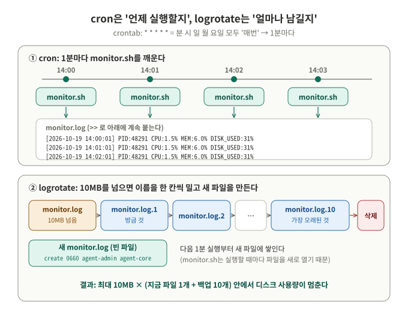

### cron 줄 읽는 법

```text
* * * * * /home/agent-admin/agent-app/bin/monitor.sh > /dev/null 2>&1
```

| 부분 | 뜻 |
|---|---|
| `* * * * *` | 분 · 시 · 일 · 월 · 요일이 모두 "매번" → **1분마다** |
| 전체 경로 | cron은 내 셸과 환경이 달라서 전체 경로를 씀 |
| `> /dev/null 2>&1` | 화면 출력은 버림. 기록은 monitor.sh가 monitor.log에 직접 남김 |

- 로그 시각이 매분 `:02`초 근처인 이유: cron이 매분 0초에 깨우고, CPU 측정에 1초 쉬기 때문입니다.
- **앱이 꺼져 있으면** cron이 실행해도 `[FAIL]`로 바로 끝나서 로그가 쌓이지 않습니다.

### logrotate 설정 해설

```text
/var/log/agent-app/monitor.log {
    size 10M                            # 10MB를 넘으면 자른다
    rotate 10                           # 예전 파일 .1 ~ .10 까지만 남기고 더 오래된 건 삭제
    missingok                           # 파일이 없어도 에러 내지 않음
    notifempty                          # 빈 파일은 자르지 않음
    create 0660 agent-admin agent-core  # 새 monitor.log의 주인 · 권한 (core 정책 유지)
    su agent-admin agent-core           # 이 계정 권한으로 작업 (로그 폴더가 root 소유가 아니라서 필요)
}
```

| 알아둘 점 | 내용 |
|---|---|
| 동작 | 10MB를 넘으면 `monitor.log` → `monitor.log.1`, 예전 것은 한 칸씩 밀리고 `.10`을 넘는 것은 삭제, 새 빈 monitor.log 생성 |
| 언제 검사하나 | logrotate는 하루 한 번 자동 실행 |
| 하루 한 번이면 충분한가 | 한 줄 약 65바이트 × 1,440분 ≈ 하루 94KB → 10MB까지 약 100일 |
| 왜 스크립트가 아니라 logrotate | Ubuntu 기본 도구라 이미 매일 돌고 있고, 설정 6줄로 끝남 |
| 확인 방법 | `sudo logrotate -d`: 판단만 출력 / `sudo logrotate -f`: 크기와 상관없이 지금 한 번 돌림 |
| 테스트 환경 검증 | 11MB 로그를 만들어 12번 돌린 결과, monitor.log + `.1` ~ `.10` (11개)만 남음 |
