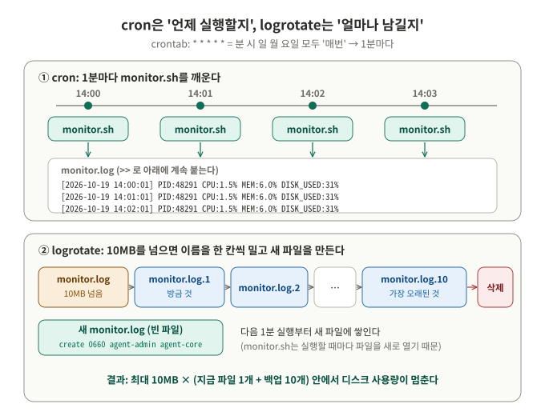
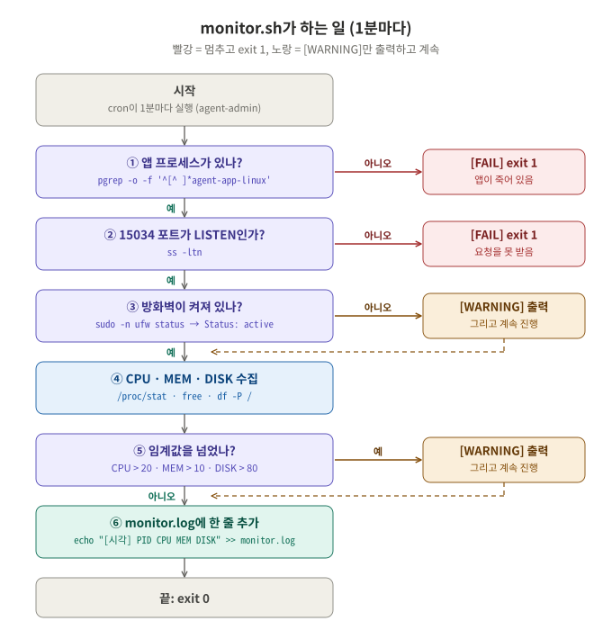
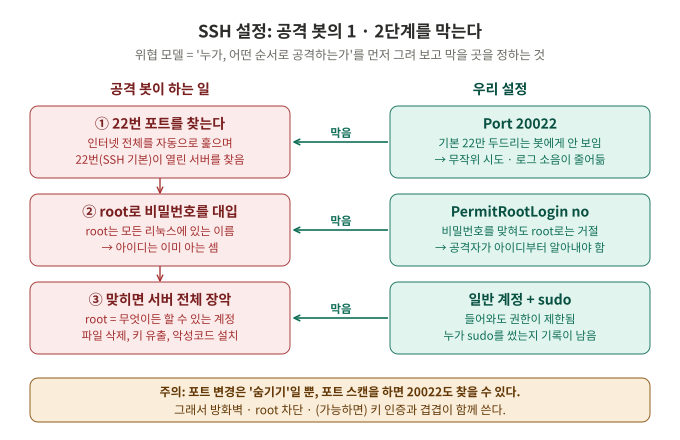
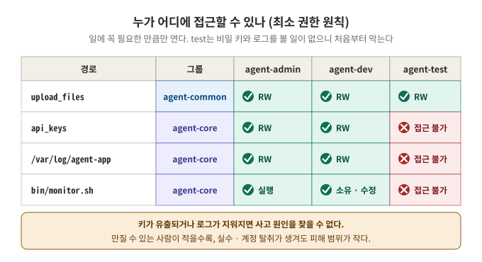
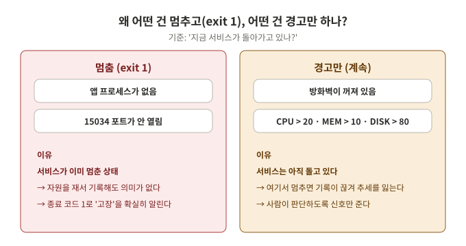
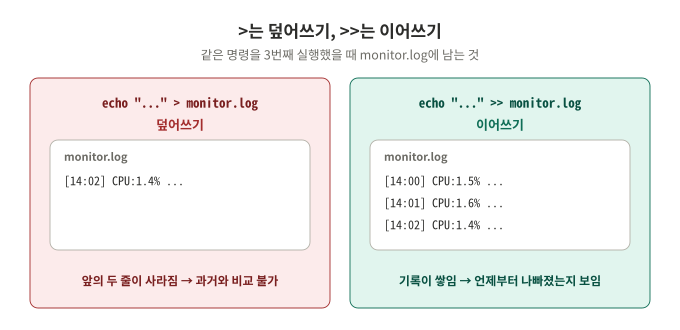
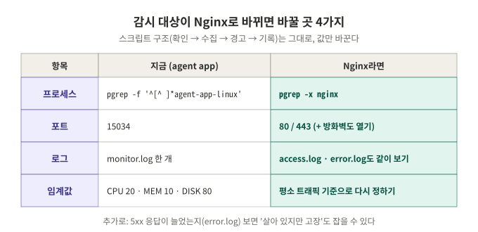
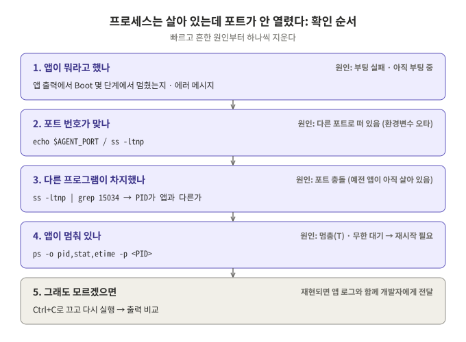
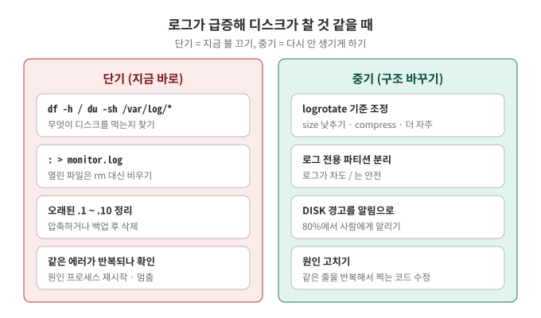

# 피어 평가 정리 (평가표 항목 1~4)

평가 질문마다 **보여줄 곳**과 **말하기 예시**를 정리했습니다. 말하기는 외우지 말고 흐름만 잡아 본인 말로 합니다.

[← README](../README.md) · [monitor.sh](../bin/monitor.sh) · [logrotate 설정](../config/logrotate-agent-app)

---

## 평가 진행 순서 (시연)

[README 한눈에 보기](../README.md#한눈에-보기) 그림으로 전체를 보여주고, 아래 순서로 터미널에서 직접 확인합니다.

| 순서 | 할 것 (터미널) | 답하는 평가 질문 |
|---|---|---|
| 1 | `sudo sshd -T \| grep -E "^port \|^permitrootlogin "`, `sudo ss -tulnp \| grep sshd` | 항목 1-1, 3-1 |
| 2 | `sudo ufw status verbose` | 항목 1-2 |
| 3 | `id agent-admin`, `id agent-dev`, `id agent-test` | 항목 1-3 |
| 4 | `ls -ld` + `getfacl` + `sudo -u agent-test cat .../t_secret.key` (거절) | 항목 1-3, 3-2 |
| 5 | 터미널 1: agent-admin으로 앱 실행 → Boot 5단계 [OK], Agent READY | 항목 1-4 |
| 6 | 터미널 2: `monitor.sh; echo "exit=$?"` → exit=0. 앱 Ctrl+C 후 다시 → exit=1 | 항목 1-5, 2-1, 3-3 |
| 7 | 앱 다시 실행 → `crontab -l`, `tail -f /var/log/agent-app/monitor.log` 로 1분마다 늘어나는 것 보기 | 항목 1-6, 1-7, 3-4 |
| 8 | `cat /etc/logrotate.d/agent-app`, `sudo logrotate -f ...` 후 `ls -l /var/log/agent-app` | 항목 1-8, 2-4 |
| 9 | 아래 항목 2~4 질문에 그림을 보며 답변 | 항목 2~4 |

---

## 항목 1. 결과물이 요구사항을 채우는가

| # | 평가 질문 | 상태 | 확인 명령 | 보여줄 곳 |
|---|---|---|---|---|
| 1-1 | SSH 포트 20022, Root 원격 접속 차단 | ✅ | `sudo sshd -T \| grep -E "^port \|^permitrootlogin "` → `port 20022`, `permitrootlogin no` | [README 1단계](../README.md#1단계-ssh-잠그기-포트-20022-root-원격-접속-차단) |
| 1-2 | 방화벽(UFW) 활성, 20022/tcp · 15034/tcp만 허용 | ✅ | `sudo ufw status verbose` → `Status: active`, 허용 2줄 | [README 2단계](../README.md#2단계-방화벽-켜기-20022tcp-15034tcp만-허용) |
| 1-3 | 계정 3개, 그룹 agent-common/core 구성 | ✅ | `id agent-test` → agent-common만 | [README 3단계](../README.md#3단계-계정--그룹-만들기), [4단계](../README.md#4단계-폴더--권한-정하기-공유-폴더-vs-보안-폴더) |
| 1-4 | Boot Sequence 5단계 [OK], Agent READY | ✅ | 앱 실행 화면 + `ss -ltn \| grep 15034` | [README 6단계](../README.md#6단계-앱-실행-boot-sequence-5단계-ok) |
| 1-5 | monitor.sh가 프로세스/포트 점검, 비정상 시 exit 1 | ✅ | 앱을 끄고 `monitor.sh; echo "exit=$?"` → `exit=1` | [README 7단계 실행 확인 4, 5](../README.md#7단계-monitorsh-만들기) |
| 1-6 | monitor.log가 지정 포맷으로 누적 | ✅ | `tail -5 /var/log/agent-app/monitor.log` | [README 8-1](../README.md#8-1-cron-등록-agent-admin의-crontab) |
| 1-7 | cron 매분 실행으로 자동 증가 | ✅ | `crontab -l`, `wc -l` 1분 간격 비교 | [README 8-1](../README.md#8-1-cron-등록-agent-admin의-crontab) |
| 1-8 | 용량관리(10MB/10개) 설정 + 동작 설명 | ✅ logrotate | `cat /etc/logrotate.d/agent-app` | [README 8-2](../README.md#8-2-logrotate로-10mb--10개-관리), 아래 그림 |

**1-8 동작 설명**



> "logrotate가 하루 한 번 monitor.log 크기를 봅니다. 10MB를 넘었으면 `monitor.log`를 `monitor.log.1`로, `.1`은 `.2`로 … 한 칸씩 밀고, `.10`을 넘는 가장 오래된 파일은 지웁니다. 그리고 `create` 설정대로 agent-admin:agent-core, 660 권한의 빈 monitor.log를 만듭니다. monitor.sh는 실행할 때마다 `>>`로 파일을 새로 열기 때문에, 다음 1분부터는 새 파일에 자연스럽게 이어서 씁니다."

---

## 항목 2. 구현 방식을 설명할 수 있는가

### 2-1. 프로세스 식별 · 포트 확인에 쓴 명령과 선택 이유

**보여줄 곳**: [monitor.sh](../bin/monitor.sh) ①②, [README 7단계 표](../README.md#7단계-monitorsh-만들기)



| 무엇 | 쓴 명령 | 고른 이유 | 고르지 않은 것 |
|---|---|---|---|
| 프로세스 | `pgrep -o -f 'agent_app.py\|agent-app-linux'` | 결과가 **PID 숫자 하나**라서 비었는지만 보면 됨. `-f`로 명령줄 전체를 보니 `python3 agent_app.py`와 실행 파일 둘 다 찾음 | `ps aux \| grep` → grep 자기 자신이 걸려서 한 번 더 걸러야 함 |
| 포트 | `ss -ltn` → 4번째 칸이 `:15034`로 끝나는 줄 | Ubuntu 기본 설치, `-l`(LISTEN만) `-t`(TCP만) `-n`(숫자로) 로 원하는 것만 나옴 | `netstat` → 기본 설치가 아니고(net-tools) 예전 도구 |

> **말하기**: "앱이 살아 있는지는 pgrep으로 봤습니다. 결과가 PID 하나로 나와서 비어 있으면 죽은 것이고, 그 PID를 로그에도 그대로 씁니다. 포트는 ss -ltn으로 LISTEN 중인 TCP 포트만 보고, 주소 칸이 :15034로 끝나는 줄이 있는지 확인했습니다. 둘 중 하나라도 없으면 exit 1로 끝냅니다."

> **주의한 점**: pgrep 패턴에 `agent-app`처럼 짧은 이름을 쓰면, monitor.sh의 경로(`/home/agent-admin/agent-app/bin/monitor.sh`)에도 같은 글자가 있어 **스크립트 자신이 앱으로 잡힙니다.** 그래서 `agent_app.py`, `agent-app-linux` 처럼 앱에만 있는 이름을 썼습니다.

### 2-2. CPU · MEM · DISK 추출 방법, 로그 포맷을 고정한 이유

**보여줄 곳**: [monitor.sh](../bin/monitor.sh) ④⑥

| 값 | 어디서 | 어떻게 계산 |
|---|---|---|
| CPU | `/proc/stat`의 `cpu` 줄 | 부팅 후 누적 시간이라 **1초 간격으로 두 번** 읽고, (전체 증가량 − 쉰 시간 증가량) ÷ 전체 증가량 × 100 |
| MEM | `free`의 `Mem:` 줄 | used ÷ total × 100 (소수 1자리) |
| DISK | `df -P /`의 2번째 줄 | Use% 칸에서 `%`를 뺀 숫자 (`-P`로 줄바꿈 없는 고정 형식) |

```text
[2026-10-19 01:38:02] PID:1550 CPU:1.0% MEM:5.9% DISK_USED:31%
```

> **말하기**: "CPU는 /proc/stat을 1초 간격으로 두 번 읽어서 그 사이 쉬지 않은 비율을 구했습니다. top 출력은 숫자가 100이 되면 칸이 붙어 버려 파싱이 깨질 수 있어서 피했습니다. 메모리는 free의 used/total, 디스크는 df -P로 루트의 Use%를 썼습니다.
> 로그는 한 줄에 한 번의 측정, 칸 순서를 항상 같게 고정했습니다. 그래야 grep으로 특정 시각을 찾고, awk로 평균을 내는 등 **사람이 아니라 프로그램도 읽을 수 있는 데이터**가 됩니다. 시각을 맨 앞에 둬서 정렬하면 시간순이 됩니다."

### 2-3. 소유자(agent-dev)와 실행자(agent-admin, cron) 권한 정책

**보여줄 곳**: `ls -l /home/agent-admin/agent-app/bin/monitor.sh`, [README 7단계 표](../README.md#7단계-monitorsh-만들기)

```console
-rwxr-x--- 1 agent-dev agent-core 4440 Oct 19 01:26 monitor.sh
```

| 칸 | 대상 | 결과 |
|---|---|---|
| `rwx` 소유자 | agent-dev | 작성자라 수정 가능 |
| `r-x` 그룹 | agent-core (admin 포함) | admin은 **읽고 실행만** → cron 실행 가능, 수정은 불가 |
| `---` 그 외 | agent-test | 실행도 불가 (`Permission denied`) |

> **말하기**: "만든 사람(dev)과 돌리는 사람(admin)을 나눴습니다. 소유자는 agent-dev, 그룹은 agent-core, 권한 750이라서 dev는 고칠 수 있고, admin은 agent-core 그룹이라 읽기·실행만 됩니다. 그래서 admin의 crontab이 이 파일을 실행할 수 있고, 운영 중에 실수로 스크립트를 바꾸는 일은 없습니다. bin 폴더도 agent-dev:agent-core 750이라 test는 폴더 안으로 들어갈 수조차 없습니다."

### 2-4. 용량 기반 로그 관리(10MB/10개) 구현 방식

**보여줄 곳**: [config/logrotate-agent-app](../config/logrotate-agent-app) (= `/etc/logrotate.d/agent-app`)

| 설정 | 의미 |
|---|---|
| `size 10M` | 10MB 넘으면 돌림 |
| `rotate 10` | 예전 파일 `.1` ~ `.10` 까지만 보관 |
| `create 0660 agent-admin agent-core` | 새 파일도 core 정책 그대로 |
| `su agent-admin agent-core` | 로그 폴더가 root 소유가 아니라서, 이 사용자 권한으로 작업 (안 쓰면 logrotate가 보안 경고를 내고 거부) |

> **말하기**: "스크립트로 직접 파일 크기를 재고 이름을 바꿀 수도 있지만, Ubuntu에는 logrotate가 이미 매일 돌고 있어서 설정 파일 하나만 추가했습니다. size 10M, rotate 10이 요구사항 그대로입니다. 한 줄이 약 65바이트라 하루 94KB 정도 쌓이므로 하루 한 번 검사로 충분합니다. `logrotate -d`로 판단만 미리 볼 수 있고, `-f`로 강제로 한 번 돌려 확인했습니다."

---

## 항목 3. 개념을 설명할 수 있는가

### 3-1. SSH 포트 변경과 Root 차단이 왜 효과적인가 (위협 모델)



> **말하기**: "위협 모델은 '누가, 어떤 순서로 공격하나'를 먼저 그려 보는 것입니다. 가장 흔한 공격은 봇이 인터넷을 훑어 22번 포트를 찾고, 모든 리눅스에 있는 root 계정에 비밀번호를 대입하는 것입니다.
> 포트를 20022로 바꾸면 22번만 두드리는 대량 봇의 시도가 크게 줄고, PermitRootLogin no로 막으면 비밀번호를 맞혀도 root로는 못 들어옵니다. 공격자는 아이디부터 알아내야 하고, 들어와도 일반 권한이며, sudo를 쓰면 기록이 남습니다.
> 다만 포트 변경은 숨기기일 뿐이라 포트 스캔으로 찾을 수 있습니다. 그래서 방화벽, root 차단과 **겹쳐서** 써야 의미가 있습니다."

### 3-2. api_keys와 로그 폴더를 agent-core로 제한한 이유 (최소 권한 원칙)



> **말하기**: "최소 권한 원칙은 '일에 꼭 필요한 만큼만 권한을 준다'입니다. agent-test는 테스트 파일만 다루면 되니 upload_files만 있으면 됩니다.
> api_keys가 새면 외부 서비스가 도용되고, 로그가 지워지거나 조작되면 장애나 침입의 원인을 찾을 수 없습니다. 그래서 운영을 책임지는 admin과 dev만 있는 agent-core로 막았습니다.
> 이렇게 하면 test 계정이 실수하거나 탈취당해도 키와 로그까지는 피해가 번지지 않습니다. 실제로 test로 키를 읽으면 Permission denied가 나옵니다."

### 3-3. '경고만 하고 종료하지 않는 항목'을 분리한 운영상 이유



> **말하기**: "기준은 '지금 서비스가 돌아가고 있나'입니다. 앱 프로세스가 없거나 포트가 안 열렸으면 서비스가 이미 멈춘 것이라 자원을 재 봐야 의미가 없고, exit 1로 확실히 실패를 알립니다. 종료 코드가 1이면 다른 도구(알림, 재시작 스크립트)가 감지할 수 있습니다.
> 반대로 방화벽이 꺼졌거나 CPU가 높아도 서비스는 돌고 있습니다. 여기서 멈추면 **기록이 끊겨서** '언제부터 나빠졌나'를 볼 수 없게 됩니다. 그래서 경고만 출력하고 기록은 계속합니다."

### 3-4. 리다이렉션 (덮어쓰기 vs 이어쓰기)



| 기호 | 동작 | 파일이 없으면 |
|---|---|---|
| `>` | 파일을 **비우고** 새로 쓴다 | 새로 만든다 |
| `>>` | 파일 **끝에 이어** 쓴다 | 새로 만든다 |

> **말하기**: "`>`는 덮어쓰기라 실행할 때마다 앞의 기록이 사라지고 마지막 한 줄만 남습니다. `>>`는 이어쓰기라 1분마다 한 줄씩 쌓입니다. 모니터링 로그의 가치는 **과거와 비교하는 것**이라서, 장애가 났을 때 그 직전 몇 분의 CPU · 메모리 흐름을 보려면 반드시 쌓여 있어야 합니다. 그래서 `>>`를 썼습니다.
> 참고로 crontab의 `> /dev/null`은 화면 출력을 버리는 것이고, 기록은 스크립트 안의 `>>`가 따로 남깁니다."

---

## 항목 4. 응용할 수 있는가

### 4-1. 모니터링 대상이 Nginx로 바뀐다면 바꿀 핵심 포인트



> **말하기**: "스크립트 구조(확인 → 수집 → 경고 → 기록)는 그대로 두고 위쪽 설정값만 바꿉니다.
> 프로세스는 `pgrep -x nginx`(master 프로세스), 포트는 80과 443 두 개를 확인하고 방화벽도 80/443을 열어야 합니다.
> 로그는 monitor.log 말고도 Nginx 자체의 access.log, error.log를 같이 봐야 합니다. 프로세스와 포트가 멀쩡해도 error.log에 5xx가 쌓이면 '살아 있지만 고장'이기 때문입니다.
> 임계값은 웹 서버는 트래픽에 따라 CPU가 높은 게 정상일 수 있어서, 평소 값을 며칠 기록해 보고 다시 정합니다."

### 4-2. "프로세스는 살아있는데 포트가 안 열리는" 상황: 원인 후보와 확인 순서



| 원인 후보 | 확인 명령 |
|---|---|
| 아직 부팅 중이거나 Boot 단계에서 실패 | 앱 출력에서 몇 번째 [OK]까지 나왔는지 |
| 다른 포트로 떠 있음 (환경변수 오타) | `echo $AGENT_PORT`, `ss -ltnp` 전체 보기 |
| 다른 프로그램이 15034를 차지 (포트 충돌) | `ss -ltnp \| grep 15034` → PID가 앱과 다름 |
| 앱이 멈춤 (정지 · 무한 대기) | `ps -o pid,stat,etime -p <PID>` → stat이 T 등 |

> **말하기**: "빠르고 흔한 원인부터 지웁니다. 먼저 앱이 남긴 출력을 보고, 다음은 포트 번호가 맞는지, 그다음 다른 프로그램이 그 포트를 쓰고 있는지, 마지막으로 앱이 멈춰 있는지 봅니다. 실제로 monitor.sh 테스트에서 프로세스는 있는데 포트를 안 연 경우 `[FAIL] not listening`과 exit 1이 나오는 것을 확인했습니다. ([README 실행 확인 5](../README.md#7단계-monitorsh-만들기))"

### 4-3. 로그가 급증해 디스크가 가득 찰 위험: 단기 / 중기 대응



> **말하기**: "단기로는 먼저 `df -h`, `du -sh`로 무엇이 큰지 찾고, 지금 쓰고 있는 로그는 rm 대신 `: > 파일`로 비웁니다. 열려 있는 파일을 rm하면 프로세스가 계속 잡고 있어서 공간이 바로 돌아오지 않기 때문입니다. 오래된 .1~.10은 압축하거나 백업 후 지우고, 같은 에러가 반복되면 원인 프로세스를 재시작합니다.
> 중기로는 logrotate 기준을 낮추거나 압축을 켜고, 로그를 별도 파티션으로 분리해 로그가 차도 시스템 전체가 멈추지 않게 합니다. monitor.sh의 DISK 80% 경고를 알림으로 연결하고, 근본적으로는 로그를 쏟아내는 코드를 고칩니다."
