# 평가표 기준 정리 (항목 1~4)

평가표 질문 순서 그대로, 질문마다 **① 묻는 것 → ② 쉬운 설명 → ③ 실행해서 보여주기 → ④ 말하기**로 정리했습니다. 위에서부터 하나씩 설명하고 실행하면 됩니다. 말하기는 외우지 말고 흐름만 잡아 본인 말로 합니다.

[← README](../README.md) · [단계별 수행 내역](steps.md) · [개념과 배경](concepts.md) · [monitor.sh](../bin/monitor.sh)

| 표시 | 어디서 실행 | 프롬프트 |
|---|---|---|
| `[Mac]` | Mac 터미널 | `codewhite77770105@cx2r6s7 ~ %` |
| `[탭 1]` | VM, agent-admin (앱 전용 창) | `agent-admin@b4-1:~/agent-app$` |
| `[탭 2]` | VM, arang (확인용 창) | `arang@b4-1:~/codyssey_B4-1$` |

> 명령을 치기 전에 **마지막 줄의 프롬프트**로 위치를 확인하세요. Mac에서 `sudo`를 치면 Mac 관리자 비밀번호를 묻습니다.

---

## 0. 준비 (평가 시작 전 3분)

```bash
open ~/Applications/UTM.app                 # [Mac] b4-1이 멈춰 있으면 ▶, 1분 대기
```

**탭 1: 앱 켜기**
```bash
ssh -p 20022 arang@192.168.64.2             # [Mac]
sudo -iu agent-admin
cd $AGENT_HOME
./agent-app-linux-x86                       # Boot 5단계 [OK] → Agent READY. 이 창은 그대로 둠
```

**탭 2: 확인용 창** (Mac 터미널에서 ⌘T)
```bash
ssh -p 20022 arang@192.168.64.2             # [Mac]
cd ~/codyssey_B4-1
sudo -v                                     # arang 비밀번호를 미리 넣어 둠 (15분간 다시 안 물음)
```

전체 흐름을 먼저 보여 주려면 [README](../README.md)의 그림과 결과 요약표로 시작합니다.

---

# 항목 1. 결과물이 요구사항대로 동작하는가

## 1-1. SSH 포트가 20022로 변경되었고, Root 원격 접속이 차단되는가?

**① 묻는 것:** 설정 파일만 고친 게 아니라 실제로 적용되고 동작하는지

**② 쉬운 설명:** SSH = 원격으로 들어오는 문, 포트 = 문 번호. 문을 22 → 20022로 옮기고, 최고 관리자(root)는 원격으로 못 들어오게 막았습니다.

**③ 실행해서 보여주기**
```bash
sudo sshd -T | grep -E "^port |^permitrootlogin "        # [탭 2]
```
✅ `port 20022`, `permitrootlogin no` → sshd가 **실제로 쓰는** 규칙

```bash
sudo ss -tlnp | grep sshd                                 # [탭 2]
```
✅ `LISTEN ... 0.0.0.0:20022 ... "sshd"` → 20022번 문이 **실제로 열림**

```bash
ssh -p 20022 root@192.168.64.2                            # [Mac] 새 탭, 비밀번호는 아무거나
```
✅ `Permission denied` → root는 **실제로 거절** (Ctrl+C로 빠져나옴)

**④ 말하기**
> "sshd_config에서 Port를 20022로, PermitRootLogin을 no로 바꿨습니다. 설정 파일만으로는 적용 여부를 모르니 `sshd -T`로 실제 적용값을 보고, `ss`로 20022번이 LISTEN인 것, root로 접속하면 거절되는 것까지 확인했습니다."

📸 [1-1](images/evidence/1-1_sshd_rules.png) · [1-2](images/evidence/1-2_sshd_listen.png) · [1-3](images/evidence/1-3_root_denied.png)

---

## 1-2. 방화벽이 활성화되어 있고(UFW), 20022/tcp와 15034/tcp만 허용되는가?

**① 묻는 것:** 방화벽이 켜져 있고, 열린 문이 딱 2개뿐인지

**② 쉬운 설명:** 방화벽 = 입구의 출입 명단. "기본은 전부 막고, 필요한 문만 연다." 20022는 내가 SSH로 들어오는 문, 15034는 앱이 쓰는 문입니다.

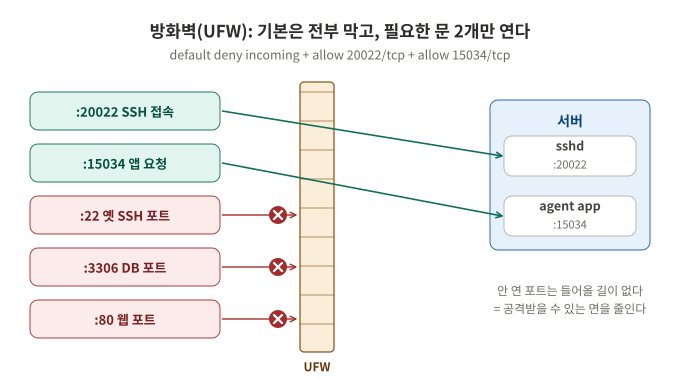

**③ 실행해서 보여주기**
```bash
sudo ufw status verbose                                   # [탭 2]
```
✅ `Status: active`, `Default: deny (incoming)`, 허용 목록에 `20022/tcp`, `15034/tcp`만 (`(v6)` 줄은 IPv6용 복사본)

**④ 말하기**
> "UFW를 기본 차단(deny incoming)으로 두고 20022와 15034만 허용했습니다. SSH가 끊기지 않도록 허용 명단을 먼저 넣고 맨 마지막에 켰습니다."

📸 [2](images/evidence/2_ufw_status.png)

---

## 1-3. agent-admin/dev/test 계정과 agent-common/core 그룹이 요구사항대로 구성되어 있는가?

**① 묻는 것:** 계정 3개, 그룹 2개, 그리고 누가 어느 그룹에 들어 있는지

**② 쉬운 설명:** 계정 = 사람 한 명, 그룹 = 같은 권한을 받는 명단. common(공용)에는 3명 모두, core(핵심)에는 admin · dev만 넣었습니다. 그룹에는 상하 관계가 없어서 각각 넣습니다.

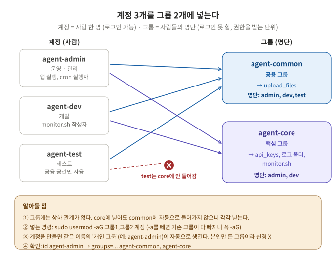

**③ 실행해서 보여주기**
```bash
id agent-admin; id agent-dev; id agent-test               # [탭 2]
```
✅ admin · dev → `agent-common`, `agent-core` / test → `agent-common`만
(맨 앞의 같은 이름 그룹은 계정을 만들 때 자동으로 생긴 개인 그룹)

**④ 말하기**
> "admin과 dev는 공용 · 핵심 두 그룹에, test는 공용 그룹에만 넣었습니다. test는 비밀 키와 로그를 볼 일이 없어서 core에서 뺐습니다."

📸 [3](images/evidence/3_id_groups.png) · 폴더 권한 [4-1](images/evidence/4-1_dirs.png)

---

## 1-4. 앱이 Boot Sequence 5단계 [OK]를 통과하고 "Agent READY"가 출력되는가?

**① 묻는 것:** 계정 · 폴더 · 환경변수 세팅이 맞아서 제공 앱이 정상 부팅하는지

**② 쉬운 설명:** 제공 앱은 켤 때 5가지(실행 계정, 환경변수, 키 파일, 포트, 로그 폴더)를 검사하는 **채점기**입니다. 하나라도 틀리면 `[FAIL]`과 이유를 보여 주고 꺼집니다.

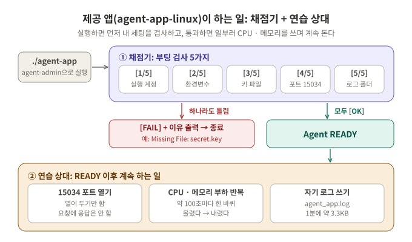

**③ 실행해서 보여주기**
- **[탭 1]** 화면을 보여 줍니다 (0. 준비에서 켠 화면을 위로 스크롤)

✅ `[1/5]` ~ `[5/5]` 모두 `[OK]` → `All Boot Checks Passed!` → `Agent READY`

```bash
sudo ss -ltnp | grep 15034                                # [탭 2]
```
✅ `LISTEN ... 0.0.0.0:15034 ... "agent-app-linux"`

**④ 말하기**
> "앱을 일반 계정인 agent-admin으로 실행하면 부팅 검사 5개가 모두 OK이고 Agent READY가 나옵니다. 그 뒤 15034에서 LISTEN합니다. 참고로 실제 앱은 키 경로를 폴더로, 파일 이름을 secret.key로 요구해서 문서 대신 앱 기준에 맞췄습니다."

📸 [6](images/evidence/6_boot_ready.png) · [6-2](images/evidence/6-2_app_listen.png)

---

## 1-5. monitor.sh가 프로세스/포트 상태를 점검하고, 비정상 상태에서 exit 1로 종료되는가?

**① 묻는 것:** 앱이 죽으면 monitor.sh가 알아채고 실패(exit 1)로 끝나는지

**② 쉬운 설명:** monitor.sh는 경비원입니다. 앱 프로세스 → 15034 포트 순서로 확인하고, 없으면 바로 멈추며 종료 코드 1("문제 있음")을 남깁니다.

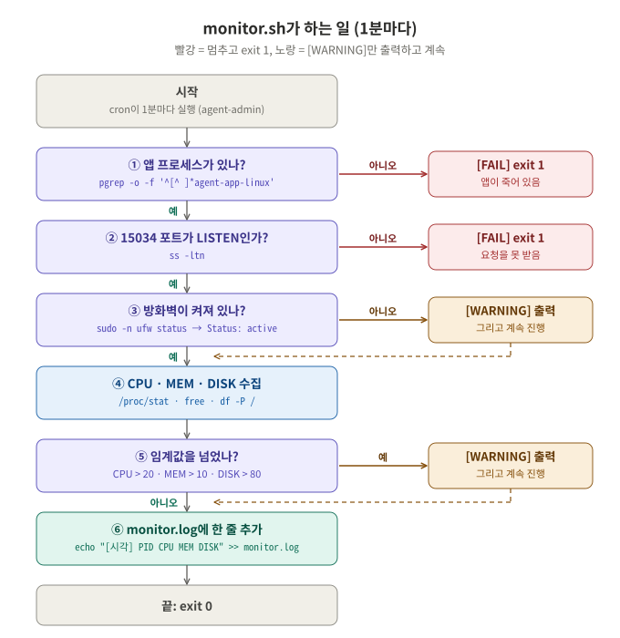

**③ 실행해서 보여주기**

정상일 때:
```bash
sudo -u agent-admin /home/agent-admin/agent-app/bin/monitor.sh; echo "exit=$?"     # [탭 2]
```
✅ 프로세스 · 포트 · 방화벽 `[OK]`, CPU · MEM · DISK 출력, `exit=0` (MEM 경고가 떠도 exit=0)

앱을 끈 뒤:
- **[탭 1]**에서 Ctrl+C → `Shutting down gracefully` 후 프롬프트로 돌아옴
```bash
/home/agent-admin/agent-app/bin/monitor.sh; echo "exit=$?"                        # [탭 1] agent-admin은 sudo 없이
```
✅ `[FAIL] not running` → 바로 멈춤 → `exit=1`
- 확인 후 **[탭 1]**에서 `./agent-app-linux-x86`으로 다시 켭니다.

**④ 말하기**
> "앱이 있으면 exit 0, Ctrl+C로 앱을 끄면 프로세스 확인에서 바로 [FAIL]이 나오고 exit 1로 끝납니다. 포트가 안 열린 경우도 같은 방식으로 exit 1입니다."

📸 [7-2](images/evidence/7-2_monitor_ok.png) · [7-4](images/evidence/7-4_monitor_fail.png)

---

## 1-6. /var/log/agent-app/monitor.log가 지정 포맷으로 누적 기록되는가?

**① 묻는 것:** 로그 형식이 요구대로이고, 기록이 덮어써지지 않고 쌓이는지

**② 쉬운 설명:** 한 번 실행할 때마다 한 줄 `[시각] PID CPU MEM DISK`를 `>>`(이어쓰기)로 붙입니다.

**③ 실행해서 보여주기**
```bash
sudo tail -5 /var/log/agent-app/monitor.log               # [탭 2]
```
✅ `[YYYY-MM-DD HH:MM:SS] PID:... CPU:..% MEM:..% DISK_USED:..%` 형식으로 여러 줄

**④ 말하기**
> "과제가 정한 포맷 그대로 한 줄에 한 번의 측정을 기록하고, `>>`로 이어 써서 기록이 쌓입니다."

📸 [8-2](images/evidence/8-2_monitor_log.png)

---

## 1-7. cron 매분 실행으로 monitor.log가 자동 증가하는가?

**① 묻는 것:** 사람이 실행하지 않아도 1분마다 저절로 기록되는지

**② 쉬운 설명:** cron = 정해진 시간마다 자동으로 실행해 주는 기능. agent-admin의 cron에 "1분마다 monitor.sh"를 등록했습니다.

**③ 실행해서 보여주기**
```bash
sudo crontab -u agent-admin -l                            # [탭 2]
```
✅ `* * * * * /home/agent-admin/agent-app/bin/monitor.sh > /dev/null 2>&1`

```bash
sudo tail -f /var/log/agent-app/monitor.log               # [탭 2] 1~2분 지켜본 뒤 Ctrl+C
```
✅ 매분 `:02`초쯤 **새 줄이 저절로** 추가됨 (앱이 켜져 있어야 함)

**④ 말하기**
> "agent-admin의 crontab에 `* * * * *`로 등록해서 1분마다 실행됩니다. 로그 시각이 매분 2초쯤인 것이 cron이 실행했다는 표시입니다."

📸 [8-1](images/evidence/8-1_crontab.png) · [8-2](images/evidence/8-2_monitor_log.png)

---

## 1-8. monitor.log 용량관리(10MB/10개)가 설정되어 있고 동작을 설명할 수 있는가?

**① 묻는 것:** 로그가 끝없이 커지지 않게 막아 두었는지, 어떻게 동작하는지

**② 쉬운 설명:** logrotate가 하루 한 번 크기를 보고, 10MB를 넘으면 잘라서 보관하고 예전 것은 10개까지만 남깁니다.

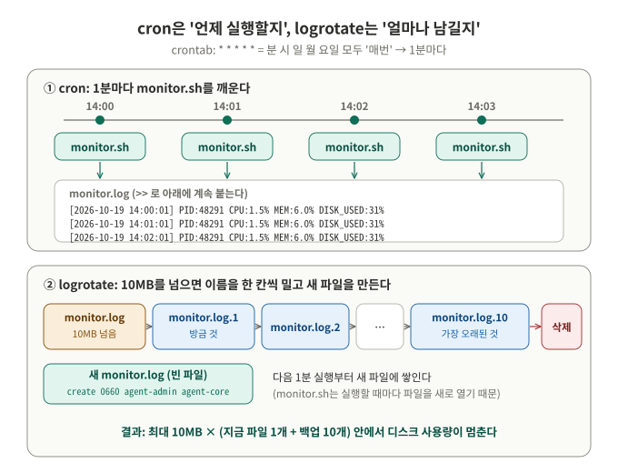

**③ 실행해서 보여주기**
```bash
cat /etc/logrotate.d/agent-app                            # [탭 2]
```
✅ `size 10M`, `rotate 10`

```bash
sudo logrotate -d /etc/logrotate.d/agent-app              # [탭 2] -d = 판단만 (실제로 자르지 않음)
```
✅ `10485760 bytes (10 rotations)`, `log does not need rotating` (아직 10MB 미만)

**④ 말하기**
> "logrotate가 하루 한 번 크기를 봅니다. 10MB를 넘으면 monitor.log를 monitor.log.1로 바꾸고, 예전 것은 한 칸씩 밀고 .10을 넘는 것은 지웁니다. 그리고 agent-admin:agent-core, 660 권한의 빈 monitor.log를 만들어서 다음 1분부터 새 파일에 이어 씁니다."

📸 [8-3](images/evidence/8-3_logrotate_conf.png) · [8-4](images/evidence/8-4_logrotate_dryrun.png)

---

# 항목 2. 구현 방법을 설명할 수 있는가

## 2-1. 프로세스 식별(pgrep/ps 등)과 포트 확인(ss/netstat 등)에 사용한 명령과 선택 이유는?

**① 묻는 것:** 왜 그 명령을 골랐는지

**② 쉬운 설명**

| 무엇 | 쓴 명령 | 고른 이유 | 고르지 않은 것 |
|---|---|---|---|
| 프로세스 | `pgrep -o -f '^[^ ]*agent-app-linux'` | 결과가 **PID 숫자**라 비었는지만 보면 되고 로그에 그대로 씀. `^[^ ]*` = 명령줄의 **첫 단어**가 앱일 때만 → 이름만 들어간 다른 프로세스를 착각하지 않음 | `ps aux \| grep` → grep 자기 자신이 걸림 |
| 포트 | `ss -ltn` → 4번째 칸이 `:15034`로 끝나는지 | Ubuntu 기본 설치. `-l` LISTEN만, `-t` TCP만, `-n` 숫자로 | `netstat` → 기본 설치가 아닌 예전 도구 |

**③ 실행해서 보여주기**
```bash
sed -n '45,59p' bin/monitor.sh                            # [탭 2] 프로세스 · 포트 확인 코드
pgrep -a -f "^[^ ]*agent-app-linux"                        # monitor.sh와 같은 패턴으로 직접 찾기
```
✅ `./agent-app-linux-x86` 2줄 (부모 · 자식). monitor.sh는 `-o`로 먼저 뜬 부모의 PID를 씀

**④ 말하기**
> "pgrep은 결과가 PID 하나로 나와서 비어 있으면 죽은 것이고 그 PID를 로그에 그대로 씁니다. 처음엔 단순 패턴을 썼다가 앱을 띄운 셸까지 앱으로 잡혀서, 명령줄 첫 단어가 앱인 것만 찾게 고쳤습니다. 포트는 ss -ltn으로 LISTEN 중인 TCP만 보고 :15034로 끝나는 줄이 있는지 확인합니다."

---

## 2-2. CPU/MEM/DISK 값을 어떤 방식으로 추출/파싱했고, 로그 포맷을 왜 그 형태로 고정했는가?

**① 묻는 것:** 숫자를 어디서 어떻게 뽑았는지, 포맷을 고정한 이유

**② 쉬운 설명**

| 값 | 어디서 | 어떻게 |
|---|---|---|
| CPU | `/proc/stat` | 부팅 후 누적값이라 **1초 간격으로 두 번** 읽고 그 차이로 "쉬지 않은 비율" 계산 |
| MEM | `free`의 Mem 줄 | used ÷ total × 100 |
| DISK | `df -P /` | Use%에서 `%`를 뺀 숫자 (`-P`로 한 줄 출력 고정) |

**③ 실행해서 보여주기**
```bash
sed -n '76,97p' bin/monitor.sh                            # [탭 2] 자원 수집 코드
sudo tail -3 /var/log/agent-app/monitor.log               # 고정된 포맷
```

**④ 말하기**
> "CPU는 /proc/stat을 1초 간격으로 두 번 읽어 그 사이 쉬지 않은 비율을 구했습니다. top은 출력 칸이 바뀌어 파싱이 깨질 수 있어 피했습니다. 메모리는 free, 디스크는 df -P를 썼습니다. 로그는 한 줄에 한 번의 측정, 칸 순서를 고정해서 grep으로 시각을 찾고 awk로 평균을 내는 등 프로그램이 읽을 수 있게 했습니다."

---

## 2-3. 소유자(agent-dev)와 실행자(agent-admin, cron) 권한 정책을 어떻게 만족시켰는가?

**① 묻는 것:** 만든 사람과 돌리는 사람을 권한으로 어떻게 나눴는지

**② 쉬운 설명:** monitor.sh = `agent-dev:agent-core 750`

| 칸 | 대상 | 할 수 있는 것 |
|---|---|---|
| 주인 `rwx` | agent-dev | 읽기, **수정**, 실행 |
| 그룹 `r-x` | agent-core (admin) | 읽기, **실행만** → cron 실행 가능, 수정 불가 |
| 나머지 `---` | agent-test | 아무것도 못 함 |

**③ 실행해서 보여주기**
```bash
sudo ls -l /home/agent-admin/agent-app/bin/monitor.sh     # [탭 2]
```
✅ `-rwxr-x--- agent-dev agent-core`

```bash
sudo -u agent-test /home/agent-admin/agent-app/bin/monitor.sh      # [탭 2]
```
✅ `Permission denied`

**④ 말하기**
> "주인은 작성자인 agent-dev, 그룹은 agent-core, 권한 750입니다. admin은 core 그룹이라 실행만 돼서 cron이 돌릴 수 있고, 실수로 스크립트를 고칠 수는 없습니다. 방화벽 확인에 필요한 root 권한도 전체가 아니라 `ufw status` 한 명령만 sudoers로 허용했습니다."

📸 [7-1](images/evidence/7-1_monitor_perm.png)

---

## 2-4. 용량 기반 로그 관리(10MB/10개)를 어떤 방식(logrotate/스크립트)으로 구현했는가?

**① 묻는 것:** 직접 짰는지, 도구를 썼는지, 그 이유

**② 쉬운 설명**

| 설정 | 뜻 |
|---|---|
| `size 10M` | 10MB 넘으면 자름 |
| `rotate 10` | 예전 파일 `.1` ~ `.10`까지만 보관 |
| `create 0660 agent-admin agent-core` | 새 파일도 core 정책 그대로 |
| `su agent-admin agent-core` | 로그 폴더가 root 소유가 아니라서 이 권한으로 작업 |

**③ 실행해서 보여주기:** 1-8과 같은 명령 (`cat /etc/logrotate.d/agent-app`, `sudo logrotate -d ...`)

**④ 말하기**
> "스크립트로 직접 짜지 않고 Ubuntu 기본 도구 logrotate를 썼습니다. 이미 하루 한 번 자동으로 돌고 있고 설정 6줄로 끝납니다. 한 줄이 약 65바이트라 하루 약 94KB씩 쌓여서 하루 한 번 검사로 충분합니다."

---

# 항목 3. 개념을 설명할 수 있는가

## 3-1. SSH 포트 변경과 Root 접속 차단이 왜 보안에 효과적인가? (위협 모델)

**① 묻는 것:** 공격자 입장에서 무엇이 막히는지

**② 쉬운 설명:** 위협 모델 = "누가, 어떤 순서로 공격하나"를 먼저 그려 보고 막을 곳을 정하는 것.

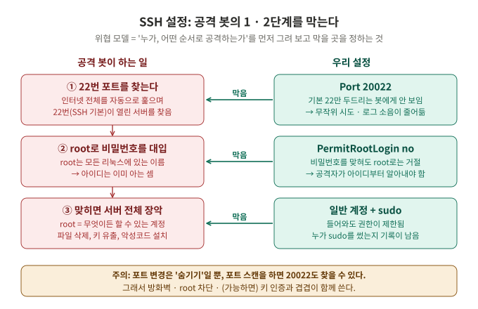

**③ 실행해서 보여주기**
```bash
ssh -o ConnectTimeout=5 -p 22 arang@192.168.64.2          # [Mac] 봇이 두드리는 옛 22번
```
✅ `Operation timed out` → 22번은 닫혀 있음

**④ 말하기**
> "가장 흔한 공격은 봇이 22번 포트를 찾아 모든 리눅스에 있는 root로 비밀번호를 대입하는 것입니다. 포트를 바꾸면 무작위 시도가 줄고, root를 막으면 비밀번호를 맞혀도 root로 못 들어옵니다. 다만 포트 변경은 숨기기일 뿐이라 방화벽, root 차단과 겹쳐서 써야 의미가 있습니다."

---

## 3-2. api_keys와 로그 디렉토리를 agent-core로 제한한 이유는? (최소 권한 원칙)

**① 묻는 것:** 왜 test를 막았는지

**② 쉬운 설명:** 최소 권한 원칙 = 일에 꼭 필요한 만큼만 권한을 준다.

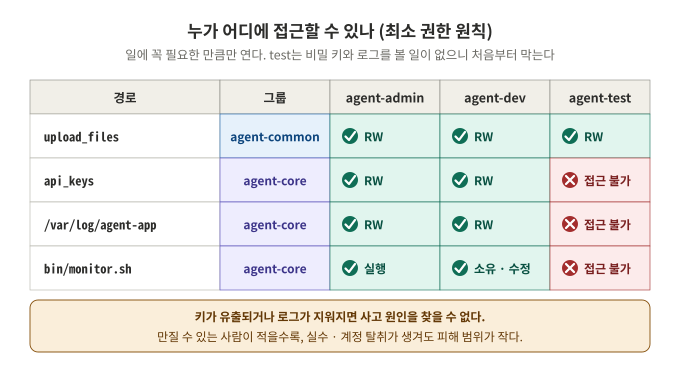

**③ 실행해서 보여주기**
```bash
sudo -u agent-test ls /home/agent-admin/agent-app/api_keys      # [탭 2]
```
✅ `Permission denied`

```bash
sudo -u agent-dev ls -la /home/agent-admin/agent-app/api_keys   # [탭 2]
```
✅ 목록이 보임 → **같은 폴더, 사람에 따라 다른 결과**

**④ 말하기**
> "키가 새면 외부 서비스가 도용되고, 로그가 지워지면 장애나 침입의 원인을 찾을 수 없습니다. test는 볼 일이 없으니 처음부터 막아서, 실수하거나 탈취돼도 피해가 번지지 않게 했습니다. 같은 원칙으로 sudo도 ufw status 한 명령만 허용했습니다."

📸 [4-2](images/evidence/4-2_test_denied.png) · [4-3](images/evidence/4-3_dev_allowed.png)

---

## 3-3. "경고는 출력하되 종료하지 않는 항목"(방화벽 비활성/임계치 초과)을 분리한 운영상의 이유는?

**① 묻는 것:** 왜 어떤 건 멈추고 어떤 건 경고만 하는지

**② 쉬운 설명:** 기준은 **"지금 서비스가 돌고 있나"**입니다.

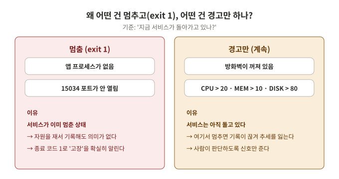

**③ 실행해서 보여주기**
```bash
sudo ufw disable                                                                   # [탭 2]
sudo -u agent-admin /home/agent-admin/agent-app/bin/monitor.sh; echo "exit=$?"
sudo ufw enable                                                                    # y 입력 (꼭 다시 켜기)
```
✅ `[WARNING] Firewall (ufw) is not active`인데도 측정 · 기록까지 하고 `exit=0`
(앱이 죽으면 `exit=1`로 멈추는 것은 1-5에서 확인)

**④ 말하기**
> "앱이 죽었으면 서비스가 이미 멈춘 것이라 exit 1로 확실히 알립니다. 방화벽이 꺼지거나 자원이 높아도 서비스는 돌고 있어서, 여기서 멈추면 기록이 끊겨 언제부터 나빠졌는지 볼 수 없습니다. 그래서 경고만 하고 기록은 계속합니다."

📸 [7-3](images/evidence/7-3_monitor_fw_warn.png)

---

## 3-4. 리다이렉션 기호 >와 >>의 차이는? 로그 누적에 >>가 필요한 이유는?

**① 묻는 것:** 두 기호의 차이와 로그에서의 의미

**② 쉬운 설명:** `>` = 파일을 비우고 새로 씀(덮어쓰기), `>>` = 파일 끝에 붙임(이어쓰기)

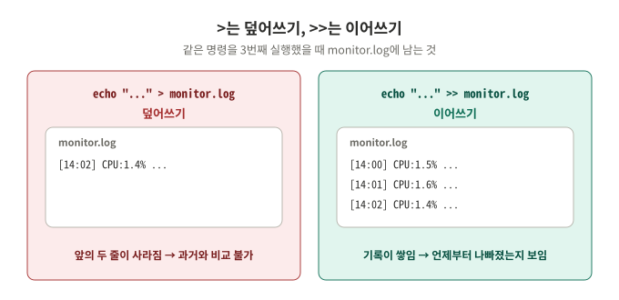

**③ 실행해서 보여주기**
```bash
echo "1번째" > /tmp/over.txt; echo "2번째" > /tmp/over.txt; echo "3번째" > /tmp/over.txt      # [탭 2]
cat /tmp/over.txt
```
✅ `3번째` 한 줄만 → 덮어쓰기

```bash
echo "1번째" >> /tmp/add.txt; echo "2번째" >> /tmp/add.txt; echo "3번째" >> /tmp/add.txt
cat /tmp/add.txt
```
✅ 3줄 모두 → 이어쓰기

```bash
sed -n '105,108p' bin/monitor.sh                          # monitor.sh의 기록 줄 (>> 사용)
```

**④ 말하기**
> "`>`는 실행할 때마다 앞의 기록이 지워지고 마지막 한 줄만 남습니다. 모니터링 로그의 가치는 과거와 비교하는 것이라, 장애 직전 몇 분의 흐름을 보려면 쌓여 있어야 해서 `>>`를 썼습니다."

---

# 항목 4. 응용할 수 있는가

## 4-1. 모니터링 대상이 Nginx로 바뀐다면 monitor.sh에서 바꿔야 할 핵심 포인트는?

**① 묻는 것:** 스크립트 구조를 이해하고 있는지

**② 쉬운 설명:** 구조(확인 → 수집 → 경고 → 기록)는 그대로, 맨 위 설정값만 바꿉니다.

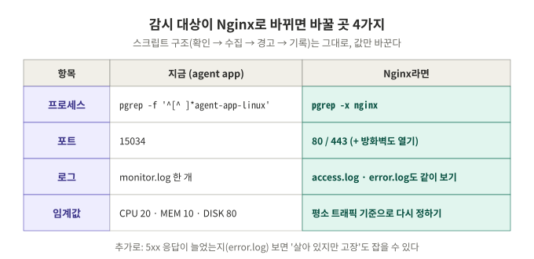

**③ 실행해서 보여주기**
```bash
sed -n '17,26p' bin/monitor.sh                            # [탭 2] 바꿀 값이 모여 있는 곳
```
✅ `APP_NAME`, `APP_PORT`, `LOG_DIR`, `CPU_LIMIT` · `MEM_LIMIT` · `DISK_LIMIT`

**④ 말하기**
> "프로세스는 nginx, 포트는 80과 443으로 바꾸고 방화벽도 열어야 합니다. 로그는 monitor.log 말고 access.log, error.log도 봐야 합니다. 프로세스와 포트가 멀쩡해도 5xx 에러가 쌓이면 살아 있지만 고장이기 때문입니다. 임계값은 웹 서버의 평소 값을 며칠 기록해 보고 다시 정합니다."

---

## 4-2. "프로세스는 살아있는데 포트가 안 열리는 상황"의 원인 후보와 확인 순서는?

**① 묻는 것:** 문제를 체계적으로 좁혀 가는 순서

**② 쉬운 설명:** 빠르고 흔한 원인부터 하나씩 지웁니다.

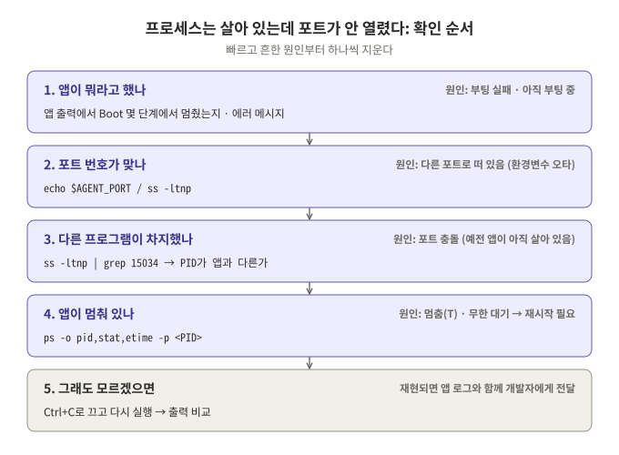

**③ 실행해서 보여주기** (확인 명령 쓰는 법)
```bash
pgrep -a -f "^[^ ]*agent-app-linux"                       # [탭 2] ① 프로세스가 정말 있나, PID는?
sudo ss -ltnp | grep 15034                                # ② 15034를 누가 쓰고 있나 (다른 프로그램?)
sudo grep AGENT_PORT /home/agent-admin/.bashrc            # ③ 앱에 준 포트 번호가 맞나
ps -o pid,stat,etime,cmd -p $(pgrep -o -f "^[^ ]*agent-app-linux")   # ④ 앱이 멈춰 있지 않나 (STAT이 T면 정지)
```

**④ 말하기**
> "먼저 앱 출력에서 부팅이 어디서 멈췄는지 보고, 다른 프로그램이 그 포트를 차지했는지, 환경변수 포트 번호가 틀렸는지, 앱이 멈춰 있는지 순서로 봅니다. 그래도 모르면 껐다 다시 켜서 출력을 비교합니다. monitor.sh는 이 상황에서 `[FAIL] not listening`과 exit 1을 냅니다."

---

## 4-3. 로그가 급증해 디스크가 가득 찰 위험이 있다면, 운영자가 취할 대응(단기/중기)은?

**① 묻는 것:** 당장 할 일과 다시 안 생기게 할 일을 구분하는지

**② 쉬운 설명:** 단기 = 지금 불 끄기, 중기 = 구조 바꾸기

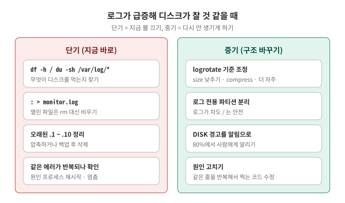

**③ 실행해서 보여주기**
```bash
df -h /                                                   # [탭 2] 디스크가 얼마나 찼나
sudo du -sh /var/log/agent-app/*                          # 어떤 로그가 큰가
```
✅ monitor.log보다 앱 자체 로그(`agent_app.log`)가 훨씬 빨리 큼 (1분에 약 3.3KB, 하루 약 4.8MB)

**④ 말하기**
> "단기로는 df와 du로 무엇이 큰지 찾고, 지금 쓰는 로그는 rm 대신 `: > 파일`로 비웁니다. 열린 파일을 지우면 공간이 바로 안 돌아오기 때문입니다. 오래된 로그는 압축하거나 정리하고, 같은 에러가 반복되면 원인 프로세스를 재시작합니다. 중기로는 logrotate 기준을 낮추고 압축을 켜고, agent_app.log도 logrotate에 넣고, 로그 파티션을 분리하고, DISK 80% 경고를 알림으로 연결하고, 로그를 쏟아내는 코드를 고칩니다."

---

## 끝나고 원래대로

| 할 일 | 명령 |
|---|---|
| 방화벽이 켜져 있는지 | `sudo ufw status` → `Status: active` (3-3에서 껐다면 `sudo ufw enable`) |
| 앱이 켜져 있는지 | `pgrep -a -f "^[^ ]*agent-app-linux"` → 비어 있으면 [탭 1]에서 `./agent-app-linux-x86` |
| 3-4 시험 파일 | `rm /tmp/over.txt /tmp/add.txt` |
