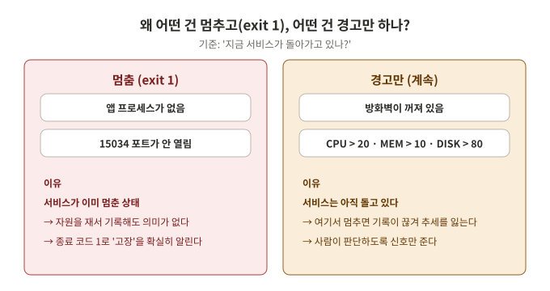
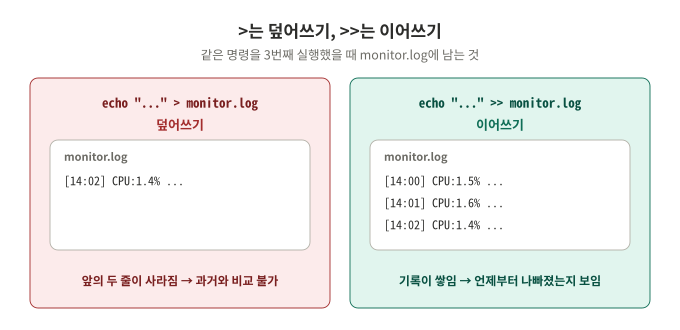
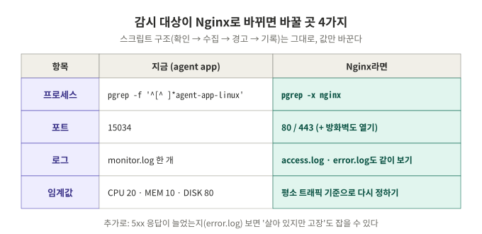
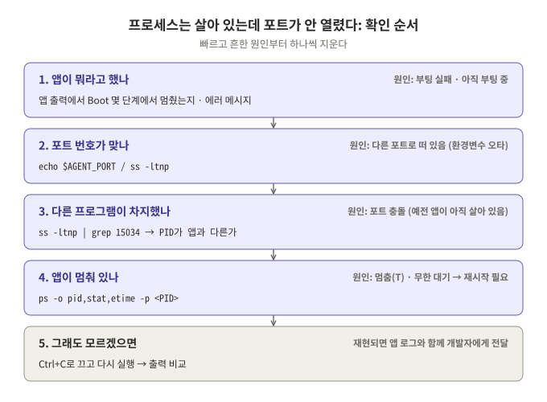
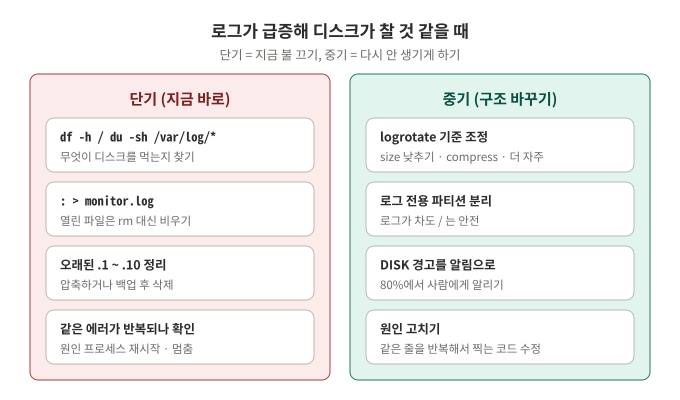

# 평가 가이드 (평가표 항목 1~4)

평가받을 때 **치는 명령과 하는 말**만 모았습니다. 무엇을 어떻게 설정했는지는 [README (수행 내역서)](README.md)에 있습니다.

- 제목 = 평가표 질문 원문, 그 아래 = **확인 명령(`키워드:` 화면에 나와야 하는 것) → 💬 답**
- "→ N단계"를 누르면 수행 내역서의 해당 단계로 갑니다.

| 평가 | 질문 요약 | 수행 내역 |
|---|---|---|
| [1-1](#1-1-ssh-포트가-20022로-변경되었고-root-원격-접속이-차단되는가) | SSH 20022, root 차단 | [1단계](README.md#1단계-ssh-잠그기) |
| [1-2](#1-2-방화벽이-활성화되어-있고ufw-20022tcp와-15034tcp만-허용되는가) | UFW, 20022 · 15034만 | [2단계](README.md#2단계-방화벽-켜기) |
| [1-3](#1-3-agent-admindevtest-계정과-agent-commoncore-그룹이-요구사항대로-구성되어-있는가) | 계정 · 그룹 | [3단계](README.md#3단계-계정--그룹) |
| [1-4](#1-4-앱이-boot-sequence-5단계-ok를-통과하고-agent-ready가-출력되는가) | Boot [OK], Agent READY | [5단계](README.md#5단계-환경변수--키-파일) · [6단계](README.md#6단계-앱-실행) |
| [1-5](#1-5-monitorsh가-프로세스포트-상태를-점검하고-비정상-상태에서-exit-1로-종료되는가) · [1-6](#1-6-varlogagent-appmonitorlog가-지정-포맷으로-누적-기록되는가) | exit 1, 로그 포맷 | [7단계](README.md#7단계-monitorsh) |
| [1-7](#1-7-cron-매분-실행으로-monitorlog가-자동-증가하는가) · [1-8](#1-8-monitorlog-용량관리10mb10개가-설정되어-있고-동작을-설명할-수-있는가) | cron, logrotate | [8단계](README.md#8단계-cron--logrotate) |
| [2-1](#2-1-프로세스-식별pgrepps-등과-포트-확인ssnetstat-등에-사용한-명령과-선택-이유는) ~ [2-3](#2-3-소유자agent-dev와-실행자agent-admin-cron-권한-정책을-어떻게-만족시켰는가) | 명령 선택, 파싱, 권한 | [7단계](README.md#7단계-monitorsh) |
| [2-4](#2-4-용량-기반-로그-관리10mb10개를-어떤-방식logrotate스크립트으로-구현했는가) | logrotate | [8단계](README.md#8단계-cron--logrotate) |
| [3-1](#3-1-ssh-포트-변경과-root-접속-차단이-왜-보안에-효과적인가-위협-모델) ~ [3-4](#3-4-리다이렉션-기호-와-의-차이는-로그-누적에-가-필요한-이유는) | 위협 모델, 최소 권한, 경고 분리, > · >> | 1 · 4 · 7단계 |
| [4-1](#4-1-모니터링-대상이-nginx로-바뀐다면-monitorsh에서-바꿔야-할-핵심-포인트는) ~ [4-3](#4-3-로그가-급증해-디스크가-가득-찰-위험이-있다면-운영자가-취할-대응단기중기은) | 응용 (Nginx, 포트 장애, 디스크) | - |

## 시작 전 준비 (3분)

| 창 | 프롬프트 |
|---|---|
| `[Mac]` Mac 터미널 | `codewhite77770105@cx2r6s7 ~ %` |
| `[탭 1]` 앱 전용 창 | `agent-admin@b4-1:~/agent-app$` |
| `[탭 2]` 확인용 창 | `arang@b4-1:~/codyssey_B4-1$` |

```bash
# [Mac] UTM 열기 → b4-1이 멈춰 있으면 ▶, 1분 대기
open ~/Applications/UTM.app

# [Mac] 탭 1: VM 접속 → agent-admin으로 바꾸고 앱 실행
ssh -p 20022 arang@192.168.64.2
sudo -iu agent-admin
cd $AGENT_HOME
# 기대: Boot [OK]×5 → Agent READY (이 창은 그대로 둠)
./agent-app-linux-x86

# [Mac] ⌘T로 탭 2: VM 접속 → 저장소 폴더로
ssh -p 20022 arang@192.168.64.2
cd ~/codyssey_B4-1
# 비밀번호를 미리 넣어 둠 (15분간 다시 안 물음)
sudo -v
```

> 명령을 치기 전에 **프롬프트**로 위치를 확인하세요. Mac에서 `sudo`를 치면 Mac 관리자 비밀번호를 묻습니다.

## 항목 1. 결과물이 요구사항대로 동작하는가

### 1-1. SSH 포트가 20022로 변경되었고, Root 원격 접속이 차단되는가?

→ [1단계](README.md#1단계-ssh-잠그기)

```bash
# [탭 2] 키워드: port 20022 / permitrootlogin no
sudo sshd -T | grep -E "^port |^permitrootlogin "

# [탭 2] 키워드: 0.0.0.0:20022 LISTEN sshd
sudo ss -tlnp | grep sshd

# [Mac] 키워드: Permission denied (Ctrl+C로 빠져나옴)
ssh -p 20022 root@192.168.64.2
```

> 💬 "sshd_config에서 Port를 20022로, PermitRootLogin을 no로 바꿨습니다. 설정 파일만으로는 적용 여부를 모르니 `sshd -T`로 실제 적용값, `ss`로 20022 LISTEN, root 접속 거절까지 확인했습니다."

### 1-2. 방화벽이 활성화되어 있고(UFW), 20022/tcp와 15034/tcp만 허용되는가?

→ [2단계](README.md#2단계-방화벽-켜기)

```bash
# [탭 2] 키워드: Status: active / deny (incoming) / 20022/tcp, 15034/tcp만
#   (v6) 줄은 IPv6용 복사본
sudo ufw status verbose
```

> 💬 "기본 차단으로 두고 두 문만 열었습니다. SSH가 끊기지 않게 허용 명단을 먼저 넣고 마지막에 켰습니다."

### 1-3. agent-admin/dev/test 계정과 agent-common/core 그룹이 요구사항대로 구성되어 있는가?

→ [3단계](README.md#3단계-계정--그룹)

```bash
# [탭 2] 키워드: admin·dev = agent-common, agent-core / test = agent-common
id agent-admin; id agent-dev; id agent-test
```

> 💬 "admin과 dev는 두 그룹에, test는 공용 그룹에만 넣었습니다. test는 비밀 키와 로그를 볼 일이 없어서 core에서 뺐습니다."

### 1-4. 앱이 Boot Sequence 5단계 [OK]를 통과하고 "Agent READY"가 출력되는가?

→ [6단계](README.md#6단계-앱-실행)

```bash
# [탭 1] 화면을 위로 스크롤
#   키워드: [1/5]~[5/5] [OK] → All Boot Checks Passed! → Agent READY

# [탭 2] 키워드: 0.0.0.0:15034 LISTEN agent-app-linux
sudo ss -ltnp | grep 15034
```

> 💬 "앱은 켤 때 실행 계정 · 환경변수 · 키 파일 · 포트 · 로그 폴더를 검사합니다. 키 경로와 파일 이름은 문서 대신 앱 기준에 맞췄습니다."

### 1-5. monitor.sh가 프로세스/포트 상태를 점검하고, 비정상 상태에서 exit 1로 종료되는가?

→ [7단계](README.md#7단계-monitorsh)

```bash
# [탭 2] 정상일 때 → 키워드: [OK] 3개, exit=0
sudo -u agent-admin /home/agent-admin/agent-app/bin/monitor.sh
echo "exit=$?"

# [탭 1] Ctrl+C로 앱을 끈 뒤 탭 1에서 → 키워드: [FAIL] not running, exit=1
/home/agent-admin/agent-app/bin/monitor.sh
echo "exit=$?"

# [탭 1] 앱 다시 켜기
./agent-app-linux-x86
```

> 💬 "프로세스 → 포트 순서로 확인하고, 없으면 바로 exit 1로 끝납니다. MEM 경고가 떠도 서비스는 살아 있어서 exit 0입니다."

### 1-6. /var/log/agent-app/monitor.log가 지정 포맷으로 누적 기록되는가?

→ [7단계](README.md#7단계-monitorsh) · [8단계](README.md#8단계-cron--logrotate)

```bash
# [탭 2] 키워드: [YYYY-MM-DD HH:MM:SS] PID:.. CPU:..% MEM:..% DISK_USED:..%
sudo tail -5 /var/log/agent-app/monitor.log
```

> 💬 "과제 포맷 그대로 한 줄에 한 번의 측정을 기록하고, `>>`로 이어 써서 쌓입니다."

### 1-7. cron 매분 실행으로 monitor.log가 자동 증가하는가?

→ [8단계](README.md#8단계-cron--logrotate)

```bash
# [탭 2] 키워드: * * * * * /home/agent-admin/agent-app/bin/monitor.sh
sudo crontab -u agent-admin -l

# [탭 2] 키워드: 1~2분 보면 새 줄이 저절로 추가됨 (Ctrl+C로 종료)
sudo tail -f /var/log/agent-app/monitor.log
```

> 💬 "agent-admin의 crontab에 `* * * * *`로 등록했습니다. 로그 시각이 매분 2초쯤인 것이 cron이 실행했다는 표시입니다."

### 1-8. monitor.log 용량관리(10MB/10개)가 설정되어 있고 동작을 설명할 수 있는가?

→ [8단계](README.md#8단계-cron--logrotate)

```bash
# [탭 2] 키워드: size 10M / rotate 10
cat /etc/logrotate.d/agent-app

# [탭 2] 키워드: 10485760 bytes (10 rotations)
sudo logrotate -d /etc/logrotate.d/agent-app
```

> 💬 "logrotate가 하루 한 번 크기를 봅니다. 10MB를 넘으면 monitor.log를 .1로 바꾸고, 예전 것은 한 칸씩 밀고 .10을 넘는 것은 지운 뒤, 660 권한의 새 monitor.log를 만듭니다."

## 항목 2. 구현 방법을 설명할 수 있는가

### 2-1. 프로세스 식별(pgrep/ps 등)과 포트 확인(ss/netstat 등)에 사용한 명령과 선택 이유는?

→ [7단계 표 ①②](README.md#7단계-monitorsh)

```bash
# [탭 2] monitor.sh의 프로세스·포트 확인 코드
sed -n '45,59p' bin/monitor.sh

# [탭 2] 같은 패턴으로 직접 찾기 → 키워드: ./agent-app-linux-x86 2줄 (부모·자식)
pgrep -a -f "^[^ ]*agent-app-linux"
```

> 💬 "pgrep은 결과가 PID라 비었으면 죽은 것이고 그대로 로그에 씁니다. 처음엔 앱을 띄운 셸까지 잡혀서 첫 단어 패턴으로 고쳤습니다. 포트는 기본 도구인 ss -ltn으로 LISTEN 중인 TCP만 봅니다."

### 2-2. CPU/MEM/DISK 값을 어떤 방식으로 추출/파싱했고, 로그 포맷을 왜 그 형태로 고정했는가?

→ [7단계 표 ④⑥](README.md#7단계-monitorsh)

```bash
# [탭 2] monitor.sh의 자원 수집 코드 (/proc/stat, free, df -P)
sed -n '76,97p' bin/monitor.sh
```

> 💬 "CPU는 /proc/stat을 1초 간격으로 두 번 읽어 차이로 구했고, top은 출력 칸이 바뀔 수 있어 피했습니다. 메모리는 free, 디스크는 df -P입니다. 포맷을 고정하면 grep · awk로 프로그램이 바로 읽을 수 있습니다."

### 2-3. 소유자(agent-dev)와 실행자(agent-admin, cron) 권한 정책을 어떻게 만족시켰는가?

→ [7단계](README.md#7단계-monitorsh)

```bash
# [탭 2] 키워드: -rwxr-x--- agent-dev agent-core
sudo ls -l /home/agent-admin/agent-app/bin/monitor.sh

# [탭 2] 키워드: Permission denied (test는 실행 불가)
sudo -u agent-test /home/agent-admin/agent-app/bin/monitor.sh
```

> 💬 "주인 dev는 수정 · 실행(rwx), core 그룹인 admin은 실행만(r-x)이라 cron이 돌릴 수 있지만 고칠 수는 없고, test는 아무것도 못 합니다(---). root 권한도 `ufw status` 한 명령만 sudoers로 허용했습니다."

### 2-4. 용량 기반 로그 관리(10MB/10개)를 어떤 방식(logrotate/스크립트)으로 구현했는가?

→ [8단계](README.md#8단계-cron--logrotate) (확인 명령은 1-8과 같음)

> 💬 "직접 짜지 않고 Ubuntu 기본 도구 logrotate를 썼습니다. 이미 하루 한 번 돌고 있고 설정 6줄로 끝납니다. 하루 약 94KB씩 쌓여서 하루 한 번 검사로 충분합니다."

## 항목 3. 개념을 설명할 수 있는가

### 3-1. SSH 포트 변경과 Root 접속 차단이 왜 보안에 효과적인가? (위협 모델)

→ [1단계 그림](README.md#1단계-ssh-잠그기)

```bash
# [Mac] 봇이 두드리는 옛 22번 → 키워드: Operation timed out (닫혀 있음)
ssh -o ConnectTimeout=5 -p 22 arang@192.168.64.2
```

> 💬 "흔한 공격은 봇이 22번을 찾아 root로 비밀번호를 대입하는 것입니다. 포트를 바꾸면 무작위 시도가 줄고, root를 막으면 비밀번호를 맞혀도 root로는 못 들어옵니다. 포트 변경은 숨기기일 뿐이라 방화벽 · root 차단과 겹쳐 씁니다."

### 3-2. api_keys와 로그 디렉토리를 agent-core로 제한한 이유는? (최소 권한 원칙)

→ [4단계](README.md#4단계-폴더--권한)

```bash
# [탭 2] 키워드: Permission denied
sudo -u agent-test ls /home/agent-admin/agent-app/api_keys

# [탭 2] 키워드: 목록이 보임 → 같은 폴더, 사람에 따라 다른 결과
sudo -u agent-dev ls -la /home/agent-admin/agent-app/api_keys
```

> 💬 "키가 새면 외부 서비스가 도용되고, 로그가 지워지면 사고 원인을 못 찾습니다. 볼 일이 없는 test는 처음부터 막아 실수나 탈취의 피해 범위를 줄였습니다."

### 3-3. "경고는 출력하되 종료하지 않는 항목"(방화벽 비활성/임계치 초과)을 분리한 운영상의 이유는?

→ [7단계](README.md#7단계-monitorsh)



```bash
# [탭 2] 방화벽 잠깐 끄기
sudo ufw disable

# [탭 2] 키워드: [WARNING] Firewall (ufw) is not active, 그래도 exit=0
sudo -u agent-admin /home/agent-admin/agent-app/bin/monitor.sh
echo "exit=$?"

# [탭 2] 꼭 다시 켜기 (y)
sudo ufw enable
```

> 💬 "기준은 '지금 서비스가 돌고 있나'입니다. 앱이 죽었으면 exit 1로 확실히 알리고, 방화벽 꺼짐 · 자원 높음은 서비스가 살아 있으니 멈추지 않고 기록을 이어 가야 언제부터 나빠졌는지 볼 수 있습니다."

### 3-4. 리다이렉션 기호 >와 >>의 차이는? 로그 누적에 >>가 필요한 이유는?



```bash
# [탭 2] > 덮어쓰기 → 키워드: 2만 남음
echo 1 > /tmp/o; echo 2 > /tmp/o; cat /tmp/o

# [탭 2] >> 이어쓰기 → 키워드: 1, 2 둘 다 남음
echo 1 >> /tmp/a; echo 2 >> /tmp/a; cat /tmp/a

# [탭 2] monitor.sh의 기록 줄 → 키워드: >> "$LOG_FILE"
sed -n '105,108p' bin/monitor.sh
```

> 💬 "`>`는 실행할 때마다 앞의 기록이 지워집니다. 모니터링 로그는 과거와 비교하는 데 가치가 있어서, 장애 직전 흐름을 보려면 `>>`로 쌓아야 합니다."

## 항목 4. 응용할 수 있는가

### 4-1. 모니터링 대상이 Nginx로 바뀐다면 monitor.sh에서 바꿔야 할 핵심 포인트는?



```bash
# [탭 2] 바꿀 값이 모인 곳 → 키워드: APP_NAME, APP_PORT, LOG_DIR, *_LIMIT
sed -n '17,26p' bin/monitor.sh
```

> 💬 "구조는 그대로 두고 프로세스를 nginx, 포트를 80 · 443으로 바꾸고 방화벽도 엽니다. 프로세스와 포트가 멀쩡해도 5xx가 쌓이면 고장이라 access.log · error.log도 봐야 합니다. 임계값은 웹 서버의 평소 값을 며칠 기록해 보고 다시 정합니다."

### 4-2. "프로세스는 살아있는데 포트가 안 열리는 상황"의 원인 후보와 확인 순서는?



```bash
# ① 프로세스가 정말 있나, PID는?
pgrep -a -f "^[^ ]*agent-app-linux"

# ② 15034를 다른 프로그램이 차지하고 있나
sudo ss -ltnp | grep 15034

# ③ 앱에 준 포트 번호가 맞나
sudo grep AGENT_PORT /home/agent-admin/.bashrc

# ④ 앱이 멈춰 있나 → 키워드: STAT이 T면 정지 상태
ps -o pid,stat,etime,cmd -p $(pgrep -o -f "^[^ ]*agent-app-linux")
```

> 💬 "앱 출력에서 부팅이 어디서 멈췄는지 보고, 포트 선점 → 포트 설정 → 앱 정지 순서로 봅니다. 그래도 모르면 다시 켜서 출력을 비교합니다. monitor.sh는 이때 `[FAIL] not listening`과 exit 1을 냅니다."

### 4-3. 로그가 급증해 디스크가 가득 찰 위험이 있다면, 운영자가 취할 대응(단기/중기)은?



```bash
# [탭 2] 디스크가 얼마나 찼나
df -h /

# [탭 2] 어떤 로그가 큰가 → 키워드: agent_app.log가 monitor.log보다 훨씬 큼
sudo du -sh /var/log/agent-app/*
```

> 💬 "단기: 무엇이 큰지 찾고, 쓰는 중인 로그는 rm 대신 `: > 파일`로 비웁니다(열린 파일을 지우면 공간이 바로 안 돌아옴). 중기: logrotate 기준을 낮추고 압축을 켜고, agent_app.log도 logrotate에 넣고, DISK 80% 경고를 알림으로 연결하고, 로그를 쏟아내는 코드를 고칩니다."

## 끝나고 원래대로

```bash
# 방화벽이 켜져 있나 (3-3에서 껐다면 sudo ufw enable)
sudo ufw status

# 앱이 켜져 있나 (비어 있으면 탭 1에서 ./agent-app-linux-x86)
pgrep -a -f "^[^ ]*agent-app-linux"

# 3-4 시험 파일 지우기
rm -f /tmp/o /tmp/a
```
