# 수행 내역서

내 VM에서 **실행한 명령**과 **화면에서 확인한 것**을 증거 사진 20장과 함께 한곳에 모았습니다. 설정 방법과 개념은 [README](README.md), 평가 때 칠 명령은 [evaluation.md](evaluation.md)에 있습니다.

**환경:** 교육장 iMac(Intel) + UTM, Ubuntu Server 22.04.5 LTS (x86_64), VM `192.168.64.2`, 내 계정 `arang`

| 표시 | 어디서 | 프롬프트 |
|---|---|---|
| `[MAC]` | Mac 터미널 | `codewhite77770105@cx2r6s7 ~ %` |
| `[SSH]` | ssh로 접속한 VM, 내 계정 arang (6단계부터는 탭 2) | `arang@b4-1:~$` |
| `[SSH: agent-admin]` | VM에서 `sudo -iu agent-admin`으로 바꾼 뒤 (6단계부터는 앱이 도는 탭 1) | `agent-admin@b4-1:~$` |

## 한눈에 보기

| 📸 | 단계 | 확인한 것 |
|---|---|---|
| [1-1](#1-1-ssh-설정-적용값) | 1단계 SSH | `port 20022`, `permitrootlogin no` → sshd가 **실제로 쓰는** 값이 바뀜 |
| [1-2](#1-2-sshd가-20022번에서-대기) | 1단계 SSH | `0.0.0.0:20022 ... LISTEN ... sshd` → 20022번 문이 열림 |
| [1-3](#1-3-root-원격-접속-거절) | 1단계 SSH | `Permission denied` → root는 비밀번호를 넣어도 못 들어옴 |
| [2](#2-ufw-상태) | 2단계 방화벽 | `Status: active`, `deny (incoming)`, 허용은 `20022/tcp` · `15034/tcp`만 (`(v6)`은 IPv6용 복사본) |
| [3](#3-계정별-그룹) | 3단계 계정·그룹 | admin · dev는 `agent-common`과 `agent-core`, test는 `agent-common`만 (맨 앞 같은 이름 그룹은 자동으로 생긴 개인 그룹) |
| [4-1](#4-1-폴더-5개의-주인그룹권한) | 4단계 폴더·권한 | agent-app `750` common · upload_files `2770` common · api_keys `2770` core · bin `750` dev:core · 로그 `2770` core (`s` = setgid, `+` = ACL) |
| [4-2](#4-2-test는-비밀-폴더-거절) | 4단계 폴더·권한 | `Permission denied` → core가 아닌 test는 못 들어감 |
| [4-3](#4-3-dev는-비밀-폴더-통과) | 4단계 폴더·권한 | 목록이 보임 → 같은 폴더인데 core인 dev는 통과 |
| [5-1](#5-1-환경변수-5개) | 5단계 환경변수·키 | `AGENT_HOME`, `AGENT_KEY_PATH`(폴더), `AGENT_LOG_DIR`, `AGENT_PORT=15034`, `AGENT_UPLOAD_DIR` |
| [5-2](#5-2-키-파일-권한) | 5단계 환경변수·키 | `secret.key`, `t_secret.key` 모두 `-rw-rw----` (660), 그룹은 폴더의 setgid로 자동 `agent-core` |
| [6](#6-boot-5단계와-agent-ready) | 6단계 앱 실행 | `[1/5]` ~ `[5/5]` 모두 `[OK]` → `All Boot Checks Passed!` → `Agent READY`, 그 뒤 부하 반복 |
| [6-2](#6-2-앱이-15034에서-대기) | 6단계 앱 실행 | `0.0.0.0:15034 ... LISTEN ... agent-app-linux` |
| [7-1](#7-1-monitorsh-설치-권한) | 7단계 monitor.sh | `-rwxr-x--- agent-dev agent-core monitor.sh` → 주인 dev, 그룹 core, `750` |
| [7-2](#7-2-정상일-때) | 7단계 monitor.sh | 점검 3개 `[OK]`, `MEM threshold exceeded (12.7% > 10%)` 경고, `exit=0` |
| [7-3](#7-3-방화벽을-껐을-때) | 7단계 monitor.sh | `[WARNING] Firewall (ufw) is not active`, 그래도 기록까지 하고 `exit=0` (확인 후 다시 켬) |
| [7-4](#7-4-앱이-죽었을-때) | 7단계 monitor.sh | `[FAIL] not running` → 바로 멈춤 → `exit=1` |
| [8-1](#8-1-crontab-등록) | 8단계 cron·logrotate | `* * * * * /home/agent-admin/agent-app/bin/monitor.sh > /dev/null 2>&1` → 1분마다 |
| [8-2](#8-2-monitorlog-자동-누적) | 8단계 cron·logrotate | 16:48 ~ 16:57 매분 `:02`초에 한 줄씩, `[시각] PID CPU MEM DISK_USED` 포맷 |
| [8-3](#8-3-logrotate-설정) | 8단계 cron·logrotate | `size 10M`, `rotate 10`, `create 0660 agent-admin agent-core` |
| [8-4](#8-4-logrotate-판단-결과) | 8단계 cron·logrotate | `10485760 bytes (10 rotations)`로 읽음, `log does not need rotating` (아직 10MB 미만) |

---

## 1단계 SSH

### 1-1. SSH 설정 적용값

```bash
# [SSH]
sudo sshd -T | grep -E "^port |^permitrootlogin "
```

**확인한 것:** `port 20022`, `permitrootlogin no` → sshd가 **실제로 쓰는** 값이 바뀜

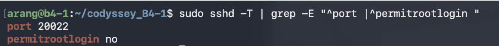

### 1-2. sshd가 20022번에서 대기

```bash
# [SSH]
sudo ss -tlnp | grep sshd
```

**확인한 것:** `0.0.0.0:20022 ... LISTEN ... sshd` → 20022번 문이 열림

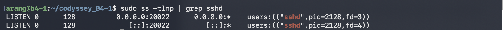

### 1-3. root 원격 접속 거절

```bash
# [MAC]
ssh -p 20022 root@192.168.64.2
```

**확인한 것:** `Permission denied` → root는 비밀번호를 넣어도 못 들어옴

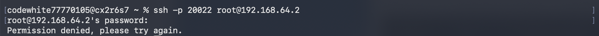

---

## 2단계 방화벽

### 2. UFW 상태

```bash
# [SSH]
sudo ufw status verbose
```

**확인한 것:** `Status: active`, `deny (incoming)`, 허용은 `20022/tcp` · `15034/tcp`만 (`(v6)`은 IPv6용 복사본)

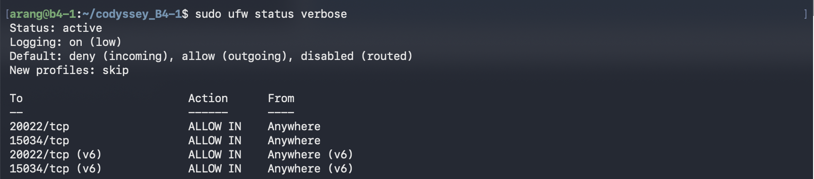

---

## 3단계 계정·그룹

### 3. 계정별 그룹

```bash
# [SSH]
id agent-admin; id agent-dev; id agent-test
```

**확인한 것:** admin · dev는 `agent-common`과 `agent-core`, test는 `agent-common`만 (맨 앞 같은 이름 그룹은 자동으로 생긴 개인 그룹)

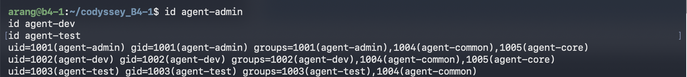

---

## 4단계 폴더·권한

### 4-1. 폴더 5개의 주인·그룹·권한

```bash
# [SSH]
sudo ls -ld /home/agent-admin/agent-app \
    /home/agent-admin/agent-app/upload_files \
    /home/agent-admin/agent-app/api_keys \
    /home/agent-admin/agent-app/bin \
    /var/log/agent-app
```

**확인한 것:** agent-app `750` common · upload_files `2770` common · api_keys `2770` core · bin `750` dev:core · 로그 `2770` core (`s` = setgid, `+` = ACL)

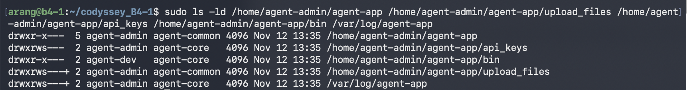

### 4-2. test는 비밀 폴더 거절

```bash
# [SSH]
sudo -u agent-test ls /home/agent-admin/agent-app/api_keys
```

**확인한 것:** `Permission denied` → core가 아닌 test는 못 들어감

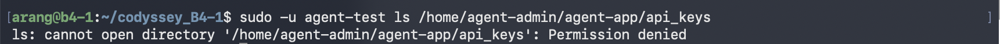

### 4-3. dev는 비밀 폴더 통과

```bash
# [SSH]
sudo -u agent-dev ls -la /home/agent-admin/agent-app/api_keys
```

**확인한 것:** 목록이 보임 → 같은 폴더인데 core인 dev는 통과

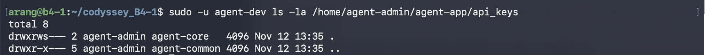

---

## 5단계 환경변수·키

### 5-1. 환경변수 5개

```bash
# [SSH: agent-admin]
env | grep ^AGENT_ | sort
```

**확인한 것:** `AGENT_HOME`, `AGENT_KEY_PATH`(폴더), `AGENT_LOG_DIR`, `AGENT_PORT=15034`, `AGENT_UPLOAD_DIR`

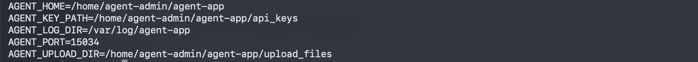

### 5-2. 키 파일 권한

```bash
# [SSH: agent-admin]
ls -l $AGENT_KEY_PATH
```

**확인한 것:** `secret.key`, `t_secret.key` 모두 `-rw-rw----` (660), 그룹은 폴더의 setgid로 자동 `agent-core`

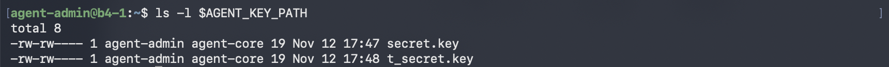

---

## 6단계 앱 실행

### 6. Boot 5단계와 Agent READY

```bash
# [SSH 탭 1: agent-admin]
./agent-app-linux-x86
```

**확인한 것:** `[1/5]` ~ `[5/5]` 모두 `[OK]` → `All Boot Checks Passed!` → `Agent READY`, 그 뒤 부하 반복

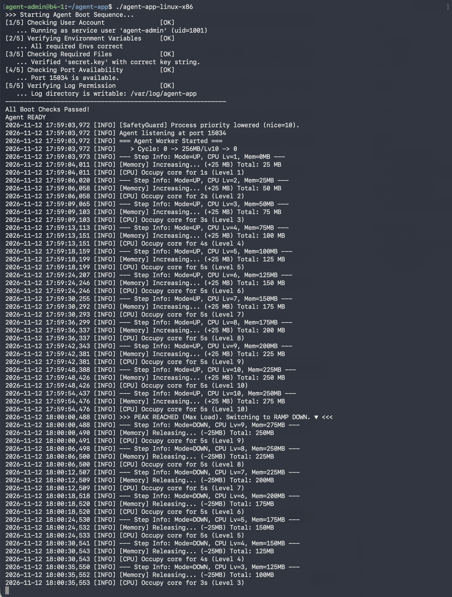

### 6-2. 앱이 15034에서 대기

```bash
# [SSH 탭 2]
sudo ss -ltnp | grep 15034
```

**확인한 것:** `0.0.0.0:15034 ... LISTEN ... agent-app-linux`

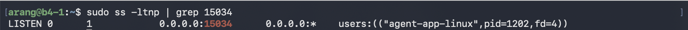

---

## 7단계 monitor.sh

### 7-1. monitor.sh 설치 권한

```bash
# [SSH]
sudo ls -l /home/agent-admin/agent-app/bin
```

**확인한 것:** `-rwxr-x--- agent-dev agent-core monitor.sh` → 주인 dev, 그룹 core, `750`

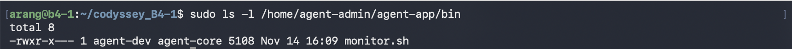

### 7-2. 정상일 때

```bash
# [SSH]
sudo -u agent-admin /home/agent-admin/agent-app/bin/monitor.sh
echo "exit=$?"
```

**확인한 것:** 점검 3개 `[OK]`, `MEM threshold exceeded (12.7% > 10%)` 경고, `exit=0`

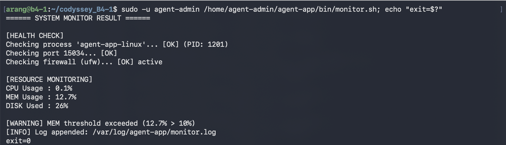

### 7-3. 방화벽을 껐을 때

```bash
# [SSH]
sudo ufw disable
sudo -u agent-admin /home/agent-admin/agent-app/bin/monitor.sh
echo "exit=$?"
sudo ufw enable
```

**확인한 것:** `[WARNING] Firewall (ufw) is not active`, 그래도 기록까지 하고 `exit=0` (확인 후 다시 켬)

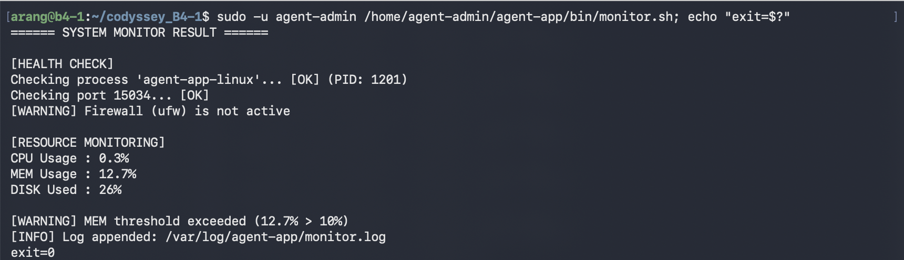

### 7-4. 앱이 죽었을 때

```bash
# [SSH 탭 1: agent-admin] Ctrl+C로 앱을 끈 뒤 같은 창에서 (sudo 없이)
/home/agent-admin/agent-app/bin/monitor.sh
echo "exit=$?"
```

**확인한 것:** `[FAIL] not running` → 바로 멈춤 → `exit=1`

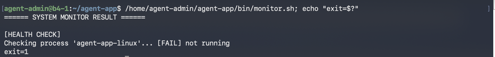

---

## 8단계 cron·logrotate

### 8-1. crontab 등록

```bash
# [SSH]
sudo crontab -u agent-admin -l
```

**확인한 것:** `* * * * * /home/agent-admin/agent-app/bin/monitor.sh > /dev/null 2>&1` → 1분마다

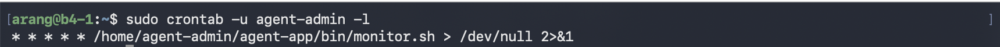

### 8-2. monitor.log 자동 누적

```bash
# [SSH]
sudo tail /var/log/agent-app/monitor.log
```

**확인한 것:** 16:48 ~ 16:57 매분 `:02`초에 한 줄씩, `[시각] PID CPU MEM DISK_USED` 포맷

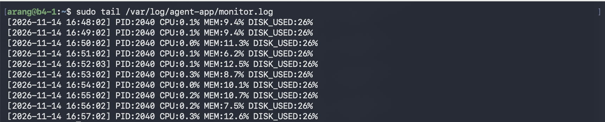

### 8-3. logrotate 설정

```bash
# [SSH]
cat /etc/logrotate.d/agent-app
```

**확인한 것:** `size 10M`, `rotate 10`, `create 0660 agent-admin agent-core`

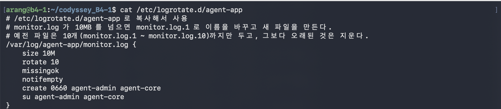

### 8-4. logrotate 판단 결과

```bash
# [SSH]
sudo logrotate -d /etc/logrotate.d/agent-app
```

**확인한 것:** `10485760 bytes (10 rotations)`로 읽음, `log does not need rotating` (아직 10MB 미만)

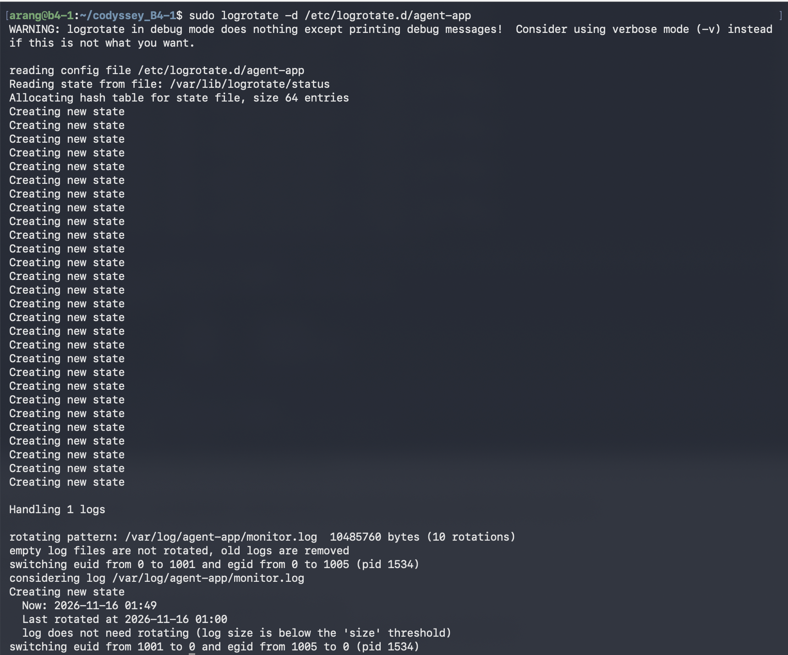
